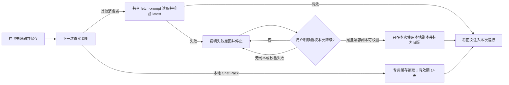

# Prompt 治理：飞书保存后下一次调用生效

## 真源与运行规则

飞书是受治理 Prompt 正文唯一人工真源。用户只在飞书维护正文；实时消费者下一次运行直接读取当前 latest。Chat Pack 本地应用按专用 14 天缓存契约使用最近一次验证成功的正文，并在后台刷新。Prompt 正文不需要发布、同步或确认生效。

`00_config/prompt-assets.json` 登记稳定 `prompt_id`、优先级、兼容文件路径、派生关系和最近一次记录的 revision/hash。它是消费者与飞书文档之间的技术映射，不是第二份正文真源。revision、hash 与读取时间只作运行证据。

除本地 Chat Pack 的专用缓存例外外，消费者每次实际使用受治理 Prompt 前都调用共享 `fetch-prompt.mjs`。读取结果必须符合 `prompt-asset/v1`，并通过用户身份、Prompt 身份、revision、完整正文和 hash 校验。正文以内存方式传给本次调用；宿主必须接收路径时，只创建本次调用独立的临时文件并在结束后清理。不写共享 Prompt 缓存。

实时消费者读取飞书失败时说明当前无法取得最新版本并停止。不得静默使用本地旧正文，也不得自动重试为旧正文。仅当存在可校验的既有兼容副本，且用户在失败后明确授权本次降级时，才可临时使用；结果须注明本地 revision/hash 不是飞书最新值。授权不保存到后续运行。需要回滚时在飞书恢复历史内容，之后的调用自然读取恢复后的版本。Chat Pack 仅在自己的 14 天有效缓存仍可用时继续使用已明确标注年龄的缓存；过期或失效时遵循相同的失败关闭边界。

## Learn-X 消费者

- Chat Pack 本地服务将全部已登记 Prompt 与 Core《道》《法》放入 Chat Pack 专用磁盘缓存，逐项校验身份、正文 hash 和有效期；有效期为最近一次真实成功读取后的 14 天。它只服务本地 Chat Pack，不改变共享读取器、Core 原始读取器或其他自动化的实时读取语义。缓存失败不覆盖有效旧项；缓存服务不可用或必需项缺失、过期、校验失败时，生成停止并显示原因。
- `GET /api/chatpack/cache/status` 仅返回缓存状态与元数据；`POST /api/chatpack/cache/refresh` 请求全量后台更新并支持当前必需项优先；`POST /api/chatpack/cache/read` 只在本次必需项完整有效时返回正文。三者只接受本机回环与同源请求。服务启动、每日、每次生成和手动操作共用一分钟刷新节流与并发去重；后台刷新最多同时读取两个资源。正文缓存放在 Git 忽略的本地运行目录，不进入公开构建。
- `POST /api/chatpack/prompts/latest` 保留为兼容入口：它仍按登记 ID 实时读取，并可查询当前进程中的兼容缓存，但新本地 UI 生成链路使用 Chat Pack 专用磁盘缓存接口。
- Chat Pack 本地生成使用所选有效缓存 Prompt 与 Core 正文组装。公开静态版不打包受治理正文，也不读取本地缓存；其他自动化仍直接读取 latest。未登记为受治理 Prompt 的本地适配内容继续按现有方式工作。
- `learn-x-weekly-journal` 和 `learn-x-monthly-journal` 每次生成前分别读取 `learn-x.weekly-journal`、`learn-x.monthly-journal`，不再读取本地旧正文。
- 周期洞察运行时按当前子类型映射读取受治理 Prompt latest。状态只记录 `prompt_id`、revision、hash 和 `prompt_fetched_at`，不保存正文；读取失败时不启动 Bridge。
- Weekly、Monthly、Yearly Output 主 Prompt 分别使用 `chatpack.weekly-output`、`chatpack.monthly-output`、`chatpack.yearly-output`。Chat Pack 本地生成入口负责读取并标注专用缓存中的正文；缓存无效时等待其后台 latest 刷新，失败后停止。其他入口须先运行共享读取器并遵循本次返回的 `content`。
- 未登记为受治理 Prompt 的本地适配内容继续按现有方式工作。

## 登记与维护

普通 Prompt 可以先作为非治理文件试用。`discover`、`adopt` 用于治理资产的发现和登记。治理维护、状态诊断与兼容副本修复工具仍可显式使用，但 `status --live`、`sync`、`publish` 不再是日常 Prompt 使用步骤，也不改变“飞书保存后下一次调用生效”的语义。

本地编辑器不直接改写受治理正文。受治理正文在飞书修改并保存后，所有实时消费者在下一次调用自动读取；用户无需关注本地兼容副本是否同步。P0 表示核心工作流、高频长期使用或出错影响明显；P1 表示已有重复使用且大概率继续维护。

Governance 负责 Prompt 身份映射、latest 读取和运行证据；Chat Pack 负责组装，自动化负责执行，`learn-x-prompt-review` 负责内容契约与评测。Prompt 不自动写入 Memory、Core 正式道法或 Flomo。
