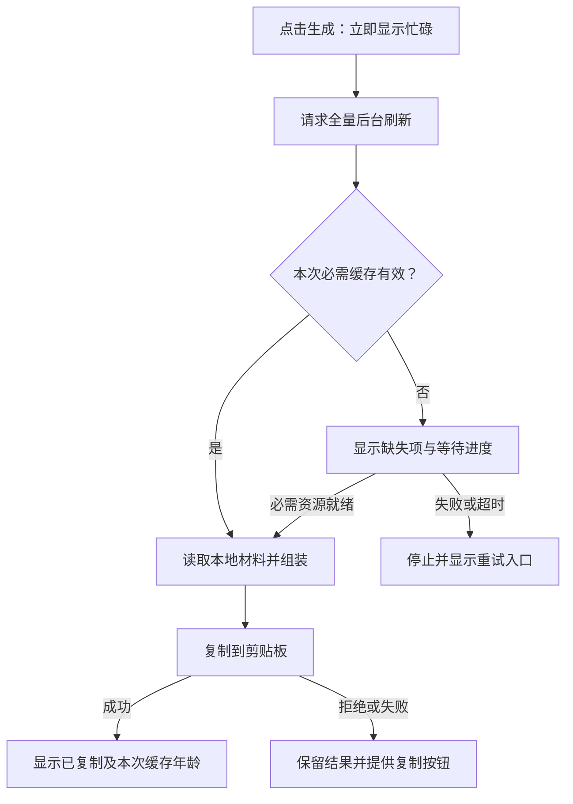
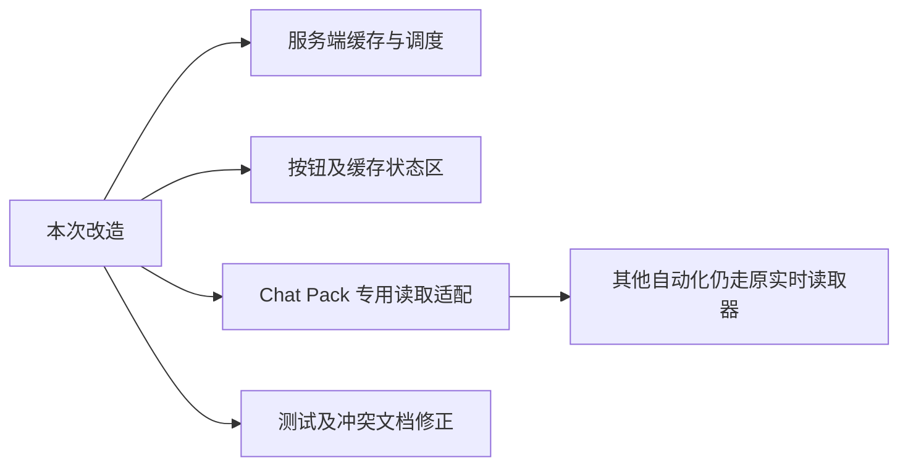

# Execution Plan｜Learn-X Chat Pack 提速与缓存状态改造

- 状态：已确认
- 最后核对日期：2026-10-20
- 上下游链接：[Requirement](../../requirements/2026-10-chatpack-cache-performance.md) → [Case](case.md)
- 来源：当前用户在会话中提供的完整方案及确认

## 方案原文

# Learn-X Chat Pack 提速与缓存状态改造

## 1. 结论与目标

**当前缓存问题仍在。** 已向运行中的服务查询，截图对应的“周输出”和“多思考一步”缓存均未命中，查询耗时仅 4–10 毫秒。

已确认的设计缺陷：

- 缓存只有进程内 Map，服务重启即丢失；当前没有过期机制，不能把这次问题归因于过期。
- 冷启动先等 Prompt，再读取上下文，网络耗时叠加。
- 默认选中的 Core《道》每次生成都实时读取，Prompt 命中也不能消除这段等待。
- 按钮没有忙碌状态；反馈远离按钮，缓存查询错误还会被当成普通未命中。
- 尚未复现用户页面当时的 JavaScript 错误，不能断言所有“无响应”都来自同一原因。

**采用已确认的杠杆解：将远端准备移出点击的主要等待路径，服务端全量维护持久缓存，按钮使用已准备好的资源组装、复制。**

需求基线：

- R1：全部已登记 Prompt 和 Core《道／法》缓存有效期统一为 **14 天**。
- R2：服务启动全量拉取，每 24 小时自动更新；每次生成也触发后台全量更新。
- R3：所有刷新入口共用一分钟节流、并发去重；保留手动刷新。
- R4：显示缓存年龄、可用性、更新进度和失败原因。
- R5：缺失、过期或缓存损坏时等待刷新；刷新失败则停止本次生成。
- R6：点击立即反馈，系统错误可见、可恢复，不再无限等待。

其余方向无新增选择：沿用 Node 服务、现有读取器和本地页面；不引入数据库、外部缓存服务或新的常驻进程。

## 2. 缓存与自动更新

### 缓存范围与存储

全量准备当前登记的 **14 个 Prompt＋2 份 Core 正文**，数量随配置变化。

缓存仅服务于本地 Chat Pack。共享 Prompt 读取器、Core 原始读取器和其他自动化继续保持原有实时读取规则。本地周期材料、Memory 等仍按当前选择读取。

服务先恢复磁盘缓存，再后台更新。缓存放在已有 Git 忽略的本地运行目录，限制文件访问权限，串行原子写入，公开构建不读取、不打包。

每项保存正文、来源身份、revision、正文 hash、真实读取成功时间和失效时间：

- 14 天从该项实际成功读取时间计算，重启不续期。
- 来源映射改变、身份不符或缓存正文 hash 不符时失效。
- 历史 `synced.sha256` 不用于限制飞书新版本。
- 新拉取失败保留原有有效缓存，不伪造更新时间。
- 写盘失败单独显示“本次可用，持久保存失败”。

### 更新规则

- 启动、每日定时、生成按钮和手动刷新进入同一个全量刷新入口。
- 同一进程跨标签页合并请求，全局最多同时读取两个资源。
- 两轮全量刷新启动时间至少相隔 60 秒；保存触发时间，重启不清零。
- 刷新正在运行时合并；冷却期间显示剩余时间，不额外发起读取。
- 当前生成缺失或过期的资源提升队列优先级。
- 每项独立更新；无关 Prompt 失败不阻塞当前所需资源已齐全的生成。

### 本地接口

新增同源、回环地址限定的接口：

| 接口 | 行为 |
|---|---|
| `GET /api/chatpack/cache/status` | 只返回资源状态、年龄、刷新进度、失败原因和冷却时间 |
| `POST /api/chatpack/cache/refresh` | 请求全量后台刷新，可携带当前必需资源作为优先项；立即返回受理或合并状态 |
| `POST /api/chatpack/cache/read` | 读取本次所需的完整有效资源集合；不完整时返回明确缺失项，不返回半包 |

现有 latest 接口兼容保留。缓存响应明确标注来源，不能冒充本次实时读取的 latest。

## 3. 按钮、状态区与错误恢复

在生成按钮下方增加始终可见的缓存小区块，默认展示：

> 本次使用：3 天前拉取的缓存 · 有效期剩余 11 天
> 后台更新：正在更新 8/16 · 查看详情 · 刷新全部缓存

展开后逐项显示版本、上次成功读取时间及失败原因。

**缓存可用性和刷新结果分开表达：**

| 维度 | 状态 |
|---|---|
| 缓存 | 未拉取、可用、已过期、校验失败 |
| 更新 | 待更新、正在更新、更新成功、部分失败、更新失败、冷却等待 |
| 本次生成 | 准备中、等待资源、组装中、复制中、已完成、失败、已取消 |

“有效缓存＋后台更新失败”可以同时存在。接口无法访问时显示“缓存服务不可用”，不能显示为“没有缓存”。

具体交互与保护：

- 点击后 100 毫秒内改变按钮文字、显示忙碌状态，并禁止重复生成。
- 阶段状态、耗时和错误紧邻按钮展示；不依赖滚动才能看到。
- 生成等待上限 90 秒；超时结束本次生成。共享后台刷新如仍在运行，状态区继续如实显示。
- Prompt 子进程设置 65 秒硬超时，Core 沿用 30 秒读取超时；所有路径通过 `finally` 恢复按钮。
- 捕获完整生成快照：当前问题、周期、Prompt、全部增强器和 Context 选择及策略。过程中选择变化则停止本次交付。
- 旧请求不得覆盖新预览、状态或剪贴板；后台更新不改写已生成内容。
- 复制失败保留结果，提供紧邻按钮的“复制”重试；复制未确认不得显示“已复制”，禁止重叠复制。
- 使用统计异常作为独立提示，不阻塞已生成结果的交付。

复杂度：需求中／系统中／影响面中，总分 3，属中等改造。三张图分别说明模块、用户链路和影响边界。

## 4. 最小实施里程碑与落盘包

| 里程碑 | 内容与验证 | 停止或回退 |
|---|---|---|
| M0：保存基线 | 保存需求原文、用户两轮裁决、完整方案和 Case，读回核对；保护现有未提交工作 | 来源缺失或冲突则停止 |
| M1：穿通真实快路径 | 先实现持久缓存和按钮附近反馈，打通截图中的“周输出＋多思考一步＋Core”路径；重启服务后仍能直接生成 | 未取得真实点击证据，不扩展调度 |
| M2：全量自动维护 | 接入启动、每日、生成及手动刷新；完成一分钟节流、队列优先级和完整状态区 | 失败不覆盖最后成功缓存 |
| M3：异常与回归 | 完成超时、取消、复制恢复、故障注入及三种构建检查；修正文档矛盾 | 回退代码即可恢复旧路径，缓存可保留但不消费 |

目标仓库：`/Users/yuwei/code/learn-x`。Case 标识：`2026-10-chatpack-cache-performance`。

实施 M0 保存到：

- `/Users/yuwei/code/learn-x/docs/requirements/2026-10-chatpack-cache-performance.md`
- `/Users/yuwei/code/learn-x/docs/cases/2026-10-chatpack-cache-performance/execution-plan.md`
- `/Users/yuwei/code/learn-x/docs/cases/2026-10-chatpack-cache-performance/case.md`

来源为当前会话 `01a1573b-ee92-73f3-bdd7-97a26b054f51`：首次四点请求、两轮用户裁决及本完整方案。需求文档保留人类原文；方案文档保留本方案全文和 Execution Handoff；Case 保存实际进度、证据与下一里程碑。本轮仅规划，尚未落盘。

Handoff 必须携带：已确认决定、现有脏工作区、当前两个 Prompt 均未命中的实测、21 项测试基线、未复现的现场错误，以及“缓存例外仅限 Chat Pack”的边界。实施后增量更新当前架构说明和相关功能文档，不修改全局治理规则。

## 5. 验收矩阵

| 验收 | 前提 → 用户动作 → 可观察结果 |
|---|---|
| ACC1／R1 | 缓存已准备，重启服务 → 生成截图组合 → 仍命中磁盘缓存，显示真实年龄 |
| ACC2／R2 | 页面未点击 → 启动服务或到每日刷新时间 → 全部资源自动开始更新 |
| ACC3／R3 | 多标签页连续生成、手动刷新 → 60 秒内仅启动一轮全量读取，页面显示合并或倒计时 |
| ACC4／R4 | 分别制造未拉取、过期、损坏、更新中和部分失败 → 状态区准确区分，不把错误当成未命中 |
| ACC5／R5 | 必需资源过期且飞书不可用 → 生成 → 明确失败，不复制过期或不完整内容 |
| ACC6／R6 | 点击按钮 → 100 毫秒内出现反馈；健康且缓存齐全时，截图组合连续测量 10 次，95% 在 2 秒内完成生成复制 |
| ACC7／R5、R6 | 无关 Prompt 拉取失败 → 生成已齐全的当前组合 → 正常生成，并独立提示全量更新部分失败 |
| ACC8／R6 | 请求挂起、读取坏 JSON、服务断开 → 生成 → 有限时间结束等待，显示原因并恢复操作 |
| ACC9／R6 | 等待期间改问题、周期或 Context → 原任务停止；旧响应不覆盖结果 |
| ACC10／R6 | 浏览器拒绝复制 → 保留生成结果，显示“未复制”和可用的复制重试入口 |
| ACC11／R1–R6 | 更新正文、变更来源映射、破坏缓存 hash、模拟磁盘不可写 → 正确更新或失效，失败不伪造成功 |
| ACC12／兼容性 | 运行相关单测及本地、公开、无上下文构建 → 公开产物无私有缓存；其他自动化实时语义保持 |

已有证据：相关测试 **21/21 通过**；运行中缓存联合查询未命中，两个单项查询也均未命中。新增机制、性能目标和真实页面故障恢复均属于实施后待验证项。

会话标题：Learn-X Chat Pack 提速与缓存状态改造

## Execution Handoff

### 用户已确认的关键决定
完整需求及验收见上述方案原文。另确认：启动全量准备、每日刷新、每次生成触发后台全量更新，统一 60 秒节流，提供缓存年龄及手动刷新。

### 重要背景与限制
目标仓库为 `/Users/yuwei/code/learn-x`。当前主分支工作树有用户既有未提交改动；实施须保护这些改动。改造仅适用于本地 Chat Pack；公开构建不可读入或打包缓存。

### 关键假设与尚存未知
首次读取运行中服务时，截图涉及的两个 Prompt 均未命中（只读 `cache_only` 查询）。当前 UI 的实际“无响应”错误尚未在用户浏览器中复现。缓存位置须使用仓库已有忽略目录；存储权限和写入失败行为须验证。

### 已完成调查或 Spike 的结果及证据
- `app/code/server.mjs` 当前只维护进程内 Prompt Map；`cache_only` 查询没有 TTL 或持久化。
- `app/code/public/app.js` 当前 Prompt 等待完成后才读取上下文；Core《道／法》经 `api/file` 每次实时读取。
- 相关基线命令：`rtk node --test app/code/scripts/server.test.mjs app/code/scripts/chatpack.test.mjs app/code/scripts/core-truth-context.test.mjs`，21/21 通过。
- 运行时只读查询：cache-only 对 `chatpack.weekly-output` 和 `chatpack.one-step-deeper` 均返回未命中；分别约 5ms / 4ms，联合约 10ms。
- 协议读取失败必须保持明确错误；来源身份映射改变要失效，但不能用历史 `synced.sha256` 阻止合法的新 latest。

### 相关文件、模块和接口
核心路径为 `app/code/server.mjs`、`app/code/public/app.js`、`app/code/public/index.html`、`app/code/public/styles.css`、`app/code/scripts/server.test.mjs`、`app/code/scripts/chatpack.test.mjs`；文档同步 `docs/CHAT_PACK.md`、`docs/PROMPT_GOVERNANCE.md`、`docs/TECH.md` 及 `docs/architecture.md`。

### 执行中容易误解的重要信息
刷新是逐资源成功：无关 Prompt 更新失败不阻塞本次已齐备的组合；本次必需项未齐备时不得复制。旧有效缓存不得因新读取失败而丢失。磁盘内容 hash、来源映射指纹与历史同步 hash 是不同概念。保留其他工作区改动，不提交、不清理、不重置。

## 实施进展（2026-10-20）

方案核对时此文档记录的是规划基线；用户随后明确授权实现。M0 三份文档已落盘并读回。M1–M3 的代码、文档和离线验证已完成：服务端 14 天持久缓存、启动/每日/生成/手动统一刷新、60 秒节流与双并发、生成状态区和有界失败恢复均已实现；全仓测试 618/618 通过，本地/公开/无上下文公开构建通过。真实隔离页面重启后显示 16/16 项可用，截图组合的两个点击样本分别在 3.3 ms、20.7 ms 内显示忙碌反馈，页面均报告约 0.1 秒完成并确认复制。

本段记录方案首次执行时的状态：ACC6 已取得两次真实页面样本，随后 Ego Lite 报告任务空间交给用户并暂停页面动作。用户在后续轮次明确授权继续后，已恢复同一 TaskSpace 并完成连续样本，最新证据见本方案末尾与 [Case](case.md)。原始用户环境的无响应堆栈仍未采集。

实施时还在截图对应的 PM2 服务 `ywdev-learn-x`（端口 4173）复现了影响缓存稳定性的重启循环：PM2 文件监听器以绝对路径报告事件，初始相对路径忽略规则未覆盖 `app/code/.local/chatpack-cache/`，缓存原子写入因此触发进程重启，计数一度达到 569。已扩展忽略规则覆盖本地运行目录并重新注册该 PM2 应用；代码热更新后最近两次只读快照确认服务 online，PID 与运行起始时间稳定、重启计数为 9。PM2 启动清单已保存。缓存接口 16/16 可用。最近一次全量远端读取 16 项均失败，底层原因是 `open.feishu.cn` DNS `no such host`；这次失败没有覆盖成功时间，`cache/read` 可完整读取截图所需的两个 Prompt 和 Core《道》。因此当前证据支持“缓存可用、后台刷新失败”两个并存状态，远端 DNS 恢复前不会有新版本进入缓存。

## 继续执行记录（2026-10-20）

在用户明确继续后恢复了 Ego Lite 任务空间 8，并按截图选择 `learn-x 相关 / 周输出 / 多思考一步 / Core《道》`。真实页面首轮误触默认组合一次，生成已完成并覆盖剪贴板；已即时向用户披露，没有读取或转发生成正文。之后恢复截图选择并完成两次目标测量：忙碌反馈 3.3 ms、20.7 ms，页面显示已复制，应用耗时均约 0.1 秒；第二次宿主总耗时 775 ms。第二批点击前浏览器再次报告用户接管，遵守控制边界暂停。随后修复必需缓存未命中时状态接口挂起不能及时取消的问题；离线故障注入覆盖坏 JSON、缓存服务断开、缓存状态接口挂起及 90 秒超时。最终 `npm test` 618/618；`npm run build:local`、`npm run build:public`、`npm run build:public:no-context` 全部成功；`git diff --check` 通过。缓存状态接口仍显示 16/16 可用，最近更新 16/16 失败且成功读取时间未被改写，原因是飞书域名 DNS 查询失败。代码热更新后的 PM2 服务 online，重启计数 9 在随后两次快照间保持不变。

### 补充执行记录（2026-10-20）

独立 yw-testing 子代理对需求和实现做只读审查，独立定向测试 34/34、修复前全仓测试 618/618。它发现父级 `.local` 若为符号链接，递归创建缓存叶目录可能把缓存写到预期 Git 忽略目录之外；当前 `.local` 是普通目录。协调者已修复为在目录创建/使用前拒绝符号链接，并添加隔离反例：symlink target 内不得出现缓存文件，但进程内的新读取仍可用。独立复测 `chatpack-cache.test.mjs` 11/11；协调者修复后定向测试 35/35、全仓测试 619/619，三种构建全部通过。

独立运行态快照于 2026-10-20 04:16:49 UTC：后台刷新 16/16 失败（Prompt 为 `open.feishu.cn` DNS `no such host`，Core 为 `Lark document read failed`）；缓存仍 16/16 可用，`fetched_at` 保持 04:05:23–27。截图组合 `cache/read` 为 HTTP 200、来源 `learn-x-chatpack-cache`。协调者当前 shell 的直接接口复核被本地网络沙箱拦截，但只读 `lsof` 观察到 Node 仍监听 4173。

该时点的验收仍为部分达成：ACC6 真实页面样本为 2/10，真实飞书刷新受 DNS 阻塞，用户原始 JavaScript 错误堆栈未复现。后续十次连续页面测量已完成；最新验收详情见 [测试报告](testing-report.md) 与 [验收报告](acceptance.md)。

### ywuse 与剪贴板边界补充（2026-10-20）

Deep 验收已完成并写入 [Acceptance](acceptance.md)，使用知识库新增 Chat Pack 使用说明并将链接加入导航首页及本仓 README，均已读回。剪贴板主生成与复制重试现均有独立 90 秒期限：未决时显示“复制状态未知”、阻止重叠操作并提供刷新页面恢复入口；迟到 resolve/reject 后更新状态并恢复控件。独立 yw-testing 子代理复核挂起主路径和复制重试路径通过，并以内存变体验证迟到 reject 后可再次重试。缓存新 revision 正文更新和重启读回用例已补齐。最终 `npm test` 624/624；`build:local`、`build:public`、`build:public:no-context` 均成功。

后续复测更新（2026-10-20 04:42 UTC）：同一 TaskSpace 8 中恢复截图组合，实测 10 次连续点击。click 事件至首个状态 DOM 更新为 1–4 ms，完成生成并确认复制为 61–171 ms，10/10 低于 2 秒。此前的旧页面现场仍有未决剪贴板写入，后续点击被明确拦截；载入当前页面后该锁解除，题目与目标选择恢复，连续测量通过。状态接口于 04:41:58–59 UTC 再次返回 16/16 缓存可用、刷新 16/16 失败；Prompt 错误为 `open.feishu.cn` DNS `no such host`，Core 为 `Lark document read failed`，旧 `fetched_at` 未被改写。冷却期内的手动刷新请求在页面显示倒计时，并合并到下次 60 秒边界。原始用户 JS 堆栈未取得，Ego Lite 事件缓冲无异常记录，不能据此等同根因。仍待 24 小时每日调度观察，以及网络恢复后真实 Core/Prompt 刷新。

### 运行态续查（2026-10-20 08:43 UTC）

重新接续时发现 4173 实际加载了上一轮 `build:public` 写入共享 `dist/` 的公开运行图，缓存面板因此隐藏。执行 `npm run build:local` 后，隔离页恢复 `runtime.target=local` 和截图所需周输出、增强器及缓存区。4173 当前缓存 16/16 可用、约 63 分钟龄；后台刷新因 Prompt DNS 失败单独报告。与 4181 的只读状态对照显示两个进程在约 1.5 秒内分别启动全量刷新，4181 已成功 13/16 时 4173 有 10 项失败。二者共用磁盘缓存但分别持有内存、调度状态，跨进程互斥/同步未实现。

截图组合的本地 `cache/read` API 连续 10 次返回 HTTP 200、来源标记正确、资源完整；耗时 1.1–37.2 ms，首个请求 37.2 ms。该接口测量不覆盖 Context 组装及剪贴板。本轮浏览器点击先导开始前，Ego Lite 报告隔离空间 3 由用户控制；未接管或重试，已请求用户是否再次授权。Chat Pack 定向测试 36/36，`git diff --check` 通过。24 小时自动刷新、全仓最终回归、用户原始 JS 堆栈和本地运行图恢复后的新一轮真实点击仍待完成。

### 锁恢复、真实点击与完整回归补充（2026-10-20 09:25 UTC）

用户明确授权再次接管并完成真实点击测量。目标组合 `learn-x 相关 / 周输出 / 多思考一步 / 2026-W42 / Core《道》` 测试前缓存 16/16 可用。受信任 click 到首个 UI 变化为 1.4–11.9 ms；到页面确认复制为 123.7–215.8 ms，10/10 成功且低于 2 秒，未读取剪贴板正文。

针对独立审计发现的 stale lock 死锁，缓存刷新锁现通过临时文件写完后原子 hardlink 发布；stale 主锁和 recovery marker 回收前核验文件身份。近期不完整主锁显示单独 `recovering` 状态与重试时间，不伪装成实际读取进度；无法安全锁定则更新失败并由服务返回 503。新增页面状态断言和三类真实 Node 子进程竞争测试，覆盖无旧锁、过期主锁和过期 recovery 锁。

独立临时压力复测覆盖 30 对 OS 进程、120 组独立缓存实例的六类锁情形；每组只启动一次读取且缓存最终可用。Chat Pack 定向用例 44/44；全仓默认并行回归 646/647，唯一失败在输出未保留的 `build-static-data.test.mjs` 子进程；相同测试清单串行执行为 647/647。local、public、public:no-context 构建成功并最终恢复 local 构建。

4173 和 4181 的最新只读 API 快照均显示 16/16 缓存可用且冷却时间相同，但刷新结果仍分别为 16 项失败与 16 项成功。当前源码的跨进程合并由新增 OS 进程测试验证；运行中的 4181 是否加载本次代码仍未知，本轮未重启该服务。24 小时自动刷新、用户原始 JS 错误堆栈和浏览器原生剪贴板挂起仍是未验证项，因此验收结论维持部分达成。

### 调试修订：刷新失败后立即重试（2026-10-20）

用户指出失败后仍显示长冷却，并要求失败后允许立即更新。根因是 `lastRefreshStartedAt` 在刷新开始时写入，却同时被用作成功节流基准；因此 `failed` 与 `partial` 也被按成功更新处理。实现改为仅成功结果适用 60 秒节流；全失败或部分失败后，后续启动、生成或手动请求立即可重试。运行中的请求仍由共享锁合并，失败不自动循环重试；每日排程仍按刷新开始时间计算。对应修复和测试记录见 [Testing](testing-report.md) 与 [Case](case.md)。
