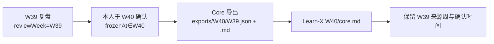
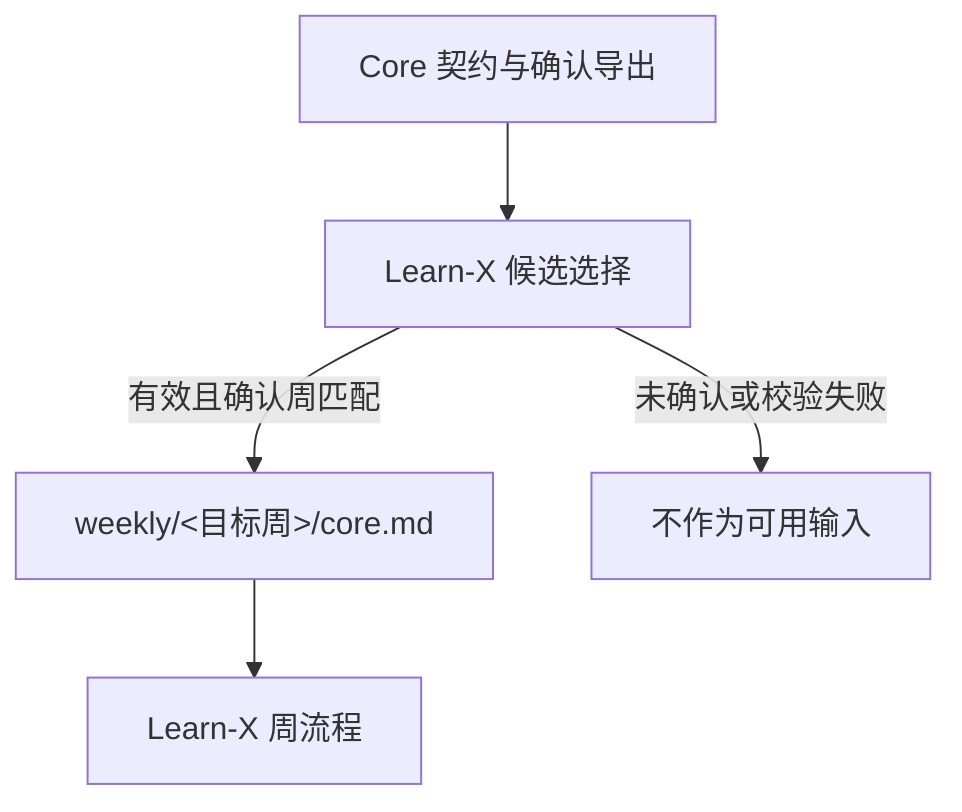

# Execution Plan｜Core 复盘按确认周进入 Learn-X

- 状态：已确认
- 最后核对日期：2026-10-11
- 上下游链接：[Requirement Truth](../../requirements/2026-10-core-confirm-week-import.md) → [Case](case.md)
- 来源：用户在本次对话直接提供并授权执行的完整方案。

## 方案原文

# 修复 Core 复盘按确认周进入 Learn-X

## 结论与证据

问题已确认：Core 契约要求 W39 复盘在 W40 确认后进入 Learn-X W40；Learn-X 当前采集逻辑却同时要求导出文件名、`reviewWeek` 和 `frozenAt` 都属于目标周，因而会漏掉该复盘。

本次只改 Learn-X 采集逻辑及其测试，不改 Core 架构或导出流程。现有定向测试 4/4 通过，但未覆盖跨周场景；临时 fixture 复现确认 `confirmedWeek=W40, reviewWeek=W39, frozenAt∈W40` 当前被判为缺失。契约见 [execution-plan.md](/Users/yuwei/code/core/docs/cases/2026-10-core-v1/execution-plan.md:98)，现有验收记录说明 Core 导出尚无真实运行证据，见 [acceptance.md](/Users/yuwei/code/core/docs/cases/2026-10-core-v1/acceptance.md:10)。

## 语义与最小修改

- `reviewWeek`：复盘所归属的原始周；保留在 Learn-X 产物及来源信息中。
- `frozenAt`：本人确认时间；按上海时区确定确认周。
- `confirmedWeek` / Learn-X 接收周：确认周。W39 复盘于 W40 确认，应进入 Learn-X W40。

只调整 Learn-X 消费端：按目标确认周读取 `exports/<目标周>/` 下候选导出，校验 `status`、文件名与 `reviewWeek` 一致、`frozenAt` 属于目标周、schema 和正文 hash；从有效候选中选最新确认版本。固定写入目标周 `core.md`，保留原始复盘周、确认时间和来源路径。未确认或无效候选不进入可用输入；重复采集覆盖同一周产物，不追加重复正文。

## 执行里程碑与验收

- **M0 文档留痕：** 以本次请求原文为 Requirement 来源，引用 Core 现有契约；在 Learn-X 建立本问题的 Requirement、执行计划和 Case，路径为 `docs/cases/2026-10-core-confirm-week-import/`。
- **M1 最小实现：** 修改 `.agents/skills/learn-x-input/scripts/collect-core-weekly.mjs` 的候选选择与来源路径构造；补充对应 `collect-core-weekly.test.mjs` fixture 和回归用例。
- **M2 验收：** 从 Learn-X 仓库运行 `rtk node --test .agents/skills/learn-x-input/scripts/collect-core-weekly.test.mjs`。

| 场景 | 通过条件 |
|---|---|
| 同周确认 | 进入相同目标周，来源周和确认时间正确 |
| W39→W40 跨周确认 | W40 采集成功；产物保留 `reviewWeek=W39`、W40 确认时间及 W39 来源文件 |
| 未确认或确认时间不属目标周 | 不标记为可用输入，不误收 |
| 多个有效候选 | 选择最新确认版本 |
| 重复采集 | 目标周文件不重复追加，来源与内容稳定 |
| hash/schema 错误 | 拒绝该候选，不误收 |

## 假设与剩余风险

不新增 tie-break 规则；若最新有效候选的确认时间相同，则测试要求采集明确拒绝歧义，避免静默选错。真实 Core 导出目前没有验收证据，因此修改后还需要在首次真实导出后验证一次：确认产物出现在正确的 Learn-X 周、来源元数据保留原始复盘周。该验证仅读回产物，不触发生产写入或外部发布。

## Execution Handoff

### 用户已确认的关键决定

- W39 复盘在 W40 确认后进入 Learn-X W40；确认依据：[Requirement Truth](../../requirements/2026-10-core-confirm-week-import.md)。
- 用户明确要求先完成 ywdev，再运行 yw-testing；不包含生产写入或外部发布授权。

### 重要背景与限制

- Core V1 设计契约定义导出目录为确认周、文件名为原始复盘周；见 [Core execution plan](../../../../core/docs/cases/2026-10-core-v1/execution-plan.md)。
- Core acceptance 记载生产侧导出尚未实现/验收；见 [Core acceptance](../../../../core/docs/cases/2026-10-core-v1/acceptance.md)。因此测试使用临时 fixture，真实运行仍待首次导出。

### 关键假设与尚存未知

- 按 Core 契约，`runtime/exports/<确认周>/<复盘周>.json/.md` 是唯一来源路径；若未来 Core 导出格式改变，需先更新已确认方案。
- 实际 Core 导出首次出现的时间未知；尚无真实运行可验收。

### 已完成调查或 Spike 的结果及证据

- 原选择器遍历所有确认周目录，并固定查找 `<目标接收周>.json/.md`，同时将 `reviewWeek` 限制为接收周，导致跨周确认遗漏；代码证据见 [collect-core-weekly.mjs](../../.agents/skills/learn-x-input/scripts/collect-core-weekly.mjs)。
- 现已按目标确认周目录读取候选并保留原始周；细节与测试证据见 [Case](case.md)。

### 相关文件、模块、接口和外部资料

- Learn-X 采集入口：`.agents/skills/learn-x-input/scripts/collect-core-weekly.mjs`
- Learn-X 定向测试：`.agents/skills/learn-x-input/scripts/collect-core-weekly.test.mjs`
- 下游输入读取：`.agents/skills/learn-x-process/scripts/collect-weekly-input.mjs`
- Core 契约与验收：`core/docs/cases/2026-10-core-v1/{execution-plan,acceptance}.md`

### 执行中容易误解的重要信息

- `reviewWeek` 是原始复盘周；`frozenAt` 决定确认周；Learn-X 接收周跟随确认周。
- 未确认或无效候选不可进入 Process 输入；旧文件可以保留，但必须通过 source-status 标明过期并由下游排除。
- 单测、临时 fixture 和本地交付不证明真实 Core 导出已运行。首次真实导出后只读核对落点与来源元数据。

### 执行与独立验收记录（2026-10-11）

- 实现：Learn-X 只从目标确认周目录选择有效导出；以文件名核对原始 `reviewWeek`，按 Shanghai `frozenAt` 确认周筛选并选取最新候选，写入目标周 `core.md` 并保留复盘周、确认时间与来源路径。
- 对抗发现与修复：元数据 JSON 为 `null` 时原逻辑在读取 `status` 处抛异常，可能保留先前的 ready 来源状态并让旧正文进入 Process。现在先拒绝非对象根值，标记来源 unavailable，并由下游排除保留的旧文件；新增回归覆盖此前 ready → 损坏元数据 → 下游过滤。
- 协调者验证：`rtk node --test .agents/skills/learn-x-input/scripts/collect-core-weekly.test.mjs`，10/10 通过；`rtk node --test .agents/skills/learn-x-process/scripts/collect-weekly-input.test.mjs`，10/10 通过。W39→W40、同周、未确认、目标周外确认时间、最新候选、并列时间拒绝、重复采集、hash/schema 错误与旧文件排除均有测试覆盖。
- 独立 yw-testing：只读复测以上两组命令均 10/10；独立临时夹具确认 null 根值在重采集后变为 unavailable、旧文件标 stale 且不进入 Process；窗口起点被接受、结束点被拒绝。未修改文件。
- 验收边界：所有测试使用隔离临时目录。Core 仍没有真实周导出，因此真实落点和真实元数据尚未验收；首次导出后仅读回核验，不触发生产采集或外部写入。
