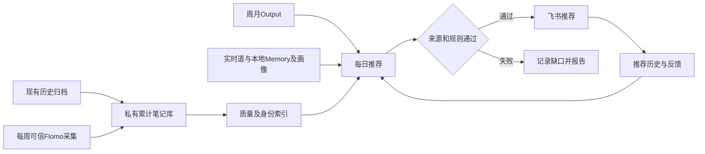
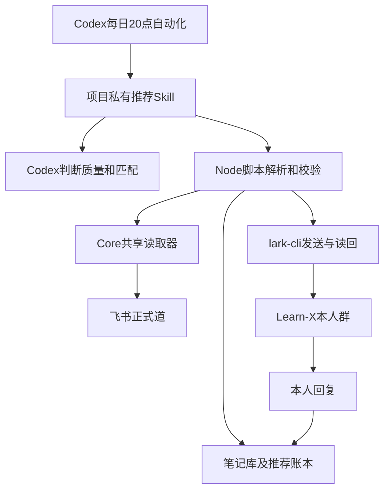
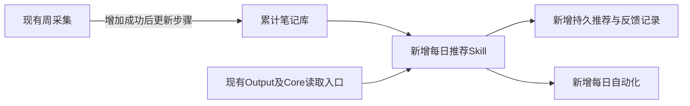
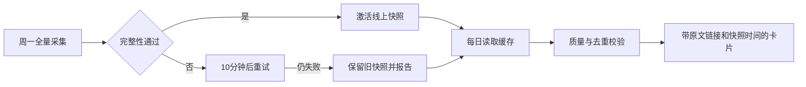
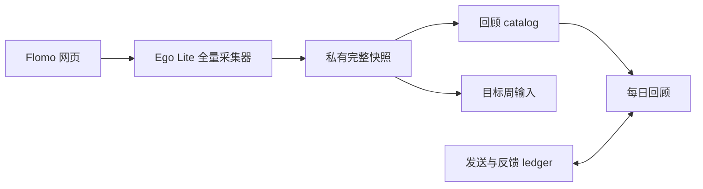
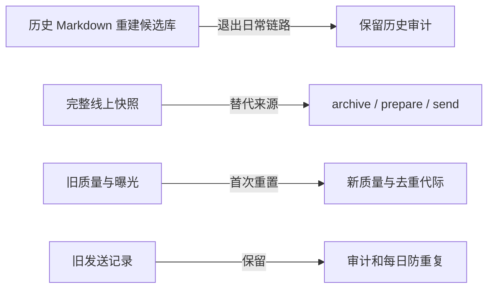

# Execution Plan｜Flomo 每日回顾推荐

- 状态：已确认
- 最后核对日期：2026-10-07
- 上下游链接：[Requirement](../../requirements/2026-10-flomo-daily-review.md) → [Case](case.md)
- 来源：上一条完整方案，用户明确要求实施。

## 方案原文

# Flomo 每日回顾推荐方案

## 1. 目标与路线

**在 Learn-X 内维护累计笔记库，每周补充，每天20:00结合近期与长期上下文，推荐3–6条值得回顾的笔记。**

采用已确认的「本地库＋周更新」路线。日常推荐不访问 Flomo，不另建独立服务；现有规模先用本地文件、确定性校验和 Codex 判断，无需引入向量数据库。

调查确认：

- 本地约有771段历史笔记，尚未核验为完整全量，也未全部通过质量筛选。
- 每周流程采集目标周笔记；智慧之门只接收带「需回顾」标签的增量。
- 部分历史笔记没有 Flomo ID，必须保留本地原文入口。
- 正式《道》已通过 Core 共享读取器实时读取成功；本地季度 Memory、个人理解文件均存在。
- 新周采集器尚未验收，存在日期字段不一致，复用前必须修正。
- 工作区有其他任务正在修改周流程，实施时保护并核查既有改动。

首版承诺的是**历史归档库＋每周新增补充**。按创建时间采集无法发现所有旧笔记的远端编辑、删除，因此不能宣称与当前 Flomo 全量实时一致。

## 2. 推荐规则

### 数量与质量

正常运行每天3–6条，按以下顺序选择：

1. 高质量且与近期 Output 明确相关的笔记。
2. 不足3条时，从高质量、与长期《道》、Memory或个人关注相关的笔记中补足，并说明关联较弱。
3. 超过3条的补充项，必须同时具有较高质量和明确的当下回顾价值；最多6条。

质量判断要求具体依据：有独立思考、真实经验、清晰表达、可迁移判断或审美价值。短诗、短思考不因篇幅短而被排除；空泛口号、残缺内容、重复搬运不因关键词匹配而入选。

允许推荐能挑战近期判断的笔记，避免只强化已有观点。每条保存原文依据、上下文出处和推荐理由。

**不得降低质量或突破去重规则凑数。**若连3条高质量候选都没有，当天记为未达标并报告原因，不伪装为正常推荐。

### 过滤与身份

- 整条排除所有 `learn-x` 标签及其层级子标签，忽略大小写；同时排除已知 Learn-X 同步生成标题和标记。
- 沿用「不回顾」「不洞察」「AI洞察」等已有排除边界。
- 手写笔记仅在正文讨论 Learn-X，不因此被排除。
- 原文、日期无法可靠解析，正文不完整，或来源明确为 `failed/unavailable` 的记录不得进入候选。
- 历史归档无侧车时按兼容规则读取，标为历史快照；保留覆盖缺口。

有真实 `memo_id` 时用稳定身份；无 ID 时建立本地 `note_key`，保存来源文件和记录边界，不编造 Flomo 链接。后来补到 ID 时合并别名并保留推荐历史。同 ID 改文不重置历史；无法可靠关联的变化先隔离。完全相同内容的复本共用推荐去重身份，防止通过不同来源绕过限制。

### 重复限制

统一使用 Asia/Shanghai 的 ISO 周，周一至周日：

| 规则 | 精确口径 |
|---|---|
| 同周不重复 | 一条笔记在同一周最多推荐一次 |
| 周间最多5条 | 当前有效四周窗口内，任意两周的推荐笔记交集不超过5条 |
| 四周最多10次 | 当前周＋前三周，计算「推荐总次数－不同笔记数」，不超过10 |
| 窗口外解除限制 | 更早周不再参与上述限制；历史保留，不删除 |

例如，同一笔记四周各推荐一次，产生3次重复。一个月的限制按已确认的四周口径执行，不另加自然月限制。

上线前验证容量：每天至少3条，完整四周至少84次；最多10次重复，因此至少需要**74条不同的合格笔记**。

### 时间分布

按整周实际送达量统计，作为软目标：

- 近30天：20%–30%。
- 近365天合计：80%–90%，包含近30天部分。
- 超过365天：通常10%–20%，目标不超过20%。

年龄按笔记原始创建时间计算，不按入库时间。质量和重复硬约束优先；偏离比例时记录原因，不用低质量笔记补年龄配额。

### 上下文与反馈

每天重新读取：

- 最近4个已结束周、最近2个已结束月的实质性 Output，优先最新周期。
- Core 正式《道》，复用现有实时读取器，仅取正式正文。
- 本地活跃季度／年度 Memory。
- `01_core` 下现有个人理解文件，不另建人物画像。

兼容 Output 的 H1–H6 标题，读取完整正文。占位文件不算有效上下文；部分周期缺失列入清单，周和月全部缺失则停止推荐。《道》读取失败不得静默回退。较早画像标注更新时间，不能覆盖新的 Output 证据；Memory 候选也不能当已确认认知。

反馈保存在私有目录 `04_output/_dist/flomo-review/`，与推荐历史关联。你回复推荐消息，例如“第2条有帮助”“第1条跳过”，即可记录。

- 按被回复消息、批次和序号定位，只接受本人明确反馈。
- 每日收集过去四周推荐消息的回复；更早反馈支持按日期补采。
- 分页完整后才更新采集状态，重复读取不重复记账。
- “跳过”只是反馈，不自动永久屏蔽或修改 Flomo 标签；没有回复不推断为负面反馈。
- 不自动写入 Memory、正式道法或人物画像。

## 3. 数据流与实现

复杂度：需求高2＋系统高2＋影响面中1＝5，复杂档。

实现边界：

- 脚本负责解析、身份合并、日期、过滤、重复计数、持久化和发送校验；Codex负责语义判断。脚本不调用外部 AI 接口。
- 首次批量判断笔记质量并建立简短索引，按正文哈希复用；新增或修改笔记重新判断。每天先看索引，最终入选前必须复读原文。
- 周采集成功后更新累计库；日运行也检查本地新增归档，避免周流程某个后续阶段停住而遗漏更新。
- 私有数据落在现有 Git 忽略目录。笔记库保留原文、创建时间、身份别名、来源、正文哈希和来源状态；每日批次保留上下文清单、入选依据、发送状态和反馈。
- 预览只生成候选与统计，不计入已推荐历史。正式发送前在互斥锁下重新核验来源版本和重复预算，并预留当日批次。
- 发送使用持久日期键与稳定幂等键。飞书幂等键只有有限有效期，不能替代本地账本。
- 状态采用 `reserved → sending → delivered`；不确定结果进入 `needs_review`，保留占用，只读恢复，不自动重发。明确未发送的失败才释放预留。

推送沿用实时核验后的 Learn-X 本人群及既有 bot 身份。每天一条消息，包含编号、创建日期、原文摘录、推荐理由和真实来源链接。没有 Flomo ID的历史笔记注明来源；随消息附当日 Markdown，提供全部入选原文。

发送前核验接收范围和频率，发送后读回消息及内容。跨日不补发过期批次；手动验收发送也计入当天，避免晚上再次推送。

## 4. 实施里程碑与落盘包

| 里程碑 | 实施内容 | 验证与停止条件 |
|---|---|---|
| M0 文档保存 | 保存用户需求原文、历次裁决、完整方案与交接信息；核查现有改动 | 来源和文档读回一致后才进入实现；本轮规划不写文件 |
| M1 穿通真实路径 | 用少量真实笔记完成建库、完整上下文读取、3条推荐、飞书发送读回和反馈采集；修正必要的采集日期错误 | 复跑不重复发；真实采集能收录已知范围内笔记、排除范围外笔记。失败停在此处 |
| M2 完成存量与规则 | 解析全部历史归档、建立质量索引，接入周增量，完成四周账本与年龄统计 | 输出覆盖、排除、身份冲突和容量报告；至少74条合格独立笔记，并通过7日及28日模拟 |
| M3 定时上线 | 通过 Codex 自动化工具配置每日20:00项目工作流，提示词引用项目 Skill和配置 | 首个完整自然周验收每日送达、同周零重复、数量、反馈和配比；失败保留账本并暂停发送 |

回退通过暂停每日自动化、移除新增周更新调用完成。原始归档、笔记身份、推荐历史和反馈保留，避免回退后丢失去重依据。实施完成后再更新 Architecture Truth。

目标仓库：`/Users/yuwei/code/learn-x`。Case：`2026-10-flomo-daily-review`。M0保存三份文档：

- `docs/requirements/2026-10-flomo-daily-review.md`：逐字保存当前用户需求及追加裁决，整理已确认基线。
- `docs/cases/2026-10-flomo-daily-review/execution-plan.md`：完整保存本方案，附 Execution Handoff。
- `docs/cases/2026-10-flomo-daily-review/case.md`：来源索引、实际进度、证据、下一里程碑和停止点。

原文来源为本聊天中完整的人类消息；方案来源为本次完整计划。保存时按共用契约捕获原文，不从摘要重建。交接附录记录六类信息：已确认决定、背景限制、假设未知、调查证据、相关入口、易误解事项。来源无法取得或出现冲突时停止M0。

新增项目 Skill 使用 `skill-creator`；本轮不创建自动化、不发送消息、不修改数据。

## 5. 验收与剩余边界

| 编号 | 前提与动作 | 可观察结果 |
|---|---|---|
| ACC1 入库 | 导入历史格式、重复来源、无ID笔记和可信周增量 | 每条可追溯；重复导入不增加记录；未知ID不生成假链接 |
| ACC2 排除 | 加入大小写和层级 Learn-X 标签、生成正文、失败残留文件 | 整条不进入推荐；手写正文提到Learn-X仍可正常评估 |
| ACC3 数量质量 | 准备强相关、弱相关高质量、关键词匹配但空泛的候选 | 正常3–6条；补足项说明依据；低质量不入选；容量不足明确未达标 |
| ACC4 去重 | 模拟连续28天、跨周、跨年和第五周 | 同周零重复；窗口内两周交集≤5、重复次数≤10；过期历史不继续限制 |
| ACC5 身份变化 | 无ID补ID、同ID改文、复本、身份合并 | 不获得新的推荐资格；合并后按规范身份重算历史，冲突隔离 |
| ACC6 上下文 | 使用真实W40标题格式、缺失周期、旧画像、道读取失败 | 完整读取且出处可查；缺项可见；不把旧画像标为最新；道失败停止 |
| ACC7 年龄 | 检查30天、365天边界及小样本一周 | 包含关系正确，按整周统计，偏离有原因 |
| ACC8 发送恢复 | 并发运行、超时、远端送达后进程崩溃、人工重跑 | 无重复消息；不确定结果只读核验；账本与真实消息对应 |
| ACC9 反馈 | 回复不同日期的“第2条”、多项反馈、分页、编辑及重复读取 | 正确绑定笔记；不漏页、不重复计数；歧义不猜；未回复无负面推断 |

已完成的是只读调查与规划：正式《道》实时读取成功；现有4个采集单测通过，但都使用模拟扫描，不能证明真实浏览器路径可用。

仍需实施验证：完整合格库存是否达到74条、真实推荐质量、采集分页完整性、群身份及消息权限、推送与反馈闭环。

会话标题：Flomo 每日回顾推荐方案

## Execution Handoff

### 用户已确认的关键决定
见完整方案及Requirement追加确认。
### 重要背景与限制
周流程有并行任务的脏改动，不覆盖；私有笔记和上下文不得进入Git。
### 关键假设与尚存未知
真实Ego扫描、74条合格供给、推送与反馈权限待验收。
### 已完成调查或Spike的结果及证据
约771段历史；正式道规划期读取rev7；模拟采集4/4不等于真实路径。
### 相关文件、模块、接口和外部资料
Learn-X输入/周自动化、Core read-core-truth.mjs、lark-cli im，共用契约dev-workflow/docs/templates/planning-assets.md。
### 执行中容易误解的重要信息
四周是当前+前三ISO周；画像有旧成功版本；发送不确定时不重发。

## 用户最新裁定｜2026-10-07

用户最新指示：“明确授权，然后方案细节其实已经改了，是 5~8 条吧，反正你要按照最新的方案来。”该直接用户指示仅更新下列内容，原方案原文继续保留：

- 每天20:00的正常推荐目标更新为5–8条。数量仍取决于质量和近期Output匹配度，不为达到5条降低标准；若只有3–4条同时满足质量与对应序号上下文要求，可按实际数量推送并在消息中说明不足原因；不足3条仍停止推送并报告未达标。
- 第4–8条必须强匹配近期周/月Output；背景关联只用于前三条。
- 容量模拟按每天5条计算：7日最低35条不同合格笔记；28日最低130条不同合格笔记（140次最低推荐量扣除四周最多10次重复）。
- 用户已明确授权按本方案向既有Learn-X本人群创建每日20:00推送；每次实际发送前仍须实时核验本人群成员、发送身份与频率，并排除个人敏感笔记。完整Markdown附件、单条post和不确定结果只读恢复、不自动重发等边界维持原方案。

2026-10-08更新：用户进一步确认每天数量边界为5–10条、整体平均目标7–8条，并将真实外发格式收敛为Card 2.0。每条只展示标题、原文、回顾理由、小字日期和有链接时的Flomo原文链接；不再显示“创建日期：”或“原文见随附Markdown”前缀。完整原文只留在本地审计文件。历史Markdown附件批次继续支持只读恢复，不重发。

2026-10-08补充：用户再确认硬下限5条、目标6–7条、整体平均6条；诗类卡片标题压缩为摘要前两字加“诗”。

## 方案版本｜Flomo 线上全量库与每周同步｜2026-10-09

- 状态：已确认并获明确实施授权。
- 替代关系：本版本明确替代前述“历史归档＋周新增”作为每日回顾库的数据来源；旧方案原文继续保留。
- 来源：用户本轮直接提交的完整方案与“PLEASE IMPLEMENT THIS PLAN”实施指令；原始会话消息 ID：msg_01a120a5-c8f5-7363-a7a3-2d2aba80077d。

PLEASE IMPLEMENT THIS PLAN:
# Flomo 线上全量库与每周同步方案

## 1. 目标与已确认决定

将每日回顾的数据源改为 **Flomo 线上完整快照**，从根源上解决历史归档缺 ID、正文陈旧的问题。

本次调查确认：本地 646 条笔记中，572 条缺 ID。昨天的补采仅保存了 949 条“ID＋时间＋正文哈希”，没有保存正文；现有匹配也受到秒／分钟精度差异影响。

按你的裁决实施：

- 首次重建使用线上正文和真实 ID，重新评质量、重新计算推荐去重；此前推荐过的笔记允许再次出现。
- 每周全量同步，平日读取最近成功快照。旧笔记修改、删除在下一次成功同步后体现，**不承诺实时更新**。
- 同步失败允许继续使用旧快照，但明确显示快照时间。
- 采集失败后延迟 10 分钟重试。
- 原始历史文件、旧库与发送记录保留备份；不修改线上笔记。

杠杆点已确认：把线上快照作为回顾库的正文与身份来源，停止用历史 Markdown 重建每日候选库。无需新增服务、数据库或其他平台。

## 2. 核心实现

### 完整扫描与快照

复用现有 Ego Lite 采集器，增加全量模式。全量模式遍历至真实结束，不沿用目标周下界或固定 2020 年起点作为结束条件。

必须补齐以下校验：

- 等待初始加载完成；不能把刚打开时的空列表认定为全量空库。
- 检查每张非编辑器卡片的 ID、时间、正文；缺 ID 不得静默跳过。
- 合并普通笔记和置顶笔记，按 ID 去重；不同 ID 的同文笔记保留独立身份。
- 修复分页等待，确认加载完成、无后续页、再次滚动后 ID 集稳定，才能结束。
- 验证长文完整性。折叠不能直接解释为正文缺失或完整，须通过展开与详情对照确认提取方法。
- 同 ID 在扫描期间出现冲突正文、达到容量限制、超时或无法确认结束时，本轮失败。

完整结果保存 ID、正文、创建时间、原文链接及扫描起止时间、数量和结束依据。通过校验后才原子替换当前快照；失败保留最近成功版本。

不再使用旧的哈希补采文件生成正文库。Flomo 官方支持 HTML 导出，但官方说明未保证导出携带本任务所需 ID，因此不把重新导出作为主路线。[官方导出说明](https://help.flomoapp.com/basic/storage.html)

### 周同步与每日回顾

- 将现有周一 05:00 流程中的 Flomo 采集改为全量扫描，并从同一结果提取上一完整 ISO 周的 `flomo.md`，避免重复扫描。
- 保留现有生成内容、排除标签及周输入完整性门禁。
- `archive`、`prepare`、`preview`、`send` 统一消费线上快照，停止调用本地历史扫描来覆盖当前库。
- 平日回顾不访问浏览器。请求、预览、卡片绑定同一快照版本，并显示“笔记快照：日期时间”。
- 全量失败后，每日回顾可用旧快照；本周采集仍标记失败，不能据此生成 `ready` 周输入。
- 对齐每日自动化与当前 Skill，删除旧消息格式和数量说明，沿用当前 Card 2.0 规则。

### 质量、去重与删除

首次切换时清空质量评定，建立新去重代际。**发送审计和当天占用不清空**：今天已发送，切换库后不能再发一次。

以后按真实 ID 更新：

- 正文未变且质量规则未变，复用评分。
- 正文变化，失效旧评分并重新判断；保持同 ID 的曝光连续性。
- 线上删除或新命中排除规则的笔记退出候选。
- 四周曝光依据发送时保存的身份、去重组、创建时间与正文哈希计算；删除当前笔记不能导致全部推荐失败。
- 不同 ID 的相同正文继续共享去重预算。

必要接口变化限定为：采集器增加全量模式；catalog 增加来源模式与快照元数据；ledger 增加去重代际及完整历史身份信息。旧格式只用于迁移与审计。

### 重试与恢复

复用现有周执行器的锁、单浏览器队列及重试机制：

- 保留现有首次尝试＋最多 4 次重试、07:00 补查一次的上限。
- Flomo 单独配置失败后 10 分钟冷却；服务明确要求更长等待时遵守其等待时间。
- 手动全量刷新走同一重试执行入口；采集器内部不再叠加重试。
- 网络、超时等暂时失败可重试；身份、人工接管、数据契约冲突停止自动重试。
- 统一外层与浏览器超时，确认前一次扫描退出后才允许下一次。
- 每次尝试使用独立令牌和暂存结果，提交前重核令牌，拒绝迟到结果。

## 3. 链路与影响

复杂度：需求中（1）＋系统中（1）＋数据迁移影响高（2）＝4，复杂档；用三张图说明边界。

## 4. 最小里程碑与验收

| 里程碑 | 实施与验证 | 失败处理 |
|---|---|---|
| M0 文档保存 | 保存需求原文、用户裁决、完整方案和 Case；读回核验；保护现有 6 个相关脏文件 | 来源缺失或决定冲突时停止 |
| M1 穿通真实全量路径 | 真实扫描→暂存库→本地卡片预览→打开原文链接；抽查普通、置顶笔记，并通过原文链接打开最长笔记的 TipTap/ProseMirror 编辑器核对全文；核验结束依据、总 ID 数和时间范围 | 不激活新库，不扩展后续功能 |
| M2 首次切换 | 备份旧 catalog 与 ledger；重新评质量、重置曝光代际；保留今日发送占用；迁移重复执行保持幂等 | 锁内恢复一致版本；中断状态禁止发送 |
| M3 周同步与缓存接线 | 周一全量、目标周提取、10 分钟重试；每日仅读缓存；失败使用旧快照并标明时间 | 不覆盖成功快照；周来源如实失败 |
| M4 回归与验收 | 验证编辑、删除、历史曝光、消息格式和回滚；观察下一次自然周同步 | 区分测试通过与实际定时运行通过 |

验收矩阵：

| 编号 | 前提 → 用户动作 → 可观察结果 |
|---|---|
| ACC1 | 线上存在历史笔记 → 完整同步并预览推荐 → 可打开真实链接，正文与线上一致 |
| ACC2 | 修改旧笔记 → 下一次周同步 → 新正文进入库，旧评分失效 |
| ACC3 | 删除笔记或添加排除标签 → 成功同步 → 不再推荐，历史批次仍可解释 |
| ACC4 | 模拟缺 ID、延迟分页、假到底、隐藏尾段或扫描中断 → 执行刷新 → 拒绝替换成功快照 |
| ACC5 | 模拟暂时采集失败 → 查看执行状态 → 10 分钟后重试，无并行重复扫描及迟到提交 |
| ACC6 | 周同步失败且已有成功快照 → 每日回顾 → 使用旧快照并显示时间；周输入不冒充成功 |
| ACC7 | 今日已经送达 → 首次切换并重复执行 → 不重新发送；之后从新代际计算去重 |
| ACC8 | 同步后库异常 → 恢复备份 → catalog、质量与账本恢复一致，不重发消息 |

本轮已运行 backfill/catalog 定向测试，25/25 通过；也完成首屏只读核查。**尚未验证新的真实全量路径、分页终态、长文详情一致性及重试退出机制**，这些是 M1/M3 的实施门禁。

## 5. 落盘包与默认值

目标仓库：`/Users/yuwei/code/learn-x`。复用现有 Case `2026-10-flomo-daily-review`，作为明确替代旧“历史归档＋周新增”路线的方案修订，保留旧方案来源。

- [Requirement](/Users/yuwei/code/learn-x/docs/requirements/2026-10-flomo-daily-review.md)：追加本轮需求原文及三次用户裁决。
- [Execution Plan](/Users/yuwei/code/learn-x/docs/cases/2026-10-flomo-daily-review/execution-plan.md)：保存本方案全文、替代关系及 Execution Handoff。
- [Case](/Users/yuwei/code/learn-x/docs/cases/2026-10-flomo-daily-review/case.md)：记录 M0–M4、证据、停止点和回滚入口。

完整来源为本会话的原始消息记录：
`/Users/yuwei/.codex/sessions/2026/10/09/rollout-2026-10-09T20-15-28-01a12096-fe99-7c60-8c52-d51d0ad7b241.jsonl`。M0 按人类原始消息及本方案原文提取，附件仅作背景证据，不作为指令。

默认不另建自动化；沿用周一 05:00 和每日 20:00。旧快照无新增硬过期门槛，但始终显示采集时间。实施成功后才更新 Architecture Truth。

本阶段未保存文档、修改归档或更新自动化。

会话标题：Flomo 线上全量库与每周同步方案

## Execution Handoff｜2026-10-09

### 用户已确认的关键决定
见 Requirement「用户追加确认」及本版本完整方案原文；执行中不得把计划状态写成已验证事实。

### 重要背景与限制
全量线上快照及真实 memo_id 是正文、身份和原文链接的唯一来源；不得修改 Flomo 线上笔记。保留旧归档、旧 catalog、发送审计和当天发送占用。沿用周一05:00与每日20:00，不另建自动化。

### 关键假设与尚存未知
当前真实全量采集的分页终态、置顶合并、长文完整性及扫描退出/超时边界尚未验证；属于 M1/M3 门禁，不能在证据前激活新库或宣称成功。

### 已完成调查或 Spike 的结果及证据
已有定向 backfill/catalog 测试25/25和首屏只读核查；它们不证明新的全量路径、分页终态、长文正文或重试退出机制。完整调查边界见本方案原文与 Case。

### 相关文件、模块、接口和外部资料
目标仓库 `/Users/yuwei/code/learn-x`；执行入口、目标文件和验收矩阵均见本方案原文与 Case。Flomo 官方导出说明链接见本方案原文。

### 执行中容易误解的重要信息
全量采集失败时可为每日回顾使用并标注最近成功旧快照，但该周输入仍须标记失败且不得成为 ready；旧归档不得再覆盖线上快照。真实自然周观察与定时执行通过须单独取证。

## 执行裁决补充｜2026-10-11

用户针对稳定列表中的少量身份计数差异裁决：“漏几个没啥问题，继续推进。”因此保留“UI 稳定到底、每张观察卡片身份/时间/正文有效、冲突失败、长文原文详情核验”的门禁，允许去重后少量笔记缺口进入快照，并在快照、预览和每日来源状态展示预期数、观察到的唯一 ID 数、遗漏数与覆盖率。本轮默认最多容忍 3 条缺口；这是保守实现默认，不改变原方案正文，缺口超过 3 条仍失败。当前已观察到的历史差异为 951/950，实际遗漏数仍以本轮新扫描结果为准。

## 执行裁决补充｜2026-10-12

用户针对“951个预期、950个观测、未生成 `flomo.md`”直接确认：“缺10个以内都没啥问题呀，为什么不生成呢？”将 2026-10-11 的临时 3 条容差默认上调为最多 10 条；本项仅替代遗漏数阈值，不放宽已观察卡片的 ID、时间、完整正文、正文冲突、分页稳定终态等校验。快照、周输入 sidecar、预览和每日来源状态都必须报告预期数、观测唯一 ID 数、遗漏数和覆盖率；缺口超过 10 条仍拒绝发布。来源：Learn-X 周自动化线程 `01a12cc5-2a5e-76a3-a89f-987d759199af`，用户消息 `01a12d8e-643c-73e1-b3c6-77ba096bc4a9`。本决定是执行口径的补充，保留上方 2026-10-11 记录作为当时决策历史，不重写本方案正文。
