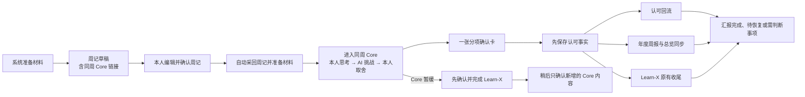
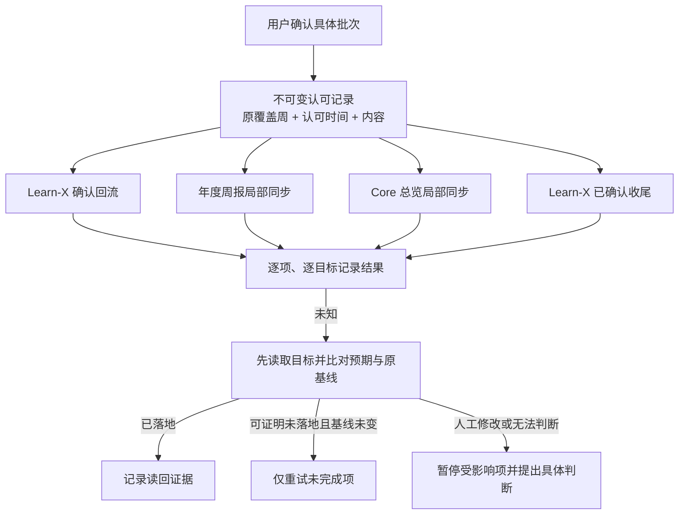
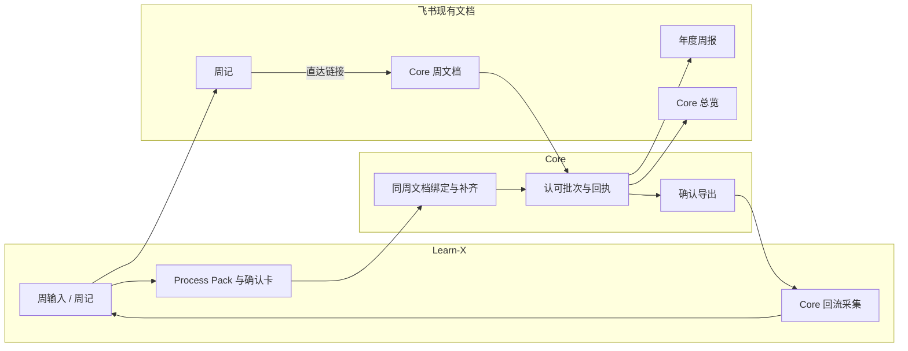
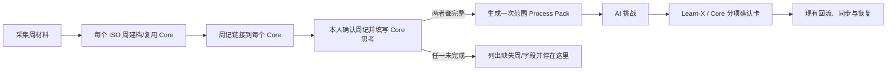

# Execution Plan｜周记与 Core 一体化复盘及可靠同步

- 状态：已确认
- 最后核对日期：2026-10-29
- 上下游链接：[Requirement](../../requirements/2026-10-weekly-core-review.md) → [Case](case.md)
- 来源：本会话用户直接提交的完整实施方案。

## 方案原文
PLEASE IMPLEMENT THIS PLAN:
# 周记与 Core 一体化复盘：最小实施方案

**核心方案：** 以 Learn-X 周流程作为唯一用户入口，提前建立同周 Core 文档；复用现有最终确认卡，在用户确认后先保存认可事实，再独立回流和同步。Core 保留独立仓库及现有执行能力，不新增调度平台。

**当前结论：** 核心路线有代码和飞书只读证据，但现有实现尚不能保证候选隔离、独立回流和自动恢复。周记写入身份存在规则冲突，bot 当前权限也未验证；这两项必须在启用真实写入前解决。本轮仅调查规划，未修改文件、写入飞书或切换调度。

## 一、现状与核心问题

### 已确认的产品需求

- 周记和完整五项 Core 连成一次复盘；保留两个飞书文档、本人先思考与 AI 后挑战。
- 周记输入审核继续保留；最终按实际内容和目标一次确认。Core 暂缓时，Learn-X 可以先收尾。
- 用户认可事实与后续执行状态分离；只回流或同步明确认可的内容，恢复不改变覆盖周和认可时间。
- 不建设新的个人 OS、通用编排或审批平台。

### 已核实的现状

1. **存在循环等待。** Learn-X 在周记审核后才生成 Process Pack；Core 的现有 `prepare` 却先读取 Pack、生成候选，最后才建档。因此它目前不能在周记草稿阶段提供 Core 链接。[Learn-X 周流程](/Users/yuwei/code/learn-x/.agents/skills/learn-x-weekly-automation/SKILL.md:106)；[Core 建档](/Users/yuwei/code/core/.agents/skills/core-weekly/scripts/weekly-review-lib/commands.mjs:174)

2. **确认入口已经存在，但分散。** Learn-X 已有包含实际 Memory 条目、排除项和收尾目标的最终确认卡；Core 另有审阅文档、继续指令及同步流程。重复之处是分别启动、分别交付内容和分别确认，并非周记输入审核本身。[Learn-X 最终确认](/Users/yuwei/code/learn-x/.agents/skills/learn-x-weekly-automation/SKILL.md:277)

3. **现有 Core 执行不足以满足可靠回流。** 代码先同步年度周报和总览，后导出；导出依赖至少一项同步成功，且使用执行时的时间。单格认可还可能把同一行未认可的候选带入投影；恢复目前主要停在只读核查，部分成功也可能被误报。[Core 同步与回流](/Users/yuwei/code/core/.agents/skills/core-weekly/scripts/weekly-review-lib/commands.mjs:681)

4. **历史接收规则需要保留并扩展。** Learn-X 目前按本人认可所在周消费 Core，保留原始复盘覆盖周，但只选择最新一份导出。同一认可周内有多次确认或多个覆盖周时，不能继续只取一份。[Core 输入采集](/Users/yuwei/code/learn-x/.agents/skills/learn-x-input/scripts/collect-core-weekly.mjs:25)

5. **线上结构已做只读核查。** 周记是按写作日期组织的一个飞书文档；Core 有年度总览、年度周报和独立周审阅文档。已检查的本机 Codex 自动化中，Learn-X 周一 05:00 主流程和 07:00 补查处于启用状态；未发现独立 Core 周二复盘任务。其他调度环境未核实，不能断言不存在。

6. **身份和权限是启用前门槛。** 周记线上治理 Prompt 当前要求 bot 写入，而周自动化中既有持续授权文字指定 user 身份；两者不能静默择一。此次 user 身份可读相关文档；bot 只读请求在认证网络层受阻，不能由此判断其文档读写或创建权限。现有周记持续授权也不能自动扩大为创建 Core 文档或新增链接的授权。[周记授权边界](/Users/yuwei/code/learn-x/.agents/skills/learn-x-weekly-automation/SKILL.md:56)

Learn-X 工作区已有多处未提交改动，包含周流程相关文件；Core 工作区本次检查为干净。实施时必须重新核对并保护既有改动。

## 二、推荐的用户流程



### 低保真交互示意

```text
飞书周记｜2026-Wxx
  原有周记内容……
  下一步：进入本周 Core 复盘 ↗

Core 周复盘｜2026-Wxx
  五项 Core 当前快照
  本周行动 / 现实反馈 / 本人思考与预判 / 下周行动
  AI 挑战：在本人完成主要思考后提供，候选清楚标识

最终确认｜2026-Wxx
  Learn-X
    [保留] 具体 Memory 条目及目标
    [保留] 本周已列明的备份、图片及其他收尾
  Core
    [保留] 已展示的本人认可内容 → Core 回流、年度周报
    [排除] 未采用的 AI 建议
    [保留] 已展示的状态变化 → Core 总览

  可修改或排除具体条目；确认当前保留项。
```

卡片复用现有会话中的确认方式；不要求新建交互式审批系统。用户明确勾选或确认的未修改原文有效；默认展示的 AI 候选不会因为出现在卡上而自动生效。修改或排除后，系统重新展示受影响的具体内容，再接收一次明确确认。

**跨界限制：** 现有 ChatGPT / Chat Pack 流程仍需要真实定稿内容返回当前流程。方案提供一次可复用的材料与挑战上下文，但不会凭文件时间、后台监听或猜测认定用户已经完成思考；跨界结果仍需通过现有可靠入口交回。

## 三、最小技术方案

### 1. 提前建档，延后补齐

- 在 Core 现有周审阅能力中拆分“建立或复用同周文档”和“材料就绪后补齐候选”。前者不依赖 Process Pack 或 AI；后者在周记已确认、材料可用后运行。
- 早期文档包含五项 Core 的**当前快照**及完整复盘结构。总览暂不可读时，可建立标明待补的骨架；不能伪造快照，也不因此阻塞周记。补齐时只写入可证明仍未被人工编辑的受管空位；已有人工内容或结构歧义保留并提示。
- 同一覆盖周使用现有 Core 周状态与共享锁绑定唯一文档。创建前保存意图；创建返回后立即保存文档 ID，再读回确认。超时、创建结果未知或读回失败时先只读核查，不能重建猜测。远端查重无法唯一证明时，保留待核查状态。
- Learn-X 生成新周记时，把已验证的 Core 文档链接写入目标周安全位置，并在周记回读中核验。已有人工稿只在能证明安全空位及获得适用授权时局部补链接；否则保留原稿并报告，不覆盖。
- 具体写入身份、目标文档和范围必须先消除当前治理冲突并核验权限。不能为打通流程切换身份、补授权或扩大持续授权。无法验证时，周记仍可按原流程继续，Core 链接明确显示待恢复。

### 2. 复用材料，保留完整思考

- 周记确认后复用现有 `weekly.md`、Process Pack 和按需指定的周输入；Core 不再重新扫描全部来源，也不要求用户重复填写已有事实。事实保留来源，周记与 Core 的同源内容不重复计作两份证据。
- 保留五项快照及每项的行动、反馈、思考与预判、下周行动。用户自己的思考与 AI 候选分开；挑战提示词只在本人形成主要思考后提供，最终取舍由本人决定。
- Core 文档可暂停并恢复；补齐或刷新材料前重新读取文档，保护用户已写内容。总览使用认可时适用的当前年度和季度；年度周报按复盘覆盖周所属年度定位。确认后恢复继续使用当时绑定的目标。

### 3. 一次确认，先保存认可事实

- 扩展 Learn-X 现有最终确认卡，按 **Learn-X / Core、具体条目、内容和目标**展示；可对具体项修改、保留或排除。Learn-X 先完成时只确认其实际范围，之后 Core 新增内容形成独立确认批次。
- 将确认时用户实际看到并明确认可的条目、目标、来源、原文或修改后内容、覆盖周、认可时间、确认依据及内容指纹作为**不可变认可批次**，先原子保存并读回验证，再执行外部同步。保存失败则停止后续写入。
- 现有整卡指纹继续用于确认前防止内容变化；确认后恢复依据已保存的认可批次及各目标基线，不因无关目标变化要求重审已认可内容。若展示后源内容发生变化，只重新核对受影响项。
- 单元格级确认只投影认可的单元格；行级确认只有明确认可整行才投影整行。列、位置或原值不唯一时停止该项；“排除”与明确认可的“删除”分开处理，避免误删或误报成功。

### 4. 回流、同步和恢复



- 扩展 Core 现有私有 `runtime/weekly-review` 记录与回执，不另建服务。每个认可批次及每个目标独立记录待执行、成功、失败或未知；只有匹配目标内容和结构的读回证据才能标记成功，`partial` 不能折算为完成。
- **认可回流先于且独立于远端同步。** 导出按认可批次不可变保存，校验正文、元数据和哈希后发布；中断产生的半成品不可消费。保留兼容旧版导出；Learn-X 采集同一确认周内所有有效批次，按批次去重并保留各自覆盖周和实际认可时间，避免“最新一份”遗漏先前内容。
- 年度周报和总览继续使用现有局部写入能力；每次写前重新定位目标、比较原基线，写后逐个认可单元格及相关结构读回。未知结果先核查：目标已等于认可内容则记成功；仍等于原基线且能证明未落地才可重试；人工修改或无法判定则只暂停受影响项。
- 飞书 `revision-id` 已有证据表明不能当作服务端并发锁。写前比较和写后读回可发现多种冲突，但不能保证消除两次读取之间的所有并发窗口；实施必须用隔离文档验证，并如实报告平台限制。
- 复用现有 Learn-X 05:00、07:00 及用户继续流程作为恢复机会，扫描此前所有未完成的认可批次，不只扫描当前周。不新增轮询或常驻服务；没有触发机会时如实显示待恢复。
- 保留 Learn-X 原有 Memory、备份和其他已获准收尾；认可回流本身不触发正式 Memory。现有重复的 Core 独立启动和同义确认步骤，在新链路验收后退役；历史记录和旧版导出保留可读。



## 四、依赖有序的实施计划

| 里程碑 | 修改与验证 | 停止或回退条件 |
|---|---|---|
| **M0 文档与基线** | 在 Learn-X 保存本需求原文、完整方案和 Case；核对两仓规则、相关 dirty diff、旧 Case 和治理 Prompt；建立 Core 侧回链。 | 来源不可取得、已有改动冲突或身份规则未厘清时，保留现状并报告；不把计划写成已实施事实。 |
| **M1 先穿通入口与链接** | 拆出 Core 建档/补齐，接入 Learn-X 周记生成点。先用隔离环境验证同周并发、重复运行和未知创建；经适用授权与权限核验后，从真实周记入口验证“草稿 → 可见同周 Core 文档 → 链接读回”，同时验证用户可打开。 | 身份冲突、权限不明、建档唯一性或用户可见性无法证明时，不启用该写入；周记原流程继续。此路径未取得真实证据前，不扩展依赖它的功能。 |
| **M2 完整复盘与合并确认** | 复用 Pack、周记及 Core 快照；实现本人先思考、AI 后挑战；扩展现有确认卡，按内容和目标冻结认可批次，支持 Learn-X 先完成、Core 后续追加。 | 快照、内容来源、确认范围或用户认可不明确时暂停对应内容；不将候选升级为事实。 |
| **M3 回流与逐目标恢复** | 修改 Core 认可保存、导出和同步回执；修改 Learn-X 消费端兼容旧导出并处理多批次；对未知结果实现可证明的核查与恢复。 | 认可保存失败不执行；目标内容或基线冲突只暂停受影响项；无法证明远端结果时保持未知。 |
| **M4 自动化接入与真实验收** | 在获得适用授权后调整现有任务职责，避免同周重复启动；以真实入口、隔离文档和一次实际周复盘验证用户体验与恢复，再按现有渠道反馈。 | 任一关键写入或读回不可靠时保持旧调度和旧入口可用；回滚入口配置，不删除认可记录、人工稿或历史结果。 |

**落盘包：** 以 Learn-X 为本任务主 Case，计划使用：

- `/Users/yuwei/code/learn-x/docs/requirements/2026-10-weekly-core-review.md`
- `/Users/yuwei/code/learn-x/docs/cases/2026-10-weekly-core-review/execution-plan.md`
- `/Users/yuwei/code/learn-x/docs/cases/2026-10-weekly-core-review/case.md`

需求原文来源为本会话用户消息；完整方案来源为本次最终方案。实施 M0 应从会话原始记录 `/Users/yuwei/.codex/sessions/2026/10/29/rollout-2026-10-29T20-06-32-01a1878d-fe57-7533-91fc-5c880d1b43f2.jsonl` 按唯一消息锚点捕获原文和方案，逐字保存并读回；若来源不完整则停止，不用摘要补造。Core 侧在现有 Case 添加回链；长期取舍如需 ADR，实施时按已确认依据追加，实施后再更新 Architecture Truth。

## 五、验收与风险

| 场景 | 前提 → 用户动作 → 可观察结果 |
|---|---|
| 正常一周 | 材料可用且写入获授权 → 打开周记、确认后点击 Core 链接 → 打开同周文档，看到完整五项结构并继续本人思考；同周重复运行不重复建档。 |
| 中断恢复 | 周记或 Core 已有人工编辑 → 中途离开后重新进入 → 原文和进度保留；后续补齐只进入安全空位。 |
| 统一确认 | 存在本人内容及 AI 候选 → 修改、排除部分条目并确认 → 仅保留项被保存和执行；明确认可但未修改的原文有效。 |
| Core 暂缓 | Learn-X 已可收尾、Core 尚未完成 → 先确认 Learn-X，之后完成 Core → 前者不等待；后者只确认和执行新增批次。 |
| 部分成功与未知 | 认可已可靠保存，年度周报成功、总览结果未知 → 系统在下次触发时只读核查 → 已成功内容不重复写；能证明未写且基线未变时恢复，存在冲突时只询问受影响项。 |
| 候选隔离 | 一行中只有一个单元格获认可，其他格为 AI 候选 → 确认并回流 → 未认可格不进入导出或正式文档；重复值、删除和空值均按明确目标处理。 |
| 时间与历史 | W39 复盘在 W40 认可，之后跨周恢复或再次认可 → 采集回流 → 覆盖周仍为 W39，每批保留原认可时间并按认可周消费；旧格式仍可读，多批次不遗漏。 |
| 人工并发与兼容 | 确认后人工修改目标，或跨季度、跨年恢复 → 系统尝试同步 → 精确定位并发现冲突；不覆盖人工内容，不把恢复时间当认可时间。 |

实施验证还须覆盖创建成功但响应丢失、读回失败、半成品导出、并发重复触发、所有目标失败、`partial` 状态、同一覆盖周多次认可，以及旧周记锚点和旧确认导出的回归。真实周复盘中的节时、长期稳定性和全部飞书权限目前均未验证，不预先宣称达成。

**复杂度：** 需求中、系统高、改造影响高；采用上面的用户链路、系统结构和恢复数据流三图。方向由本次需求给定；本方案的简化支点是提前建档、把认可事实前置，并复用既有最终卡和触发机会。无须为一般工程取舍新增用户决策。

会话标题：周记与 Core 一体化复盘及可靠同步


## Execution Handoff
### 用户已确认的关键决定
见 [Requirement 的用户追加确认](../../requirements/2026-10-weekly-core-review.md)：周记自动化 Docx/Wiki 写入统一 bot；允许本方案范围内创建或复用同周 Core 文档，并在周记安全位置写入链接。
### 重要背景与限制
实现已落入 Core 与 Learn-X 两仓。真实 bot 已创建 W43 Core 文档并写入隔离周记链接，独立读回成功；Ego Lite 点击隔离周记链接后显示完整 Core 正文。bot Wiki 读取因 OAuth token API `Forbidden` 失败，因此没有更新 Usage Truth 或切换 user。Learn-X W43 daily 缺失且 Flomo failed，真实周记、确认卡及正式同步不能实走。05:00/07:00 调度保持原样。
### 关键假设与尚存未知
完整真实周流程、年度周报/总览真实同步与恢复、bot Usage Truth 读写恢复及真实节时尚未验证。隔离页面呈现与 mock 证据不替代这些结果。
### 已完成调查或 Spike 的结果及证据
Core 预建档/补齐与跨年目标解析，Learn-X 入口/链接/统一确认/候选隔离/多批次回流已实现。Learn-X 收尾现在按不可变批次逐动作持久保存；Learn-X-only 批次进入既有恢复扫描，Memory 已写回后的中断可只读核验已认可条目再续接；未知写入先核查，只有能证明未落地且基线未变才重试。最新验证：Learn-X 全量 795/795，Core 全量 213/213，完整跨仓旅程 3/3，Memory/确认/收尾/恢复定向 48/48，周记链接专项 11/11；weekly automation Skill quick-validate 通过。真实写入证据和剩余验收见 [Acceptance](acceptance.md)。
### 相关文件、模块、接口和外部资料
主要实现：Learn-X `.agents/skills/learn-x-weekly-automation/`、`.agents/skills/learn-x-weekly-journal/`、`.agents/skills/learn-x-input/scripts/collect-core-weekly.mjs`；Core `.agents/skills/core-weekly/scripts/weekly-review-lib/` 与 `config/core.json`。主 Case 为 `docs/cases/2026-10-weekly-core-review/`。
### 执行中容易误解的重要信息
用户确认的是方案和允许的文档入口写入范围，不代表认可任何未来 AI 候选，也不允许改用其他身份、扩大目标权限或自动执行尚未确认的内容。整体验收仍为 PARTIAL。

## 2026-11-03 执行增补方案

- 状态：已确认（用户于 2026-11-03 要求实施本方案）
- 来源：本会话用户消息 `Implement the proposed plan.`，确认紧邻的完整方案。
- 替代关系：保留本文件原有方案及历史证据；仅以本增补替代“Core 可暂缓且不阻塞 Learn-X 主流程”的旧门禁，以及单周假设对范围入口的限制。既有单卡确认、认可批次、回流、同步与恢复方案继续有效。

# 周记与 Core 合并为一个有门禁的周流程

## 现状与根因

- 第一性原理：每个复盘周都要有一个用户能找到、能填写的 Core 文档；周记与 Core 的本人思考都确认后，主流程才能进入 Process Pack。
- 目前单周 Core 链接是“尽力接入”；Core 不可用时周记仍可继续。双周范围又走另一条采集链路，没有调用建档和补链，因此流程按现有规则运行了，却没有满足“周记和 Core 一起完成、Core 未完成不放行”。
- 本地运行记录里已有 W43、W44 两份 Core 骨架。范围周记锚点没有记录 Core 链接；范围清单也把 Core 输入记为 unavailable。本轮没有读取线上周记正文，实施时需先只读核实链接和安全插入位置。
- 周一 05:00 和 07:30 自动化配置均为 ACTIVE，且都以 Learn-X 周自动化 Skill 为流程来源；目前没有独立的 Core 周复盘定时任务。因此优先修正现有流程定义与范围接线，不新增调度。

## 推荐流程



- 单周仍对应一篇周记和一份 Core；范围周记则在同一篇周记中列出范围内每周的 Core 链接。
- 用户填完后用现有“继续”推进。自动化回读周记和全部 Core 文档；任一周的 Core 未完成，都不采回 `weekly.md`、不生成 Process Pack，并逐周说明缺哪一栏。
- 门禁只检查本人先思考：五项 Core 的每项都填写“本周行动、现实反馈、本周思考和预判、下周行动”；无内容时可明确填“无 / 不适用 / 未观察到”。AI 挑战和最终取舍仍在 Process Pack 后进行。
- 范围 Process Pack 仍只生成一份；Core 后续按周使用其中对应日期的事实，不生成伪单周 Pack，也不把一周的事实带入另一周。

## 实施变化与接口

- 复用现有建档和链接逻辑：周记链接器增加 `--period <period-id>`，按范围锚点逐周解析 Core 绑定并安全写入、读回核验；保留现有 `--week` 单周行为。重复运行复用现有链接和文档，遇到不唯一或未知结果时只读核查，不重建。
- Core 增加 `weekly-review.mjs gate --period <period-id> --json`：逐周读取绑定文档，校验本人填写完整性，并把读回 revision 与内容指纹记入 Core 现有绑定状态。文档改动后重新核验，旧门禁结果不再有效。
- 范围准备器将合并 Pack 按 ISO 周拆出内存中的事实视图，供各周 Core 准备使用；不另存多份 Process Pack。保留本人填写的表格，AI 挑战作为单独标注的候选交给现有分项确认卡，不覆盖本人内容、不自动采纳。
- 复用原有确认、回流和恢复能力；不改 ToDo / Base，不新增自动化任务。将现有 Requirement 中“Core 暂缓不阻塞 Learn-X”的规则作为旧决定保留，并由本次用户决定明确替代其与新门禁冲突的部分。

## 实施顺序与验收

1. **M0 文档基线：** 复用 `2026-10-weekly-core-review` Case；追加本次用户裁决，保留旧需求和旧方案原文，并记录新方案替代关系。核对两仓已有改动，不覆盖脏工作区。
2. **M1 当前范围修复：** 对 W43–W44 只读核验已绑定 Core 文档和现有周记位置；仅在能证明安全的位置补两条链接，逐条读回。复用既有文档，不重建周记或 Core。当前 Process Pack 已生成，不能追溯阻止；不删除或重写现有产物，只对尚未完成的后续步骤应用新门禁。
3. **M2 流程接线：** 将范围建档、逐周链接、本人思考门禁接入 05:00 主流程和 07:30 恢复流程；后者只补缺失周，不重复建档。
4. **M3 验收：** 覆盖单周兼容、双周两条链接、重复运行、缺一周或缺字段时阻止 Process Pack、显式“无”通过、文档修改使门禁失效、Core 写入结果未知时不重复创建，以及范围事实不串周。最后以真实周记入口验证用户能打开并填写每周 Core，再验证门禁确实阻止或放行后续阶段。

**落盘定位：** 目标仓库 `/Users/yuwei/code/learn-x`；复用本 Requirement、当前 Execution Plan 和 [Case](case.md)，不另建平行 Case。主要改造范围为 `.agents/skills/learn-x-weekly-automation/`、`.agents/skills/learn-x-input/scripts/collect-weekly-range-journal.mjs`、`.agents/skills/learn-x-weekly-journal/scripts/link-core.mjs` 及 Core `.agents/skills/core-weekly/scripts/weekly-review-lib/`。

## 2026-11-03 实施状态

- **M0：完成。** Requirement 与本 Execution Plan 已追加用户裁决和本方案；原方案及脏工作区保留。
- **M1：完成。** W43、W44 已有 Core 文档只补齐五行空白本人表单；范围周记标题后写入两条 Core 直达链接并完成线上读回。未创建重复文档、未触碰周记正文与表格。
- **M2：完成。** 正常周 Skill 调用 `skeleton → form → 周记链接`；阶段 2 的 Process Pack CLI 先校验锚点链接收据和 Core 文档。Core gate 按每个 `--week` 逐次读取最新文档；范围入口从清单取所有组成周并汇总缺项。调度仍使用既有 05:00 / 07:30 自动化，没有增加任务。
- **M3：部分完成。** Core 57/57、Learn-X 链接与门禁 17/17、三个 Skill quick validation、两仓 `git diff --check` 通过。真实 W43/W44 链接与表单写入并读回通过；实时门禁正确显示每周 20 项未填，范围 Process Pack 在生成前停止。用户完成填写后的真实放行与后续 AI 挑战/确认尚未验收。
- 实现使用 Core `gate --week` 循环，而不是单独 `gate --period`；每次主流程都直接读回文档，不缓存旧门禁结果，因此文档一旦变化会在下一次执行时重新检查。范围缺项会汇总显示所有组成周。
