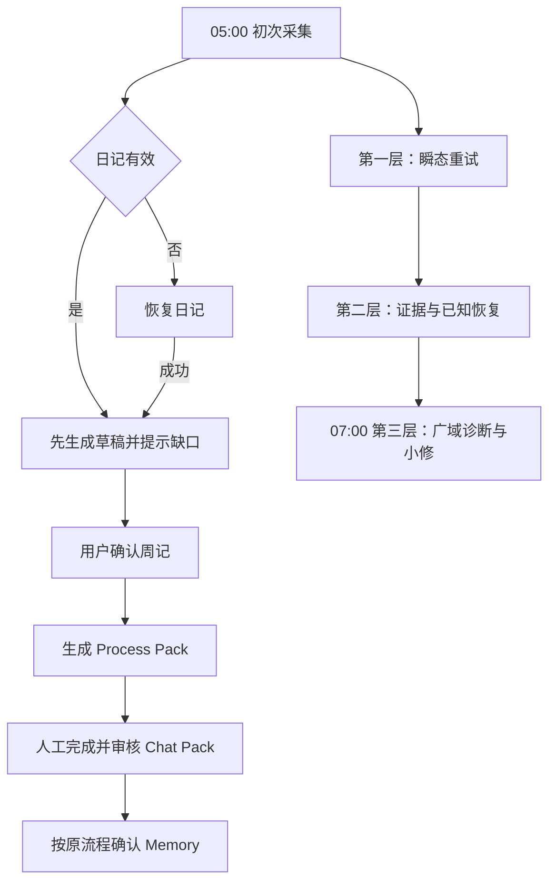
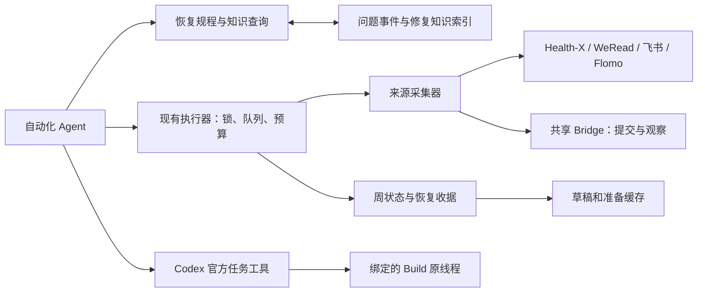
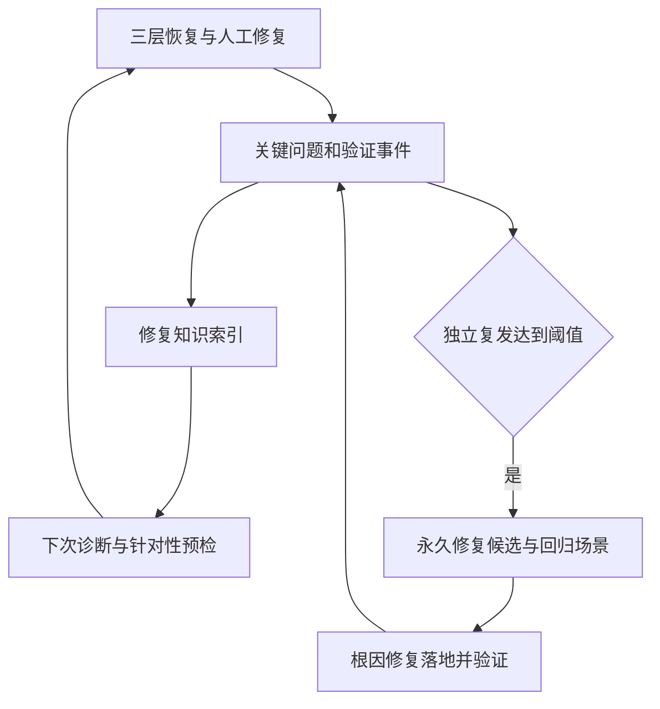
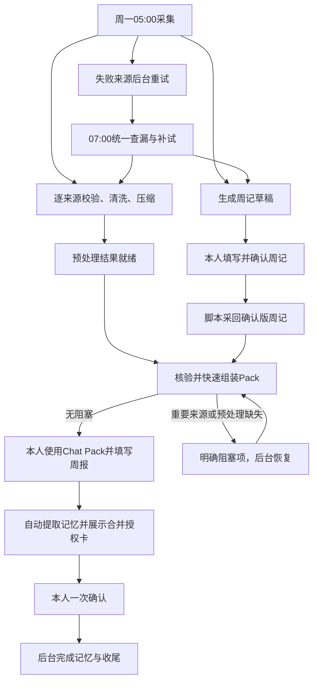
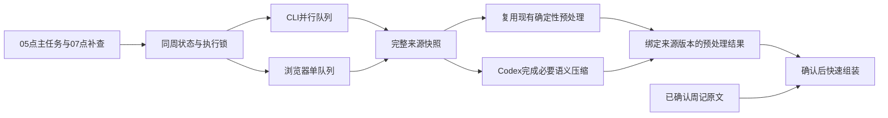
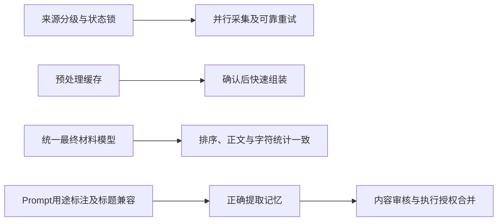

# Execution Plan｜周记自动化优化：提前预处理、分级重试与三步交互

- 状态：已确认
- 最后核对日期：2026-10-12
- 上下游链接：../../requirements/2026-10-weekly-workflow-efficiency.md → case.md
- 来源：当前有效完整方案来自用户消息 01a12e0f-b2f4-70d3-bd19-e44e6a641e63；既有方案与其执行记录原样保留于后文。

## 当前有效方案原文（用户消息 01a12e0f-b2f4-70d3-bd19-e44e6a641e63）

<!-- source_sha256: d47d13bb038a2fe0c0a65b216cddac61f90a044d1d44bf08f12e47f2769ccaaf; utf8_bytes: 12701 -->

# Learn-X 分层智能恢复与问题修复记忆闭环

## 1. 目标与总体方案

保留已确认的三层恢复和提前交付方案，新增一个小型、流程专用的修复知识库：**记录真实问题、关键证据、尝试过的修法、验证结果和人工修复经验，下次优先复用，并推动反复出现的问题得到永久修复。**

这项增量没有新的方向性取舍。方案其余关键边界已覆盖；效果仍需通过实施和真实运行验证。

已确认的基础行为：

- 脚本管理并发、冷却、状态和校验；Agent 诊断问题、选择恢复动作及实施低风险小修。
- 日记有效就先生成草稿，其他来源缺口醒目提示。
- 阶段二仍需人工确认周记，再生成完整或有缺口的 Process Pack。
- 保留 05:00、07:00 两个固定时段；飞书 Build 使用已配置的周一 01:00 自动生成。
- AI 先观察原任务，符合严格条件时最多重发一次。
- 自动小补丁限一个根因、最多 3 个实现或规则文件、100 行有效增删，同时必须可验证、可回滚。

复杂度：需求中等（1）、系统高（2）、影响面高（2），合计 5，复杂档。



## 2. 三层恢复与来源处理

| 层级 | 处理方式 | 上限 |
|---|---|---|
| 第一层 | 网络、DNS、超时、HTTP 429/5xx 等瞬态问题，冷却后重跑原命令 | 每来源最多一次简单重试 |
| 第二层 | 对账、找已有产物、观察原任务、核对日期和版本、执行已知修复 | 每来源最多两种不同恢复动作 |
| 第三层 | 检查更广的调用链和上游生成逻辑，必要时实施受控小补丁 | 同周同根因最多一个补丁，随后验证性重采 |

非网络问题可以直接进入第二层。日记就绪时立即发出交付检查点，不能等待整个首次批次或冷却结束。

来源行为：

- **桌面 Build：** 每层重新核验产物，修正 `recheck-only` 不再检查的问题。生产根 Agent 提前记录自身线程、自动化、目标周和产物路径；额度恢复后最多续跑绑定的原线程一次，运行中只等待。
- **飞书 Build：** 只发现并核验其真实覆盖周，采用现有周一 01:00 自动生成配置；不调用 build-bot-log，不改旧报告标签补当前周。
- **AI：** 通过共享 Bridge 新增 `observe` 接口采回原会话结果，核验会话、runId、标记、归属及完整性。观察失败后，仅在归属明确、模板一致、没有有效本地结果、没有限流或生成中信号且未重发时，原子预占一次机会后重发。W41 已用过的机会保留，不再次发送。
- **WeRead：** 识别升级要求，核验并安装官方包，版本统一来自实际安装信息，然后重采；消除采集器硬编码漂移。
- **Health：** 修正 Markdown 生成入口，使有效本地报告及 Learn-X 导出独立于远端 Base 同步。分别报告本地生成和远端同步状态。
- **Flomo：** 复用有效快照，统一已确认的最多 10 条计数容差；身份、正文和稳定到底校验保留。
- **智慧之门：** Base 读取进入首次 CLI 批次，Flomo 导入作为独立增强步骤。
- **Core：** 正常无确认导出记为不可用，补查合法导出，不作为网络失败或用旧数据补齐。



## 3. 新增：问题修复记忆闭环

现有周诊断最多保留 500 条，主要记录运行流水；跨周检查又主要依赖粗粒度错误类别。新增两份本地文件即可，不引入数据库、向量检索、独立服务或新的调度：

- `state/recovery-incidents.jsonl`：追加保存关键问题、恢复动作、人工修复和验证事件，作为证据真源。
- `state/recovery-playbook.json`：从事件生成可查询的问题与修法索引，可以重建。

两份文件放在 weekly-automation Skill 目录下，明确忽略提交，不进入个人 Input、Memory 或学习上下文。

### 留存哪些信息

只保存异常和关键恢复节点，正常运行继续使用原有周诊断。

| 类别 | 留存内容 |
|---|---|
| 问题 | 来源、具体错误码或症状、发生阶段、首次与最近发生时间、问题指纹 |
| 层级 | 进入过哪些恢复层、每层尝试什么、最终在哪一层恢复 |
| 根因 | 已确认事实、待验证假设及支持证据，分别标记 |
| 修复 | 受控动作、前提、执行者、适用版本、成功及失败结果 |
| 验证 | 产物读回、覆盖周、状态、计数、相关哈希、测试摘要及证据引用 |
| 人工经验 | 用户明确说明的修复步骤、来源引用、核验状态 |
| 预防 | 永久修复候选、对应回归场景、修复版本和复发情况 |

不保存私人正文、健康数值、完整聊天、Prompt、凭据、原始响应、任意可执行命令或补丁正文。关键技术证据直接留存在事件中，不能仅指向可能被裁剪的周日志。

### 如何积累、复用和纠正

1. **同一故障跨三层使用同一个问题 ID。** 各层动作分别记录，避免一次故障被算成三次复发。相同 `unknown-failure` 不能直接认定为相同根因。
2. **诊断前查询最多三条适用经验。** 按来源、具体症状、阶段、相关版本及前提匹配；历史版本不适用时只作诊断参考。
3. **成功和失败都记录。** 区分“来源已恢复”“缺口已正确处置”“整体已交付”“根因已修复”，不把跳过来源计为恢复成功。
4. **人工修复先记录，再核验。** 用户明确说做过什么即可留下候选；产物读回或复现验证后升级为已验证经验，不推断未说明的操作。
5. **已验证经验不是新授权。** 只能选择当前允许的恢复动作；补丁仍需当轮风险审查，不能凭历史成功放宽门禁。
6. **复用失败时更新适用性。** 保留历史成功，追加失效或替代证据，停止优先推荐不再适用的修法。
7. **反复发生的问题推动永久修复。** 同一问题独立发生三次，或连续两周复发，生成一条去重的永久修复候选，附修改点和回归场景。根因修复落地、验证通过后标记预防已验证；未完成则保持待处理。
8. **下一轮做针对性预检。** 对已验证且属于安全只读检查的预防项，提前检查版本一致性、生产收据、日期映射等，减少同类问题再次发生。

索引记录发生次数、恢复耗时、经验复用成功与失败次数、人工介入及复发情况。根因确认与恢复验证分开：“重跑后成功”只能证明恢复，不一定证明根因。



存储复用现有原子写入方式，加短锁及稳定事件 ID：先写事件，再更新索引。重复补写不重复计数；索引损坏可重建。记忆写入失败标为待补写，关键记录保留在原恢复收据中，继续生成内容；中间日志损坏时停止经验复用，不猜测修复事实。

首批整理本次 W40/W41 的关键案例：Flomo 容差、智慧之门连带等待、WeRead 升级、Health 导出、Build 发现与额度续跑、AI 读取失败，以及用户调整飞书 Build 时间。仅把有验证证据的结果标为已验证，其他保留候选或未解决状态。

## 4. 安全、状态与兼容

- 每次自动化使用一个 100 分钟共同截止时间，包含锁等待、冷却、Agent 调查、审查和测试；07:00 不重置历史次数。
- CLI 最多 3 路，浏览器单队列；成功来源和成功空结果不重跑。
- 保留来源状态契约，新增交付状态：完整生成、有缺口已生成、生成失败。
- 日记须真实有效且匹配目标周；阶段二须已确认周记。其他未验证来源排除并提示。
- 后到来源更新输入和缓存，不覆盖已有周记、人工编辑的 Pack 或 Output；刷新时列出差异。
- 自动小修必须有一手根因、适用范围、独立审查、原失败及相反情形验证。规模上限不是低风险证明。
- 应用前核对当前字节和哈希；回滚仅处理自己的改动且文件仍匹配补丁后哈希。并发修改时保留现场，不覆盖用户资产。
- 新诊断和知识查询接口采用加法升级；旧次数、AI 一次性标记和有效产物保留。记忆不替代当前来源、版本、身份和授权检查。

## 5. 里程碑、验收与落盘包

| 里程碑 | 实施内容 | 必须拿到的证据 |
|---|---|---|
| M0 | 保存需求、全部裁决、本完整方案；核对并行改动与各仓库规则 | 原文、路径、差异基线和来源可核查 |
| M1 | 提前交付、外部产物对账、非必要来源缺口交付 | 无关来源持续失败时草稿仍先出现；确认后 Pack 可生成，晚到 Build 被发现 |
| M2 | 固化 WeRead、Health、Core、Wisdom、Flomo 已知恢复 | 本次真实失败场景恢复并读回，其他来源不回归 |
| M3 | Bridge 原结果观察、AI 一次重发、Build 原线程续跑 | 归属验证、次数限制、原线程恢复和调用方兼容 |
| M4 | 受控小补丁、统一预算、问题记忆与预防闭环 | 小修安全、跨周经验复用、失败经验失效、永久修复候选能闭环 |

M1 是最早推翻方案的验证：日记有效时，无关来源仍能拖住草稿或 Pack，就先修这条路径，不扩展依赖它的功能。

核心验收覆盖：

- 日记有效、其他来源失败时先交付；日记无效或周记未确认时保留相应门槛。
- 晚到 Build 自动发现；错周、错产物、绑定歧义不能认领。
- AI 原回复可观察采回；错标记拒绝；重发机会跨重复运行和崩溃保持一次。
- 额度恢复只续原 Build 线程；运行中不重复启动。
- WeRead 官方升级、版本一致、恶意包拒绝；Health 本地生成与 Base 失败分开。
- Flomo 缺口 0/1/10/11、Core 正常缺失、Wisdom 独立采集准确处理。
- 补丁超限、并发编辑、预算结束及人工内容保护。
- **同一故障跨三层只计一次；不同未知错误不误合并。**
- **人工声称修复但缺证据时保持候选；失效或版本不适用的经验不自动执行。**
- **记忆并发写入、重复补写、索引重建和写入失败不阻断交付。**
- **复发候选在根因修复与回归通过后能够关闭；历史经验不能扩大授权。**

分别统计真实来源恢复率、材料交付率、人工介入率、经验复用成功率和问题复发率。可恢复病例集合事先固定，80%—90%作为真实运行目标，不能通过排除失败或把部分交付算作恢复来达成。

复用现有 `2026-10-weekly-workflow-efficiency` Case，保留旧方案，本版作为完整替代方案：

- `docs/requirements/2026-10-weekly-workflow-efficiency.md`：本轮原始需求、全部用户裁决及新增记忆闭环需求。
- `docs/cases/2026-10-weekly-workflow-efficiency/execution-plan.md`：本完整方案及调查、兼容、跨仓库影响和执行交接信息。
- `docs/cases/2026-10-weekly-workflow-efficiency/case.md`：当前有效方案、M0–M4 进度、验收证据和下一步。

原文来源为本会话完整用户请求及结构化裁决；不能由摘要代替。共享 Bridge 修改落在 browser-runtime-governance 正典仓库，Health 生成修复落在 Health-X。实施 M0 完成保存与读回后再改代码；本次仍为只读规划，尚未落盘或实施。

会话标题：Learn-X 分层智能恢复与问题修复记忆闭环


## Execution Handoff｜2026-10-12 M0

### 用户已确认的关键决定
- 当前完整方案来自用户 2026-10-12 的直接消息，获明确实施授权；本节方案原文是唯一当前有效方案。此前方案继续保留作历史，不覆盖原文。
- 三层恢复、Daily 有效即先交付、Stage 2/3 人工门槛、05:00/07:00 时间点、Build 绑定与 AI 一次重发、小补丁上限及专用修复记忆均以该原文为准。
- 当前用户追加的修复记忆请求来源为 01a12e04-c33c-7b12-80bd-fc8f45cab0d1，完整原文已逐字保存于 Requirement Truth。

### 重要背景与限制
- Learn-X 初始工作树已有 32 个变更路径；其中包括 Flomo 计数容差、中文状态呈现、Health 本地采集、AI 窄范围重发、WeRead 升级和 Process Pack 调整。它们是实施前基线，逐文件核对后续改动，不重置或覆盖。
- Health-X 工作树检查时干净；报告先生成本地文件，sync 才执行 Base 写入并导出 Learn-X，因此 Base 失败会让 Learn-X 导出缺失。Health-X 输入仍需保留其日期、已核验状态、日记分页和评分契约。
- Bridge 正典仓库 /Users/yuwei/code/browser-runtime-governance 有 14 个已修改路径和 4 个未跟踪路径，约 1,560 行新增、100 行删除；诊断与 journal 工作均为既有现场，M3 需在其上增量开发。只修改正典仓库，不改 symlink 投影。
- 飞书机器人 Build 按用户确认采用现有周一 01:00 自动生成；Learn-X 只发现并核验报告实际覆盖周，不调用 build-bot-log，不改动该调度。
- AI W41 原结果需按现有 runId 与会话观察；既有一次性重发状态不得重置。Build 额度恢复只允许绑定原线程；没有生产收据时不靠标题猜任务。
- 05:00 与 07:00 共用本次调用截止时间，运行期不启动临时唤醒任务；Stage 2 周记确认与 Stage 3 最终记忆/授权仍分别遵守用户门槛。
- 跨仓库修改需遵循各仓库 AGENTS。当前执行沙箱仅允许写 Learn-X；Health-X 与 Bridge 变更需经受控权限申请，Learn-X 不受此限制。

### 关键假设与尚存未知
- Daily readiness 事件与本地状态可在同一主 Agent 采集仍运行时触发周记生成；执行中验证独立幂等锁和已有锚点不会与 Stage 2 冲突。
- Health-X 本地导出将以合成输入和 fake CLI 做验证；真实健康报告不用于测试或复制。
- Bridge observe 只能复用公开 Runner 协议；若常驻 Runner 当前版本不支持该能力，代码验证与运行时能力必须分别报告，不以旧 Runner 的不支持推断原回复不存在。
- 真实 Flomo、Feishu、Ego Lite 和未来定时唤醒仍属于线上验收，代码测试不代替真实周运行。

### 已完成调查或 Spike 的结果及证据
- Learn-X dirty 清单为本次 rtk git status --short --branch 的 32 个变更路径；Health-X git status --short --branch 为 clean；browser-runtime-governance 有 14 个已修改路径、4 个未跟踪路径，git diff --stat 为 1,560 insertions / 100 deletions。
- Health-X 一手调用链位于 src/cli.ts 与 src/adapters/learn-x.ts；Build 生产收据与 Learn-X 重查入口需要新增；Bridge Runner 当前只接受 health/run，低层 observer 无恢复会话归属校验。具体实施证据回填到 Case。
- 文档写入前 SHA-256：Requirement f4bd1489ba1af80e030e2953e546b3cf7ebf0c603b1bc43124563a00d7b1c3ef；Execution Plan 27bddd3ac842da7613022d8f99b93c5e54aec3d3de10dac37e964275d6e9080a；Case 61c8002aad3ebd9b15861fdd2cdf0f3031d0df5e10f446269ab1963817321908。这是当前文档原文保存前的哈希。

### 相关文件、模块、接口和外部资料
- Learn-X：.agents/skills/learn-x-weekly-automation/SKILL.md、scripts/weekly-retry-supervisor.mjs、scripts/generate-ai-review.mjs、scripts/lib/、learn-x-input、learn-x-process、周记 Skill、package.json、三份任务文档。
- Health-X：src/cli.ts、src/adapters/learn-x.ts、其周报测试与 Health Skill。
- Bridge：skills/chatgpt-web-bridge/scripts/bridge.mjs、runner-host.mjs 与对应测试；正典位于 browser-runtime-governance。
- 既有原子侧车、锁和准备缓存需先查真实接口；不要新建数据库、常驻服务或第二套 source-status 锁。

### 执行中容易误解的重要信息
- 现有 dirty diff 不自动归属当前回合；只在检查每个目标文件的当前内容与 hash 后做兼容增量修改。
- 恢复成功、源状态有效、整体交付和根因永久修复是四个不同结论。
- 采集器缺口可允许部分交付，但错误或未验证正文仍须排除；“生成草稿/Pack”不等于来源成功。
- 修复记忆只存脱敏的技术事件，不复制健康数据、聊天正文、Prompt、原始响应、凭据或补丁内容；用户手工修复先作为候选，验证后才复用。

## 历史方案（2026-10-07，保留原文与既有交接）
## 方案原文
PLEASE IMPLEMENT THIS PLAN:
# 周记自动化优化：提前预处理、分级重试与三步交互

## 1. 目标与整体流程

在现有流程上做最小充分修改：保留周记模板、周一05:00启动和手动Chat Pack，把采集、校验、压缩提前完成，缩短人工步骤之间的等待。

目标：

- 本人参与时间平均约15分钟，通常不超过30分钟。
- 正常情况下，“周记已确认”到Process Pack交付不超过一分钟。
- 重要来源失败醒目提示，可选来源不阻塞。
- 正常流程只有三个操作环节，不追加独立的Pack、Memory确认口令。

三个操作环节：

1. **填写并确认周记。**
2. **审阅Process Pack，使用Chat Pack生成并填写周报。**
3. **查看记忆内容与执行授权合并卡，一次确认收尾。**



两道门槛保持区别：

- **周记草稿：** 重要来源齐全可提前生成；07:00补试结束后，有有效日记就允许生成，其他缺口明确标注。
- **Process Pack：** 日记、Flomo、AI回顾、Voice及其适用的预处理必须通过。Flomo、Voice完整查询后的可信零条允许通过；日记为空、AI空壳不能通过。

## 2. 来源分级、排序与重试

优先级用于关注和执行排序，阻断资格单独维护。因此，可选来源也可以是P0。

### 重要输入：阻断Process Pack

| 顺序 | 来源 | 优先级 |
| --- | --- | --- |
| 1 | 日记 | P0 |
| 2 | Flomo | P0 |
| 3 | AI回顾 | P0 |
| 4 | Voice | P0 |

### 可选输入：缺失不阻断

| 顺序 | 来源 | 优先级 |
| --- | --- | --- |
| 1 | 健康 | P0 |
| 2 | Core复盘 | P0 |
| 3 | 微信读书 | P1 |
| 4 | 日历 | P1 |
| 5 | 智慧之门 | P1 |
| 6 | 精读 | P1 |
| 7 | Coach | P2 |
| 8 | Build、Build-Bot、按需微信 | P2 |

一份来源配置统一驱动采集顺序、两张汇报表、Pack索引和正文顺序。已确认周记作为阶段前提单列。

### 重试规则

- 重要组：首次执行后最多重试4次。
- 可选组：首次执行后最多重试2次。
- 每次从失败结束起等待20分钟；服务端要求更长冷却时遵守更长间隔。
- 周一07:00统一查漏，为仍缺失、可安全恢复的来源额外补试一次。
- 07:00不重置次数，不重复启动正在执行的任务，不重跑成功来源。
- 成功零条不重试。权限、登录、字段契约和人工接管问题明确报告，不盲目循环。
- ChatGPT已提交或提交状态不明时只恢复原结果观察，不重新发送。
- Health、Build、Build-Bot等外部拥有的产物只重新检查，不擅自启动其生产流程。

复用现有05:00本地自动化，增加07:00本地补查任务。用有界执行器保存重试状态，结束后退出，不新增常驻服务。

独立CLI来源最多3路并行；浏览器任务使用单队列。Flomo完整采集→需回顾笔记幂等导入→智慧之门采集仍按依赖执行。

## 3. 提前预处理与一分钟快路径

### 最小改动

复用现有采集器、解析、去重、Voice压缩和字符统计函数，只补齐三项能力：

- 来源级后台编排与持久重试状态。
- 现有`process:weekly`的提前预处理能力。
- 正常目标周周记采回入口。

目前已经核实的缺口包括：状态文件并发会丢更新、Coach失败可能连带标记日记失败、正常周记采回仍靠现场CLI操作、微信读书压缩后需人工更新四处统计、Voice压缩可能绕过中文标题。

### 确认前完成的工作

来源采集成功后立即预处理，不等待所有来源完成，也不等待周记确认：

- 校验目标周、覆盖范围和来源完整性。
- 清洗、逐来源去重。
- 完成Voice压缩、微信读书语义压缩及普通超长输入处理。
- 保存可复用正文和原始→清洗→预处理字符链路。
- 提前准备上周Output对照。

语义压缩仍由Codex完成；脚本负责候选校验、缓存和组装，不在脚本中调用外部AI。

预处理结果绑定目标周、来源哈希、采集版本和规则版本。来源或规则变化只使对应结果失效；旧任务晚到不能覆盖新版本。

原始输入保持完整，压缩正文单独保存。普通15,000字符限制用于相应Pack候选，不再把固定尺寸问题当网络采集失败。正常流程不调用会覆盖原始输入、要求额外确认的压缩应用步骤。

**周记不压缩。** 已确认周记超过15,000字符仍完整纳入，不在确认后增加压缩门槛。

阶段1可以保存私有预处理材料，但不生成正式`input.json`、Process Pack、Weekly Output或Memory。



### 确认后的快路径

复用现有命令，增加准备模式：

```bash
npm run process:weekly -- --week YYYY-Www --prepare
```

收到“周记已确认”后，自动执行正常采回与最终组装：

```bash
npm run input:weekly -- --week YYYY-Www
npm run process:weekly -- --week YYYY-Www
```

这些由流程自动调用，不要求本人分别运行。

确认后只做：

1. 利用草稿阶段保存的目标锚点，窄范围读取确认版周记。
2. 核验本周来源状态、哈希及预处理版本。
3. 加入未压缩周记，完成轻量跨来源去重。
4. 统一生成正文、两张来源表、索引和字符统计。
5. 校验后交付正式Pack及Output最小壳。

正常路径不重新采集、不临时语义压缩、不手工修改统计。锚点失效时重新定位目标周，不用相邻旧周兜底；缓存失效时明确报告具体来源并回到后台预处理。

### 压缩与计数正确性

- Voice按记录结构识别任意标题，修复仅识别`with …`的问题。
- 长Voice记录维持10%–15%目标保留比例；短记录例外明确标注。
- 微信读书压缩结果与来源哈希绑定，重新生成Pack不能丢失已完成压缩。
- 总表、索引、压缩概览和正文共用最终材料模型，不再人工改四处数字。
- 最终纳入字符在跨来源去重后重新计算。
- 分别报告来源正文总字符、上周对照字符和完整Pack字符。
- 100%保留不得显示为“已压缩”；可选来源压缩不合格时明确排除，不能伪装完成。

草稿及Pack一旦交付，不因迟到输入静默重写本人正在使用的版本。



## 4. 记忆、收尾与异常监控

### Memory来源

保留现有0–3条长期候选，并明确标题用途：

- `值得长期保留（长期记忆候选，勾选后纳入）`
- `本周最值得思考的3个问题与回答（已填写的完整问答纳入候选记忆）`
- `全文核心重点纪要（纳入本周Memory）`
- `芒格之魂的洞察（纳入芒格洞察候选池）`

纪要和洞察不要求再勾选。未答、空白、占位和主动跳过的问答自动排除，不追加交互。修复背景说明被误认成回答的问题，并兼容新旧标题。

不另生成一份AI摘要冒充Memory。自动准备具体拟迁移内容，展示一张合并卡：

- 纪要、洞察、真实已答问答及主动勾选条目。
- 排除项和实际Memory目的地。
- 图片路径、备份范围与目的地、留存清理。
- YWNext刷新、Flomo同步对象及读回要求。

本人一次确认，同时完成内容审核和执行授权。执行前检查周报及拟写入内容哈希，变化后不能沿用过期批准。

### 收尾依赖

Memory成功后，图片与YWNext可并行。备份等待图片步骤完成；Flomo等待前置校验。

Flomo若回写允许的小修改，刷新受影响的索引和备份，保证最终版本一致。备份比较载荷哈希，不只按“同周成功过”跳过。

季度目标按目标周周一的真实自然年月统一计算，修复跨年拼接错误，不迁移历史Memory。

### 异常监控

分别记录采集、重试等待、预处理、周记采回、Pack组装、卡片准备和收尾耗时。

每次异常保存：

- 来源、步骤、错误分类及发生次数。
- 本次尝试、下次重试和最后安全状态。
- 可核查证据。
- 已确认根因、待验证假设和修复建议。

固定超长输入、缓存失效、网络失败分别处理，避免无效重试。正常环境确认后超过一分钟，记录具体慢步骤。

重要输入首次阻塞即醒目提示；同周连续3次相同错误或连续2周失败，输出诊断摘要。状态无变化时不重复长篇通知。日志只保留技术元信息，不保存私人正文、凭据或原始响应。

## 5. 实施、验收与落盘

### 最小里程碑

| 里程碑 | 实施内容 | 验证与停止条件 |
| --- | --- | --- |
| M0 | 保存需求、完整方案、Case，核对现有改动 | 原文与裁决读回一致；保护无关脏文件 |
| M1 | 穿通真实入口→提前预处理→确认周记→快速Pack | 测量一分钟目标，证明无需确认后语义加工；失败先定位，不继续扩展 |
| M2 | 完成分级重试、07补查、锁与恢复 | 验证后台恢复、同源竞争、次数与间隔；不重复外部副作用 |
| M3 | 完成两组排序、压缩与统计一致性 | 逐来源统计与最终正文一致，重要源缺失被拦截 |
| M4 | 完成Memory提取、合并卡和收尾监控 | 一次授权、未答题无追问、去重及最终版本读回通过 |

### 验收矩阵

| 验收 | 前提→动作→可观察结果 |
| --- | --- |
| ACC1 | 预处理完成→确认周记→正常环境一分钟内获得Pack，无临时压缩 |
| ACC2 | 其他重要来源失败、日记有效→07补试结束→草稿可生成，Pack明确阻塞 |
| ACC3 | 可选来源缺失→继续→缺口可见，合格Pack不被拖住 |
| ACC4 | 临时失败→后台恢复→重要重试4次、可选2次，07额外一次，间隔不少于20分钟 |
| ACC5 | 05/07竞争或进程中断→恢复→不丢状态、不重置次数、不重复提交 |
| ACC6 | 来源变化或旧候选晚到→组装→拒绝过期候选，只重做对应来源 |
| ACC7 | 中文标题Voice、微信读书、超长输入→预处理→压缩真实完成，原始材料保留 |
| ACC8 | 已确认周记超过15,000字符→采回→完整纳入，不要求压缩 |
| ACC9 | 空回答、问号背景、新标题→提取→只保留真实已答问答，不漏纪要与洞察 |
| ACC10 | 查看合并卡→一次确认→记忆与收尾执行、去重、读回，无分拆授权 |
| ACC11 | 慢步骤或重复失败→监控→原因与证据持久记录，推测不冒充根因 |

连续记录3个正常周运行，评估本人平均15分钟、通常不超过30分钟的目标。外部服务等待与本人深度思考分别计时。

### 落盘包

目标仓库：`/Users/yuwei/code/learn-x`。Case：`2026-10-weekly-workflow-efficiency`。

实施M0保存：

- `/Users/yuwei/code/learn-x/docs/requirements/2026-10-weekly-workflow-efficiency.md`：全部用户需求原文、确认基线及追加裁决。
- `/Users/yuwei/code/learn-x/docs/cases/2026-10-weekly-workflow-efficiency/execution-plan.md`：本版完整方案及Execution Handoff，标明替代前版。
- `/Users/yuwei/code/learn-x/docs/cases/2026-10-weekly-workflow-efficiency/case.md`：索引、真实进度、证据与下一步。

完整来源是本会话`01a10a89-3a0d-7e20-a177-a03e4ece3f63`的用户消息及本方案；按规划资产契约捕获原文，不用摘要重建。

Prompt修改走飞书真源治理；Skill修改使用skill-creator。清理退役Action Feedback、旧编号、旧排序及阶段边界矛盾。实施后再更新Architecture Truth。

本方案已进入实施并完成本地实现；下方 Implementation Handoff 记录当前实现与验证状态。后台恢复、真实飞书采回及一分钟目标仍必须取得实际运行证据。回退只针对本次变更，保留人工内容、原始输入与诊断记录；不另建仓库、应用或工作流平台。

会话标题：周记自动化优化：提前预处理、分级重试与三步交互

### Bridge 对抗修复补充｜2026-10-12

- 独立对抗审查发现：Learn-X 成功结果收据在 task space 清理失败时可能被后续 observe 直接当作成功；另有默认 60 分钟 watchdog 空闲门槛可能早于 07:00 关闭被保留任务，收据写入异常也曾被静默吞掉。
- 共享 Bridge 已改为：新收据只有清理确认后才标记 `cleanupConfirmed: true`；清理失败保留有界 `cleanupConfirmed: false` 收据，后续只重试原任务清理，确认后才交付成功。Learn-X 周 AI lease 带最长 2 小时 15 分钟的恢复期限，watchdog 在期限内跳过回收，到期后回到原空闲回收规则。
- 可选恢复收据写入失败不会抹掉当前已验证结果，但以返回字段、事件和固定非正文 stderr 诊断标明 `recoveryReceiptStatus: unavailable`。结果收据仅用于 `learn-x:weekly-ai`，权限 0600、目录 0700、最多 15,000 字符、保留 2 小时 15 分钟且不保存 prompt。
- 恢复 observe 开始时只延长 caller/runId 匹配的 active lease 至观察预算加一分钟，并在每轮观察前续心跳；总期限限制在原 lease 创建后三小时。租约身份不匹配、已关闭或续期失败时停止观察，避免 watchdog 与 Bridge 并发回收。
- Bridge 隔离回归 8/8、watchdog lease 隔离回归 3/3 通过；新增截止后拒绝迟到成功的边界用例。观察预算是墙钟硬截止，Runner 超时后回传的成功结果仍为 `needs_review`，不会触发清理/成功收据。`git diff --check` 通过。真实 Bridge/Runner/watchdog 未部署或启动；本机空闲阈值覆盖、watchdog 是否运行均未检查，不能宣称线上 07:00 保留效果已验证。


## Execution Handoff
### 用户已确认的关键决定
- 完整方案获用户明确实施授权；以上方案原文不改写，后续裁决只追加于本附录。
- 保留周一05:00、模板和手动 Chat Pack；实现三步交互、分级重试/07查漏、预处理快路径、Memory与授权合并卡。
- 周记不压缩；真实周记采回、后台恢复、一分钟耗时尚无证据。
- 2026-10-05追加裁决：第二步 Process Pack 阶段展示执行授权卡，提前说明收尾动作、授权范围和目标路径，不展示尚未生成的记忆内容；第三步展示实际记忆条目，并与已预览的授权信息合并为完整卡片，一次确认。用户最新澄清覆盖此前对第二步展示记忆内容的理解。

### 重要背景与限制
- 本轮开始前工作区已有25个已修改/删除路径，涉及 input/process/weekly Skills、脚本、测试、文档和前端；均作为既有基线保护。
- learn-x-process 与 learn-x-weekly-automation 对阶段门禁、采集顺序、压缩时点、来源排序有不一致描述；现有脏改动需合并。
- 日记/Coach联合入口存在逻辑失败域耦合；状态侧车并发读改写可能丢更新。
- 规划时 Learn-X缺完整 Flomo 周采集器；实施后已补齐采集器，Ego Lite完整周扫描仍待真实运行验证；Research-X导入器只取 #需回顾。
- 正常周记采回依赖现场 CLI；缺少目标周 input:weekly 入口。
- Pack生成仍在确认后执行 Voice 与 WeRead 压缩，WeRead需人工改四处计数。
- Health/Build/Build-Bot只重新检查；ChatGPT已提交或状态不明只观察恢复、不盲重发。
- 使用现有 Unicode 字符计数，只在授权范围内处理个人内容。

### 关键假设与尚存未知
- 一分钟是服务正常时目标，尚未实际测量。
- 05:00后的有界worker持续性和07:00中断接管需本机实测。
- 周记锚点及飞书窄范围读回需真实验证。
- 全量 Flomo collector 已实现；Ego Lite页面遍历及完整周证据待真实运行验证；禁止 Chrome/CDP/私有API。
- 第二步执行授权范围预览已规定在交付 Process Pack 的同一条阶段 2 回复中；它不生成或展示 Memory 内容，也不调用独立消息发送器。按同一条回复呈现的行为契约已纳入回归断言。
- 三个正常周人类参与时间样本尚不存在。

### 已完成调查或 Spike 的结果及证据
- 读取 docs/LEARN_X_PROCESS.md、03_input/usage.md、04_output/usage.md、weekly automation/process Skills。
- 定位状态竞争、日记与 Coach 耦合、WeRead压缩后置、周记采回缺脚本、超长输入采集拦截。
- Flomo适配器结论来自线程内只读调查，不是实测证据。

### 相关文件、模块、接口和外部资料
- .agents/skills/learn-x-input/scripts/lib/source-status.mjs
- .agents/skills/learn-x-weekly-automation/SKILL.md 及 scripts/
- .agents/skills/learn-x-input/scripts/
- .agents/skills/learn-x-process/scripts/collect-weekly-input.mjs
- .agents/skills/learn-x-process/scripts/generate-weekly-process-pack.mjs
- .agents/skills/learn-x-process/scripts/prepare-weekly-memory.mjs
- package.json；docs/architecture.md（仅实施事实完成后更新）。
- Skill遵循 /Users/yuwei/.codex/skills/.system/skill-creator/SKILL.md；Prompt遵循 /Users/yuwei/code/skills/prompt-governance/SKILL.md 与飞书真源契约。

### 执行中容易误解的重要信息
- 阶段1可保存私有预处理和草稿，不生成正式 input.json、Process Pack、Weekly Output 或 Memory。
- 成功零条须有完整扫描证据；重要门槛独立于优先级；日记有效、AI不可为空壳。
- 07:00不重置次数、不重跑成功源、不与活跃任务重复；未知ChatGPT提交只观察原任务。
- 迟到源不覆盖已交付产物；缓存失效需明确指明来源。
- 第二步展示执行动作、范围与目标路径预览，不展示尚未生成的 Memory，也不构成授权；第三步在 Memory 实际生成后展示内容与完整授权卡并一次确认。授权前后核验周报及拟写内容哈希。
- 未经真实外部验证不得宣称线上成功。

### Implementation Handoff｜2026-10-07

- M0资产已核对；M1–M4的本地实现已落地：持久来源重试与锁、05:00/07:00恢复门槛、来源预处理缓存、确认版周记锚点采回、Process Pack 快速组装、第二步授权范围预览、第三步真实记忆与授权合并确认。
- 追加审查修复：死锁回收增加互斥；AI仅在明确预检失败时安全重试；07:00有界等待活动任务与服务冷却，并接手05:00有界期限内未启动的安全来源一次；Flomo/Voice验证完整范围、分页、下界、记录数；超长输入候选必须压至15,000字符内；锚点创建原子化并按日期边界匹配；Stage 1缺重要输入时等待07:00门槛。
- 隔离端到端模拟通过：临时仓库中模拟 05:00 来源瞬时失败、20 分钟虚拟冷却和 07:00 恢复，再执行周记锚点/桩式采回、提前预处理、Process Pack 快速组装及 Memory 候选准备；未调用真实 Flomo、Ego Lite、飞书写入、Memory、图片、备份或同步。
- 模拟发现 Process Pack 汇总曾把可信的 Flomo / Voice 完整零条扫描误报为阻断；已调整为继续在来源行展示零条证据，但不进入阻断提醒。修正后的回归断言通过。
- 全仓 `npm test` 421/421、`git diff --check` 均通过。本次没有运行真实 Flomo、Ego Lite、飞书周记写入或 Memory/备份/同步，因此不能把外部验收或一分钟目标记为完成。
- `learn-x-v2` 与 `learn-x-07-00` 自动化已按同一门槛更新，应用更新结果为 ACTIVE；调度实际触发与持锁恢复仍待未来运行证据。
- 下一步在未来正常周运行补足外部验收；本地验证不触发外部写入。
- 第二步卡片契约核对：Skill要求阶段 2 的 Process Pack 消息同时包含固定范围与目标路径预览，不展示尚未生成的记忆内容且不构成授权；阶段 3 再把实际候选与同一范围合并为一次确认卡。端到端回归断言验证两阶段边界文本。

## Implementation Progress｜2026-10-12

本附录记录用户追加的“分层智能恢复与问题修复记忆闭环”方案实施进度；不覆盖前述历史方案和验收收据。

### 已实现并通过定向回归

- **M1 部分交付：** Process Pack 将有效日记与确认版目标周周记保留为硬门槛；缺失、失败或未核验的补充来源排除正文并在 Pack 中标记“有缺口已生成”。外部 Build 只有标题证明目标 ISO 周时才可被认领；后续重查会重新核验外部/人工来源。自动化 Skill 要求同一采集会话运行时只读轮询目标周状态，Daily 有效即可并发进入周记草稿；新增隔离用例证明 Flomo 仍阻塞时 Daily 状态和来源文件已可读，不能替代真实飞书草稿写入验收。
- **M2 主要路径：** WeRead 采集从已安装 Skill 元数据取版本，`upgrade_info` 分类为版本不匹配，而非网络瞬态；流程要求核实官方来源与升级结果后再重采。Health-X 新增按目标周生成本地报告并独立导出 Learn-X 的不覆盖写入路径，不触发 Base 同步。Wisdom Base 采集不受 Flomo 成败阻塞。输入回归 146/146，Health-X 合成回归 10/10。真实 WeRead 升级与重采尚未执行。
- **M3 本地实现：** Bridge 有只读 observe API、稳定 runId、提交归属和请求/实际会话地址核对；Learn-X 适配器再次核验会话与回复标记。新增短时加密权限结果收据和少数可恢复 `needs_review` 任务保留路径；只运行了定向合成 Bridge 用例，服务没有部署或重启。AI 一次性重发仍需严格观察门槛。Codex Build 已有绑定线程续跑收据与原线程唯一续跑辅助器；没有真实额度恢复或线程续跑验收。
- **M4 本地实现：** `recovery-incidents.jsonl` 追加关键异常与恢复证据；`recovery-playbook.json` 可从事件重建。跨层共享问题 ID，未知错误不合并；修复经验按稳定动作编号失效。L3 小修只有在两种未解决的 L2 动作之后进入，补丁先计算隔离副本的精确预期字节，并发改动不会被回滚覆盖。记忆 11/11、补丁护栏 5/5、分层门禁 3/3；Learn-X 全仓 579/579。Review receipt 目前只校验填报身份字段与补丁绑定，不能密码学认证审查者身份；实际使用必须由执行者核实独立审查确已发生。长期恢复率仍需正常运行数据。

### 安全边界与未完成验收

- 本轮只运行合成数据与本地定向测试；未启动真实周采集、WeRead 安装、Codex Build 续跑、AI 重发、飞书写入或 Bridge 真实会话观察。
- 没有读取 Health-X 私人输入、Bridge 运行日志或凭据；Health-X 与 Bridge 改动只涉及代码及合成测试。
- Stage 1 的真实草稿写入、05:00/07:00 自动唤醒与锁恢复、外部来源最终读回、旧 Bridge 运行处理、Codex Build 实际线程续跑、WeRead 安装/重采、第三层小补丁真实运用与长期恢复率仍需后续正常运行证据。隔离测试只证明持久 Daily 状态在其他来源运行期间可读，不代表草稿已写入飞书。
- 当前 Learn-X 全仓 `npm test` 为 579/579。另有 Bridge 定向 observe/receipt 用例 3/3 通过；Bridge 完整套件仍有沙箱 `EPERM` 的 socket 边界，未部署或重启服务。Health-X 套件未在本轮重跑。

### 当前交接

优先补全 Codex Build 原线程续跑和第三层受控诊断/补丁路径，再用隔离周流程故障注入验证 M1–M4 交界；不以测试通过替代真实来源、调度或外部服务验收。

### 2026-10-12 Health-X 导出兼容修复

- 复核发现 Health-X 新增 `--week` 参数解析会在未传 `--week` 时误删首个位置参数；导出-only 模式也仍读取 Diary Base 配置，和本方案“本地报告不依赖远端 Base”冲突。
- 已修复位置参数过滤；`report --export-learn-x --week` 不读取 Diary 配置。Learn-X collector 调用该官方导出命令，只传 `PATH` 与 `LEARN_X_ROOT`，并回读校验目标周文件。
- 合成验证：Health-X CLI/export 测试 2/2，Learn-X Health collector 测试 5/5，Health-X Skill validator 通过。未读取真实健康样例或运行全量 Health-X 测试。
- Learn-X 与 Health-X Architecture Truth 已同步。真实 Health 源、Base 隔离与定时收据仍需在后续运行验收，不以合成测试替代。

### 分层恢复独立对抗复测补充｜2026-10-12

- 复现并修复：UNKNOWN source failure 在不同恢复层被分配不同 ID；恢复事件落盘失败只保存在进程内；Build 收据路径可被 `../` 和父级符号链接绕出仓库。现在同一执行 run 跨层共用问题 ID，错误恢复事件先写入 weekly state 并按稳定 event ID 幂等补录，Build 收据读写及产物核验逐级拒绝符号链接目录并核对真实路径仍在仓库根内。
- 增加对抗回归：仓库外含匹配 ISO 周标题、有效收据和产物仍会因周目录 symlink 被拒绝；目标周目录写入也在检查点拒绝 symlink。并发首建遇 `mkdir EEXIST` 后重查目录属性；现有锁 busy 状态保持明确，不把竞争误认成成功。周 53 按 ISO 年实际最大周数处理，验证 `2025-W53` 无效、`2020-W53`/`2026-W53` 有效。
- 期间一次全量 Learn-X 测试捕获 `recorded` 局部变量作用域回归，已修复。最终 `rtk proxy npm test` 587/587；Build 续跑 8/8；恢复记忆 12/12、weekly supervisor 43/43；3 个相关 Skill quick_validate 通过；Learn-X、Health-X、browser-runtime-governance `git diff --check` 通过。
- 第一轮独立 reviewer 的指定复测通过，并确认 Build symlink 修复没有新的静态绕过。第二轮独立 reviewer 发现 UNKNOWN 故障信号被归一化合并、WeRead/recovery-memory 对无效 W53 的校验漂移、Health-X 周目录 symlink 越界；三项均已修复并由该 reviewer 独立复测通过，没有新 P1/P2。异步目录替换 TOCTOU 压力竞争尚未验证。
- 实际外部采集、Bridge 部署、真实 Feishu 写入、AI 重发、Codex 原线程续跑及调度唤醒不在本轮验证范围。不得将合成证据解释为线上成功率或真实恢复率。
- 最终 Deep 验收报告：`docs/cases/2026-10-weekly-workflow-efficiency/acceptance.md`；最终 Learn-X 全仓测试 `592/592`。Health-X 符号链接防护仅由合成目录验证，未读取真实健康数据。
