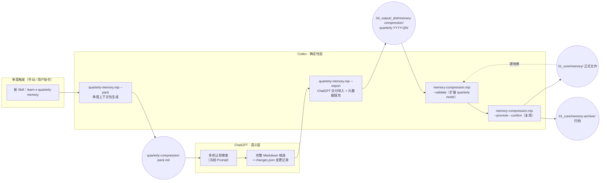

# Execution Plan｜Learn-X 季度长期 Memory 审查与压缩

- 状态：已确认（用户 2026-11-23 明确指令"使用ywdev 完整执行前面的方案"）
- 最后核对日期：2026-11-23
- 上下游链接：[Requirement Truth](../../requirements/2026-11-quarterly-memory-compression.md) → [Case](case.md)
- 来源：ywplan 技术规划（dev-workflow.architecture revision 257 方法下产出，本会话 2026-11-23 完整提交并经用户确认执行）

## 方案原文
# Learn-X 季度长期 Memory 审查与压缩｜技术方案（ywplan）

## 一、背景、目标、需求与约束

**需求来源**：《Learn-X｜季度长期 Memory 审查与压缩》Requirement Truth v1.0（冻结于 2026-11-23，R4 已确认）。本次规划继承其全部 R1–R6 需求、§4 核心 Prompt 产品语义（不重新设计）、§5 三个架构决定（AD1 季度优先、AD2 ChatGPT 负责语义/程序负责确定性、AD3 保留数据安全机制）、§6 非目标与 §9 十项验收测试。

**核心改造一句话**：把"历史 Memory 压缩"从月度自动化旁路中移出，改为季度触发的人机审查流程——新增季度上下文包生成（确定性）、ChatGPT 直接交付完整 Markdown 候选（语义）、导入适配与确定性校验/安全晋级（复用现有引擎），月记/Monthly Output/Memory 日常迁移不受影响。

**硬约束**：
- 现有安全机制（源哈希、保护单元、预算、归档、原子替换、失败回滚、"定时任务永不自动晋级"）必须保留，预算冲突不静默删减。
- 核心 ChatGPT Prompt 语义逐字保留（落盘为仓库 Prompt 资源 + 嵌入上下文包）。
- 本地工作树有 10 个未提交文件（weekly-automation / prepare-weekly-memory 在途改动），与本方案改动范围**完全不相交**，实施时不得触碰、不得混入提交。

## 二、现状与架构驱动因素（已核验代码事实）

**现状关键事实**（均来自实际读取，标注 文件:行号）：

1. **正式 Memory 是季度粒度**：`01_core/memory/` 下 `2026-Q2/Q3/Q4.memory.md`（3637/10279/3849 字），无年度文件；`memory-archive/` 当前为空。结构为 `## 候选观察池` + `## YYYY-Www` / `## Monthly｜YYYY-MM` 周期小节（memory-rules.md:45-67），来源标签 `[2026-W22]`、`[Monthly｜2026-05]`（memory-rules.md:86）。
2. **压缩引擎是单文件确定性脚本**：`.agents/skills/learn-x-process/scripts/memory-compression.mjs`（1143 行）。三态：`planMemoryCompression`（:71 只读规划，当年 current-year / 往年 annualize 双模式）→ `validateMemoryCompression`（:122 哈希 stale 检测 :514、单元审计 retained/represented_by_trace/removed :515-525、保护缺失 :526、聚合状态机 stale→needs_review→ready :588）→ `promoteMemoryCompression`（:158 归档到 `01_core/memory-archive/compression/<asOf>/<ts>` 并逐文件回读哈希 :178，原子替换+读回 :1110-1120，失败全量回滚 :208-213）。
3. **月度触发点只有两处、且是 SKILL 层指令而非脚本**：`learn-x-monthly-automation/SKILL.md:78`（阶段 1 末尾"旁路运行一次 Memory 压缩预览"）和 :160-170（"Memory 月度压缩旁路"专节）。`process:monthly` 脚本本身不调用压缩（它生成的 compression-requests 是月度输入事件压缩，属另一机制，保留）。
4. **元数据契约**：候选目录 `04_output/_dist/memory-compression/YYYY-MM/<target>/`，`.memory-compression.json` 要求 `coreDifferences` 固定 5–10 条六字段（memory-compression.mjs:1007）、`otherChanges` ≥1、`changeSummary` 30–1000 字（:1020-1025）、mode 白名单 `current-year|annualize`（:1028）、`sourceHashes` SHA-256、预算按年龄 `max(200, floor(8000×0.6^age))` 校验（:1045-1048）。
5. **保护语义是时间窗制**：当前月、跨当前月的周块、无法识别来源的单元受保护（:433-447）；**历史单元不受"修改须确认"约束**——这是 AD1"经确认的跨期纠偏"与现状的真实冲突点（RT §8 已预告）。
6. **无机器调度**：ecosystem.config.cjs 仅 Chat Pack Web 常驻；LaunchAgents/crontab/DSH schedule 无 learn-x 月度任务（crontab 一项沙箱不可读，已如实标注）。月度自动化实际由用户会话发起。
7. **日常迁移与压缩解耦**：`prepare-weekly-memory.mjs`（752 行，带确认指纹状态机）与 `prepare-period-memory.mjs`（month/year 候选抽取）不触碰 compression 引擎，天然不受影响。

**架构驱动因素**：

- **AF1 数据安全不变量**（需求 R5）：候选不可信 → 校验门槛 → 显式 confirm → 归档+原子替换+回滚。任何改动不得弱化；这是 mode/元数据演进的边界条件。
- **AF2 语义与确定性分界**（AD2）：ChatGPT 产出语义内容（压缩正文、变更记录、纠偏依据）；程序只做哈希/预算/保护/结构/导入映射。引擎禁止二次语义判断。
- **AF3 触发频率即保护语义**（R1/AD1）：月度→季度后，"当前月保护"对已关闭季度不再适用；保护模型必须从"时间窗"演进为"评审范围 + 确认清单"，否则要么阻断合法季度压缩、要么放行未确认历史改写。
- **AF4 元数据契约兼容**（R5/RT §8）：`coreDifferences` 固定 5–10 条与"真实变化驱动"直接冲突；旧 monthly-era 候选（如现存 2026-11/Q3 pending 候选）仍需可校验/可晋级。
- **AF5 季度新事实来源覆盖**（RT §8 开放项）：上下文包的"现在是什么"需要可信季度材料清单，当前脚本只扫描正式 Memory，来源清点能力需新增并显式标记缺失。

## 三、关键技术假设与验证

| # | 假设 | 证据 | 验证方式与门槛 |
|---|---|---|---|
| V1 | 季度候选可复用 `*.memory.compressed.md` + sidecar 候选结构，仅新增 mode 与元数据字段 | 引擎校验按 metadata 驱动，目录结构只约束位置与文件名模式（:473-493, :1027-1062） | M2 单测：quarterly mode 全字段通过 validate；旧 mode 候选回归不受影响 |
| V2 | 季度材料可从 `03_input/weekly|monthly` + `_source-status.json` + 已确认 Output 确定性清点 | monthly-automation 阶段 1 已有成熟来源状态协议（SKILL.md:39-44） | **M1 待验证项**：历史季度周目录与状态文件的完整覆盖；缺失时上下文包显式标记 unavailable，不阻塞（R2 验收允许） |
| V3 | ChatGPT 变更记录可机器化映射进 comparison 渲染管线 | comparison 渲染只读 `metadata.coreDifferences/otherChanges/changeSummary`（:623,:688,:885） | M2 单测：ChatGPT changes.json 导入后 comparison 报告生成且字段完整 |
| V4 | 跨年协调可用"同会话两阶段导入"实现 | promote 后源哈希变化使旧候选 stale（:161, :1098），天然防重复晋级 | M3 单测：Q4+年度合并两阶段，第二阶段哈希取晋级后真实仓库状态 |

**条件性结论**：V2 是唯一实施前未完全证实的前提，M1 先行最小验证；失败不推翻架构，只影响上下文包"现在是什么"的材料丰度（设计已允许显式缺口标记）。

## 四、核心架构与技术决策

总架构：**不新增子系统，引擎单点演进 + 一个新 Skill + 一个新脚本 + 一个新 Prompt 资源**。

**决策 D1｜触发与归属：新建 Skill `.agents/skills/learn-x-quarterly-memory/`，月度自动化只做减法**
- 新 Skill 承载：季度解析规则（默认刚结束的完整自然季度，`--quarter YYYY-QN` 可覆盖）、上下文包生成指引、ChatGPT 交接协议、导入与晋级门槛。
- `learn-x-monthly-automation/SKILL.md`：删除 :78（阶段 1 步骤 8）与 :160-170（压缩旁路专节），替换为一行指向季度 Skill 的说明；阶段 1/2/3 其余逻辑不动。
- `learn-x-process/SKILL.md` :51-55、:130 及 `docs/LEARN_X_PROCESS.md` :63-73："Memory 月度压缩"改写为"Memory 季度审查"，validate/promote 说明保留。
- 不建任何调度器（非目标；现状无机器调度，用户手动触发即满足 R1"支持手动触发"）。

**决策 D2｜引擎演进：`memory-compression.mjs` 新增 quarterly mode + 两个子命令，安全机制零削弱**
- 元数据新增 `mode: "quarterly"`（schemaVersion 2 字段 `packRef` 引用上下文包路径与哈希），`current-year`/`annualize` 原样保留 → 现存 monthly-era 候选（2026-11/Q3）继续可 validate/promote，无迁移负担。
- `validateMetadata` 扩展：quarterly mode 允许目标为任何现存 `01_core/memory/{YYYY-QN|YYYY}.memory.md`；预算仍按 asOf 年 − 目标年年龄计算（同 :1045-1048 口径）。
- 新增确定性子命令（放同一引擎文件，避免导出内部单元解析函数造成双真源）：
  - `--pack [--as-of] [--quarter]`：生成上下文包（见 D3）；
  - `--import <交付目录>`：ChatGPT 交付导入（见 D4）。
- npm scripts：`memory:quarterly`（pack/import 透传）；`memory:compress` 保留向后兼容。

**决策 D3｜上下文包（R2）：`quarterly-compression-pack.md` + 附件清单，全部只读生成**
- 输出：`04_output/_dist/memory-compression/quarterly-<YYYY-QN>/quarterly-compression-pack.md`，超长材料拆附件（清单+路径+哈希关联），不为单文件体积预删减。
- 五段结构照 R2 A–E 落实：
  - A 过去：目标季度正式 Memory 完整原文 + 相关历史文件摘要 + 哈希/版本 + 未闭环问题；
  - B 现在：季度材料清点（`03_input/weekly/YYYY-Www/` 按 `_source-status.json` ready 过滤、`03_input/monthly/YYYY-M/`、已确认 Weekly/Monthly Output、已迁移 memory-candidates 收据），逐来源给出路径、哈希、状态；**缺失/不可得来源显式标记 unavailable，不编造**；
  - C 目标 + D 约束：预算表（含年龄衰减口径）、文件结构、保护规则（评审范围 + 确认清单制）、跨期纠偏确认协议、晋级条件；
  - E 执行与交付：冻结的 §4 ChatGPT Prompt 全文（新资源 `02_prompts/meta/chatgpt-quarterly-memory-review.md`，沿用 monthly 两份手动 Prompt 的 02_prompts/meta/ 先例）+ 目标文件清单 + 交付契约 + 多轮交互协议。
- 同年较早季度（如审查 Q3 时的 Q1/Q2）不自动纳入压缩，仅在包中报告预算状态；超支历史文件由用户决定是否作为"确认纠偏"纳入本轮（防批量重写历史，符合 AD1）。

**决策 D4｜导入契约（R4/R5）：ChatGPT 交付 → 确定性导入 → 校验，Codex 不做语义判断**
- 交付目录结构（写入上下文包契约）：每目标文件一个完整 Markdown（命名 = 目标 basename，如 `2026-Q3.memory.md`）+ `changes.json`（机器可读变更记录：每条 topic/original/candidate/kind/action/review/risk，真实条数 0–N；0 条且声明"无需修改"则不生成候选，只出收据）+ 可选 changes.md 人类摘要。支持 ZIP 解包后导入。
- `--import` 程序行为：校验目标文件存在于 `01_core/memory/` → 以**真实仓库状态**计算 sourceHashes、字符预算、protectedUnitIds、asOf → 将 ChatGPT 正文写入候选 `<target-basename>/<target>.memory.compressed.md` → 程序填充 sidecar 全部技术元数据（ChatGPT 提供的哈希/路径/字数一律忽略，防伪造）→ 变更记录映射为 `coreDifferences`（字段名复用使 comparison 渲染管线零改动）+ `confirmedCorrections` → 自动跑一次 `--validate` 输出状态。
- 候选目录：`04_output/_dist/memory-compression/quarterly-<YYYY-QN>/<target-basename>/`（与 monthly-era 目录不冲突）。

**决策 D5｜保护语义演进（AF3，RT §8 保护规则冲突的正解）**：
- 评审目标季度文件：该季度已关闭，全部可归因单元可压缩；**无法识别来源的单元默认保护**（继承现有安全网），放开须经 confirmedCorrections。
- 跨期修正：任何目标季度之外的源文件单元，仅当列于 `confirmedCorrections`（含 sourcePath、unitId、旧文摘要、新证据、用户确认标记，来自 ChatGPT 多轮中用户具体确认）才允许改写；校验逐条核对"声明的单元确实被修改、未声明的保护单元确实逐字保留"，实现"有范围通过，未确认继续保护"。

**决策 D6｜跨年协调（R1）：同一次评审、两阶段导入、顺序晋级**
- 目标季度 = Q4 时，上下文包包含季度压缩 + 年度合并两个交付阶段；阶段 A（Q4 候选）晋级后，阶段 B（年度合并候选）基于晋级后真实仓库状态重新计算 sourceHashes 再导入校验。阶段 B 在阶段 A 晋级前导入会被哈希/stale 机制拒绝——用现有机制实现"避免重复压缩"，不新增协调代码。
- `memory:yearly` 与 annualize 模式保留不动（R1"现有年度整理能力保留"）。

**决策 D7｜幂等与重复触发（R1）**：复用现有三态——同源版本已有候选 → 报告 pending 不覆盖用户修改（:1090-1104）；源变化 → stale；晋级后源哈希改变使旧候选自然失效。无新增去重代码。

## 五、架构质量约束（质量场景）

| 质量目标 | 场景（触发→响应→合格判据） | 验证 |
|---|---|---|
| 正式文件安全 | 校验任一项失败 / 用户未确认 → 正式 Memory 与归档零改动；promote 抛具体错误 | M3 单测：7 种失败路径逐一断言文件未被触碰 |
| 来源一致性 | pack/candidate 生成后源文件变化 → validate 判 stale，promote 拒绝 | 复用现有机制 + 单测 |
| 确认边界 | 未列入 confirmedCorrections 的历史单元被改写 → protectedOk=false 阻断；列入且确实改写 → 通过，且逐条可追溯 | M2 新增单测（RT 验收 3/4） |
| 预算冲突 | 候选超硬上限 → 停止晋级并报告，不静默删减 | 现有 hardLimitOk 拒绝路径 + 单测（RT 验收 7） |
| 失败恢复 | promote 中途失败 → 归档回拷/反向 rename/unlink 全量回滚，归档哈希与源一致 | 现有 :208-213 + 注入故障单测（RT 验收 9） |
| 语义边界诚实 | comparison 与汇报保留"校验通过 ≠ 语义无损"声明 | 渲染文案保留（:983） |
| 回归隔离 | 月记/Monthly Output/周度与月度 Memory 迁移/annualize 行为不变 | 现有 prepare-weekly-memory、period-memory 测试全量重跑（RT 验收 10） |

## 六、实施范围与风险

**改动清单**（全部在 learn-x 仓库内）：
- 新增：`.agents/skills/learn-x-quarterly-memory/SKILL.md`、`learn-x-process/scripts/quarterly-memory.mjs`（pack/import，复用引擎导出）、`quarterly-memory.test.mjs`、`02_prompts/meta/chatgpt-quarterly-memory-review.md`。
- 修改：`memory-compression.mjs`（quarterly mode 元数据校验/保护语义/confirmedCorrections/--pack/--import CLI）、`memory-compression.test.mjs`、`memory-compression-rules.md`（新增季度规则节，monthly 规则标注 legacy 兼容）、`learn-x-monthly-automation/SKILL.md`（减法）、`learn-x-process/SKILL.md`、`docs/LEARN_X_PROCESS.md`、`docs/TECH.md` :14/:22、AGENTS.md 按需读取表、GROUP_INFO.md Skill 登记、package.json scripts。
- **不触碰**：`prepare-weekly-memory.mjs` 及 10 个在途未提交文件、`prepare-period-memory.mjs`、月记/Monthly Output 生成链、Core 正式《道》《法》、存储架构。

**风险与对策**：
- 在途未提交改动 → 实施前与用户确认其提交安排；本方案文件集与其不相交，但 git 操作须分开提交。
- ChatGPT 交付格式漂移 → `--import` 拒绝含糊输入并输出具体缺口；契约样例随包交付。
- 变更记录映射丢真 → changes.json 字段与 comparison 渲染字段一一对应，缺失必填字段判 needs_review。
- YWContext P1 同步：压缩晋级同样改变正式 Memory 内容，晋级成功后按 AGENTS.md Harness 接入规则尝试并记录同步状态（复用现有汇报要求，不新增机制）。

## 七、完整最小实施里程碑

- **M0｜规划资产落盘与核验**（获授权后首个执行步骤）：按 `planning-assets.md` 契约写入 `docs/requirements/2026-11-quarterly-memory-compression.md`（本 Requirement Truth 逐字来源原文 + 需求基线）、`docs/cases/2026-11-quarterly-memory-compression/execution-plan.md`（本方案原文 + Handoff 附录）、`case.md`；handoff-check 收据。核对在途未提交改动的处理安排。
- **M1｜季度规划与上下文包（含 V2 验证）**：`--pack` 实现 + 季度解析 + 材料清点；单测覆盖：默认季度解析、--quarter 覆盖、来源状态标记、缺失来源不编造、原文件零修改。**验证门槛**：以 2026-Q3 真实仓库生成一次上下文包，人工检查 A–E 五段完备后进入 M2。
- **M2｜quarterly mode 校验与导入**：元数据校验扩展、confirmedCorrections 保护语义、changes.json 映射；单测覆盖 RT 验收 2/3/4/6/7（无变化交付、确认纠偏通过、未确认阻断、多文件、预算冲突停止）。
- **M3｜晋级适配与恢复**：promote 对 quarterly mode + confirmedCorrections 的范围通过；故障注入回滚单测；验收 5/9。
- **M4｜月度自动化解耦与文档同步**：SKILL/文档减法与改写、Prompt 资源落盘、GROUP_INFO/AGENTS 登记；回归：月度全流程演练（阶段 1 不再出现压缩预览）、prepare-weekly-memory / period-memory / annualize 全量测试（验收 1/8/10）。
- **M5｜真实端到端演练（验收 1）**：Q3 真实季度 → 上下文包 → 用户 ChatGPT 审查 → 导入 → 校验 → 用户确认 → 晋级 → 归档读回验证。此步含真实用户参与，作为收口验收而非代码任务。

## 八、统一验收矩阵（RT §9 十项全覆盖）

| RT 验收 | 落点 | 证据 |
|---|---|---|
| 1 正常季度 | M1–M3 + M5 演练 | 端到端产物链 + 各阶段单测 |
| 2 无重要变化 | D4 changes.json 0 条路径 | M2 单测 |
| 3 已确认历史纠偏 | D5 confirmedCorrections 通过 | M2 单测 |
| 4 未确认纠偏阻断 | D5 protectedOk=false | M2 单测 |
| 5 来源过期 | stale 检测（现有 :514） | M3 单测 |
| 6 多文件交付 | --import 多目标映射 + coverage | M2 单测 |
| 7 缺失/预算冲突 | hardLimit 拒绝 + 来源 unavailable 标记 | M1/M2 单测 |
| 8 跨年整理 | D6 两阶段 + 年度合并回归 | M3/M4 单测 |
| 9 失败恢复 | 归档回拷 + 回滚（现有 :208-213） | M3 故障注入 |
| 10 回归 | 月度/周度/年度既有测试全量 | M4 测试报告 |

## 九、交接与残余风险

- **落盘包**（M0 执行）：Requirement Truth → `docs/requirements/2026-11-quarterly-memory-compression.md`；Execution Plan → `docs/cases/2026-11-quarterly-memory-compression/execution-plan.md`（本方案全文 + Handoff：改动清单、验证矩阵、V2 验证门槛、在途改动隔离要求）；Case → 同目录 `case.md`。下游无需依赖本聊天记忆。
- **残余风险**（如实）：① 程序校验只证明结构/哈希/保护/预算合规，不能证明语义等价——靠 ChatGPT Prompt 的三问自检 + 人工确认兜底；② V2 季度材料覆盖以 M1 实测为准；③ crontab 因沙箱不可读未能核验（本机无其他 learn-x 调度证据，风险极低）；④ 语义压缩质量依赖 ChatGPT 实际表现，首次 M5 演练是真实检验点。
- **用户决定项**：无未决重大取舍；D1–D7 均直接由 Requirement Truth 语义推出，如对 changes.json 机器化交付契约或"同年较早季度不自动压缩"有不同意见，可在批准前提出，不改变其余结构。

会话标题：Learn-X 季度长期 Memory 审查与压缩技术方案

## Execution Handoff

### 用户已确认的关键决定

- 2026-11-23：Requirement Truth 由用户明确推进至 R4 并冻结（见 Requirement Truth §Workflow Gate）；ywplan 技术规划完成。
- 2026-11-23：用户审阅技术方案（含"月度自动化无独立调度设施，改 SKILL.md 即可"的澄清），随后明确指令"使用ywdev 完整执行前面的方案"，授权按方案 M0–M4 实施；M5 真实端到端演练需用户本人参与 ChatGPT 审查，实施完成时交接给用户。（来源：本会话用户消息）

### 重要背景与限制

- 目标仓库 learn-x 工作树在基线 commit 93cb6b426e424a4d70c029a331c6968b5306e42e，与 GitHub 基线一致；有 10 个未提交在途文件（`.agents/skills/learn-x-process/scripts/generate-weekly-process-pack*.mjs`、`prepare-weekly-memory*.mjs`、`.agents/skills/learn-x-weekly-automation/**` 共 10 个，git diff --stat 核验）。这些文件与本方案改动集**不相交**，实施不得触碰、不得混入同一提交、不得回滚。
- Learn-X 安全机制为硬约束：源哈希、保护单元、字符预算、归档、原子替换、失败回滚、`--promote` 必须显式 `--confirm`、定时任务永不自动晋级。预算冲突不静默删减。
- 核心 ChatGPT Prompt（Requirement Truth §4）产品语义逐字保留，不得重新设计。
- 正式 Memory 结构与来源标签口径见 `.agents/skills/learn-x-process/resources/memory-rules.md`（结构模板 :45-67、来源标签 :86）；压缩预算与规则见 `memory-compression-rules.md`。

### 关键假设与尚存未知

- V1（已验证）：季度候选可复用 `*.memory.compressed.md` + `.memory-compression.json` 结构，仅新增 mode 与元数据字段；引擎校验按 metadata 驱动（memory-compression.mjs:473-493, :1027-1062）。
- V2（实施前未完全证实，M1 先行验证）：季度新材料可从 `03_input/weekly|monthly` + `_source-status.json` + 已确认 Output 确定性清点；历史季度周目录与状态文件覆盖待实测；缺失时上下文包显式标记 unavailable，不阻塞、不编造。
- V3（已验证）：comparison 渲染只读 `metadata.coreDifferences/otherChanges/changeSummary`（:623,:688,:885），字段名复用即可零改动映射 ChatGPT 变更记录。
- V4（已验证机制）：promote 后源哈希变化使旧候选 stale（:161, :1098），可防重复晋级；跨年两阶段导入依赖此机制。

### 已完成调查或 Spike 的结果及证据

- 现状清点报告（只读调查，2026-11-23，本会话）：月度自动化压缩触发点仅两处且为 SKILL 文本（learn-x-monthly-automation/SKILL.md:78、:160-170）；无机器调度（ecosystem.config.cjs 仅 Chat Pack Web；LaunchAgents 无 learn-x；crontab 沙箱不可读为唯一未核验项）；现存 monthly-era Q3 pending 候选（04_output/_dist/memory-compression/2026-11/2026-Q3.memory/，10279→2092 字）需保持可校验/可晋级（兼容约束）。
- 引擎全量阅读：memory-compression.mjs 1143 行关键函数与行为（plan :71-120 / validate :122-156,495-564 / promote :158-221 / 元数据校验 :1027-1063 / 原子写与回滚 :1110-1120,:208-213）。

### 相关文件、模块、接口和外部资料

- 引擎：`.agents/skills/learn-x-process/scripts/memory-compression.mjs`（+ `.test.mjs`）。
- 新增：`learn-x-process/scripts/quarterly-memory.mjs`、`quarterly-memory.test.mjs`、`.agents/skills/learn-x-quarterly-memory/SKILL.md`、`02_prompts/meta/chatgpt-quarterly-memory-review.md`。
- 修改：`learn-x-monthly-automation/SKILL.md`（减法）、`learn-x-process/SKILL.md`、`learn-x-process/resources/memory-compression-rules.md`、`docs/LEARN_X_PROCESS.md`、`docs/TECH.md`、AGENTS.md、GROUP_INFO.md、package.json。
- 外部资料：dev-workflow/docs/templates/planning-assets.md（本落盘契约）；飞书治理 Prompt dev-workflow.development revision 9。
- npm 现有入口：`memory:compress`（--as-of/--validate/--promote --confirm）、`memory:weekly`、`memory:monthly`、`memory:yearly`（package.json scripts）。

### 执行中容易误解的重要信息

- "月度自动化"没有独立程序或调度器，是 Codex 照 SKILL.md 执行的流程；改 SKILL 文本即完成解耦（用户已确认此理解）。
- `process:monthly` 生成的 compression-requests 是月度输入事件压缩（另一机制），**保留**，不是本次要移除的历史 Memory 压缩。
- monthly-era 候选目录为 `04_output/_dist/memory-compression/YYYY-MM/<target>/`；季度候选使用 `quarterly-YYYY-QN/<target>` 目录，避免混用。
- ChatGPT 交付中的文件哈希/路径/字数一律由导入程序按真实仓库计算，ChatGPT 提供的此类值忽略（防伪造）。
- 每次实质步骤前按 Skill 治理要求运行共享读取器（coding-agent.global / dev-workflow.*）；受治理 Prompt 读不到时停止，不静默用旧版。
