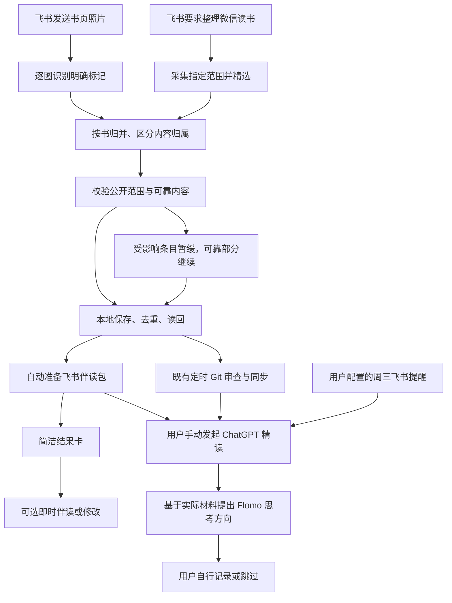
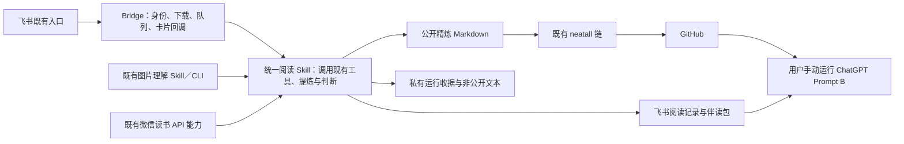
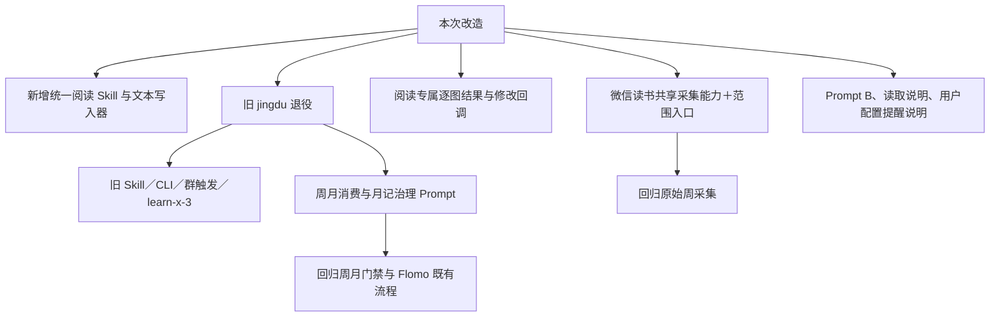

# Execution Plan｜LearnX 统一阅读沉淀与 ChatGPT 精读

- 状态：已确认（执行中）
- 最后核对日期：2026-11-03
- 上下游链接：[Requirement Truth](../../requirements/2026-11-unified-reading.md) → [Case](case.md)
- 来源：本次用户实施请求与已确认技术规划；捕获位置 `rollout-2026-11-03T15-17-38-01a1a045-4b47-7e41-a478-95ab5e251844.jsonl:341`

## 方案原文

<!-- full user source sha256: 2e232db04548ccb47dead4e8bfd04a80786f60604e623d4b3273bbfc21b2a742; chars: 6493; plan body sha256: 5770803c9de237379222d07188c881ad41e0f64dda251a465ce06ac274003dac -->
PLEASE IMPLEMENT THIS PLAN:
# LearnX 统一阅读沉淀与 ChatGPT 精读｜技术规划

## 1. 结论与事实基线

采用最小扩展：**复用现有图片与微信读书能力，新增统一阅读 Skill、按书保存的文本及伴读包，退出旧精读链路。**

本方案尚未实施、落盘或发布。实体书的真实书页识别仍须验证，不能把 OCR 成功当作全部标记覆盖成功。

本轮追加决定：

- 优先复用已有图片 Skill 和工具，不新增独立视觉服务、模型账号或通用平台。
- 周三 08:30 提醒由用户自行配置飞书自动化；工程交付文案与配置说明。
- 周日 20:00 的 `learn-x-3` 一并停用，保留历史材料。
- ChatGPT 精读始终由用户手动发起。

只读调查得到的关键事实：

| 项目 | 已核实结果 | 规划影响 |
|---|---|---|
| Git 同步 | 飞书 Base 每天 05:00 触发 group-index 群的 `neatall` 链 | 复用原机制；05:00 是启动时间，不是推送完成承诺 |
| 新文件覆盖 | `neatall` 审查未跟踪文件，审核后逐路径暂存 | 新阅读文件无需另建发布任务，但可能因检查失败而延迟 |
| 图片处理 | 当前可见 Bridge 链路输出 OCR 文本，任一图片失败会阻断整批 | 阅读流程需要逐图保留可靠结果，并验证标记信息 |
| 已有图片工具 | 已安装 `arkcli-understand`，具有图片理解与定位能力 | 作为现成能力复用；当前账户可用性和书页效果尚未实测 |
| 微信读书 | 现有 collector 仅接受 ISO 周，输出未保留条目原始 ID | 新增范围入口，保留去重所需身份，原周采集保持兼容 |
| 旧精读消费 | 周/月处理器、周度 Skill、月记受治理 Prompt 均存在消费 | 退役必须覆盖完整调用链 |
| 工作树 | Learn-X、Bridge 均有相关未提交改动 | 实施前逐项核对，保护现有工作 |

## 2. 目标架构

复杂度评分：需求中等 1、系统高 2、影响面高 2，共 **5 分，复杂档**。以下三图分别说明使用路径、系统职责和改造影响。

### 用户路径

### 系统职责

### 改造影响

## 3. 实现设计

### 统一入口与图片处理

- 新增 `learn-x-reading` Skill，承接 Prompt A 的完整语义。
- 默认使用现有 learn-x 群；逐条核验当前用户身份、发送者类型及入口，不能只信合批中的第一条消息。
- 复用 Bridge 的下载、附件限制和队列；跨批次归并交给书籍身份处理，不增加“开始／完成”交互。
- 实体书标记识别复用现有图片理解工具。OCR 只作文字辅助，不能据其非空断言划线、括号和圈注已覆盖。
- 如果现有图片工具需要本地图片引用，仅为已验证阅读入口提供受控引用；文本 Agent、普通 OCR 和其他图片业务保持原边界。
- 每张图片分别返回可靠记录、无法识别区域或失败原因。一张坏图不阻断其他可靠图片。
- 首次真实验证若表明现有工具无法满足标记覆盖，停止依赖该能力的扩展，报告具体缺口；不自动增加新视觉后端。

### 微信读书与内容契约

新增范围采集接口，输入为起止时间及可选书籍过滤，返回实际范围、书籍、划线、用户想法、稳定来源 ID、完整性与失败信息。

- “最近 3 天”定义为 Asia/Shanghai 当天及前两天，截止本次采集时刻；明确时间范围优先。
- 复用现有认证、API、分页与规范化能力，不调用整周统计冒充三天统计。
- 保留原周 collector 的接口、原始 `weread.md` 和历史归档。
- 精选由 Skill 完成；采集代码不增加价值评分或 AI 调用。
- 分别报告取得数与精选数；分页异常或部分书籍失败不得标成完整采集。
- 同名书籍确有歧义时才询问，不猜测书籍或版本。

统一记录保留：书籍及版本、来源、日期、可靠定位、核心命题、思想基石、必要疑问，以及用户明确表达的理解或行动。作者内容、AI 提炼、用户表达分别标注。

### 保存、去重与恢复

公开文本落在现有 `05_library/reading/`，按书一个 Markdown，另设轻量索引。该位置可进入公开 Git 仓库；现有 Pages 对 `05_library/` 的排除规则继续保留，无须改造站点。

非公开内容、来源映射、处理结果及交付收据放在已忽略的 `.runtime/reading/`，目录 0700、文件 0600。图片不进入阅读资产目录。

- 微信读书以原始条目 ID 派生稳定记录键。
- 实体书结合书籍、页章定位与标记文本识别重复；同图重发使用图片哈希辅助。
- 同页重拍、增加标记时，只补充新增记录。不能确定重复关系时保留待核实项，不能误删不同标记。
- 修改沿用记录 ID；同书写入串行，核对原内容哈希后原子替换，并立即读回。
- 索引由已保存书籍文件重建，避免维护另一套知识数据库。
- 公开校验在写入公开路径前完成；不公开内容不经公开目录中转。
- 写入失败保留私有待处理结果；重试复用原来源身份，不重复生成记录或重新调用模型。
- 采集 Skill 不执行 Git 暂存、Commit 或 Push。

### 飞书交付与修改

复用现有 `lark-cli` 文档及卡片能力，不新增服务。

- 每本书维护一份飞书阅读记录视图；每次采集生成本批伴读包，两个入口均不依赖 GitHub 推送。
- Docx 写入使用 bot 身份，写后读取正文验证；本地文本是阅读记录的保存依据。
- 结果卡只显示书名、来源、识别数或精选数、核心内容、真实保存状态及三个入口。
- “修改”复用现有签名回调，绑定记录 ID 和版本。提交后更新本地、飞书视图与伴读包，并读回。
- 旧版本修改遇到冲突时展示当前内容，不能覆盖后续修改。
- 本地已保存、伴读包可获取、卡片已送达分别记录。任一交付失败只恢复对应步骤，结果不明先查证，不盲目重发。
- 撤销当前记录可移出本地公开范围；若已公开，准确说明历史仍可能存在。

### ChatGPT 与旧流程退役

Prompt A/B/C 完整保留，不用工程摘要替换正文。

Prompt B 配套读取说明指向固定 GitHub 阅读索引：先取得索引，再读取最近七天涉及的书籍记录；单本、多本及章节请求按用户范围读取。说明实际取得的路径、日期及提交版本；无法取得新增内容时使用用户提供的飞书伴读包，不声称读到本地未推送内容。

每周输出按 Prompt B 验证：建议通常 2～5 条、每条约 50～160 字、每段不超过 80 字；材料不足时减量。无 Flomo 自动写入接口。

退役包括：

- 旧精读生产、飞书审阅、相关群路由和有副作用 CLI 入口。
- `learn-x-3` 周日自动化。
- 活跃来源配置、周/月聚合及月记 latest Prompt 中的 `jingdu` 消费。

保留历史文件和侧车解析兼容；拒绝新的旧式登记。旧 `ready` 文件或缺侧车文件都不能重新进入新产物。原始 WeRead、Flomo 和其他周度自动化不变，也不把新阅读记录另接为重复的周输入源。

## 4. 最小里程碑与验收

| 里程碑 | 实施内容与证据 | 停止及回退 |
|---|---|---|
| **M0 文档基线** | 保存需求原文、完整方案、追加裁决及 Case；核对工作树并读回 | 来源缺失或冲突则停止，不开始业务修改 |
| **M1 真实照片纵向路径** | 真实飞书书页 → 现有图片工具 → 标记记录 → 本地读回 → 手机可取得伴读包及卡片。覆盖划线、括号、圈注、未标记正文与一张坏图 | 标记覆盖不成立则停止扩展；只撤回本次阅读入口改动，保留证据 |
| **M2 微信读书统一接入** | 三天及指定范围、精选、稳定去重、多书归并；原周采集回归 | 范围或完整性异常保留旧文件，不登记成功 |
| **M3 修改与故障恢复** | 修改、撤销、并发、非公开内容、断点及交付失败恢复 | 版本冲突不覆盖；按已确认哈希恢复本次变更 |
| **M4 切换与退役** | 停用旧触发，阻断旧消费，联动月记治理 Prompt；验证新 ChatGPT 读取说明 | 停用新入口可止损；不自动恢复旧生产，不删除历史 |

M1 必须先取得真实证据，再扩展 M2～M4。测试照片及外部测试写入范围在实施授权中明确；本轮没有上传图片或运行该路径。

验收以用户可观察结果为准：

| 验收 | 对应需求 | 前提 → 用户动作 → 可观察结果 |
|---|---|---|
| ACC1 | R1、R2 | 提交真实标记书页 → 自动处理 → 全部可辨认标记有对应记录，模糊处单独说明 |
| ACC2 | R1、R2 | 发起默认或指定范围微信读书整理 → 采集精选 → 实际范围、取得数、精选数准确 |
| ACC3 | R3 | 同图、同页重拍或重叠日期再次提交 → 自动归并 → 无重复、无误删，本地读回一致 |
| ACC4 | R3 | 明确要求不公开 → 自动保存 → 公开文件、索引及构建均无该内容 |
| ACC5 | R4、R5 | 本地尚未推送 → 手机打开结果卡 → 阅读记录与本次伴读包已有实际正文 |
| ACC6 | R5 | 点击修改并提交 → 更新 → 同一记录及相关视图读回一致，旧版本不能覆盖新版本 |
| ACC7 | R6、R7 | 用户配置提醒并手动发起精读 → ChatGPT 取证分析 → 范围如实、建议有具体依据，无 Flomo 写入 |
| ACC8 | R8 | 放置旧 ready／无侧车 `jingdu` 并运行新周月流程 → 生成材料 → 旧精读不被消费，其他来源正常 |

针对性反例：混合发送者合批、普通照片、同页新增标记、分页游标停滞、写入中断、伴读包创建失败、消息提交结果不明、修改版本冲突及旧消费者绕过。

已运行的基线验证与未来验收分开记录：

- Learn-X 采集及来源相关测试 **30/30** 通过。
- Bridge OCR、Prompt、附件与回调相关测试 **26/26** 通过；主 Agent 抽查复跑其中 **9/9**。
- 较大的 Process 测试集 **47/49**，两项为现有文本契约不匹配，实施前需确认归属。
- 新流程、真实书页、手机访问和 ChatGPT 完整读取路径均**尚未验收**。

## 5. 落盘包与执行边界

目标仓库：`/Users/yuwei/code/learn-x`  
Case：`2026-11-unified-reading`

M0 保存三份文档：

- [Requirement Truth](/Users/yuwei/code/learn-x/docs/requirements/2026-11-unified-reading.md)：完整用户原文、R1～R8 基线与本轮追加决定。
- [Execution Plan](/Users/yuwei/code/learn-x/docs/cases/2026-11-unified-reading/execution-plan.md)：本方案全文及 Execution Handoff。
- [Case](/Users/yuwei/code/learn-x/docs/cases/2026-11-unified-reading/case.md)：来源索引、授权范围、里程碑、实际证据与下一停止点。

以上路径均为**待保存目标**。

需求完整来源已定位到当前会话原始消息：会话 `01a1a045-4b47-7e41-a478-95ab5e251844`，本地 rollout 文件第 15 行，唯一标题锚点为本次 Requirement Truth 标题，正文 11,380 字符。M0 从原始消息捕获，不能用摘要重建；本方案从同会话最终方案消息完整捕获。

Execution Handoff 核对六类内容：已确认决定、限制、未知、调查证据、相关模块、易误解事项。重点保留图片能力尚未实测、工作树已有改动、05:00 仅启动同步链、用户自行配置提醒，以及旧月记消费位于飞书真源。

新增 ADR 只记录已确认的职责与切换决定；Architecture Truth 在真实实施完成后更新。当前不修改文件、自动化、Git 状态或飞书正文。未来代码实施与停用旧自动化、发布受治理 Prompt 等外部变更分别按实际授权执行。

会话标题：LearnX 统一阅读沉淀与 ChatGPT 精读｜技术规划

## Execution Handoff

### 用户已确认的关键决定

- 复用现有飞书图片理解链路；不新增独立视觉服务或模型账号。真实书页验收不通过时停止该路径并报告。
- 周三 08:30 飞书提醒由用户自行配置；用户手动发起 ChatGPT 精读。
- 周日 `learn-x-3` 旧精读自动化一并停用，历史材料保留。
- 本次实现不 Commit、不 Push；真实推送须有固定远端 ref 读回证据。

### 重要背景与限制

- Learn-X 及 Bridge 在实施开始前均有未提交修改。开始每个切片前须对照工作树，只改本次可归因的最小范围。
- `/Users/yuwei/code/lark-channel-bridge` 是独立仓库；其图片下载/消息路径改动须按当前 repo 的规则与用户工作树边界单独核对。
- 飞书文档使用 `lark-cli` 且 Docx 写入身份固定为 bot；受治理月记 Prompt 必须发布到飞书真源并写后读取验证。
- Learn-X 公开文件在 `05_library/reading/`；`.runtime/reading/` 受 Git 忽略，图片不进入资产。
- 05:00 是飞书 Base 启动的每日审查提交链；不承诺 05:00 已推送完成。

### 关键假设与尚存未知

- 当前日常图片入口是否已经提供全部书页标记识别：未知，M1 真实书页测试是硬门禁。
- 已安装 `arkcli-understand` 的账户与配置是否在真实阅读入口中可用：未实测；先定位并复用用户所指的现成 Skill。
- 本轮无法替代真实手机发送与多张连续图片的验收；若现有路径没有真实凭据，暂停相关门禁。
- 新书的同页重拍去重需基于稳定定位与文本；证据不足时保留为待核实，不自动合并。

### 已完成调查或 Spike 的结果及证据

- 实施前：Learn-X `git status --short` 显示已有多处工作区改动；Bridge 工作区亦有多处改动。原始清单仅作为会话证据，执行中须重新读取。
- 只读基线：WeRead collector、来源状态与 weekly input 定向测试 30/30 通过；Bridge 相关测试 26/26 通过，协调者复跑 9/9。
- Process 扩展基线 47/49；两项文本契约失败在实施前已观察到，须复验并区分归属，不可为变绿改弱测试。
- 现状发现：旧 `jingdu` 被周/月 Process 与受治理 `learn-x.monthly-journal` latest 消费；更新本地 wrapper 不足以停用该消费。
- 现状发现：`05_library/` 可进入公开 Git 同步但从 Pages 排除；保持该私人站点过滤规则。

### 相关文件、模块、接口和外部资料

- Learn-X 范围采集：`.agents/skills/learn-x-input/scripts/collect-weread-weekly.mjs` 及同目录 `lib/source-status.mjs`。
- Process 来源过滤：`.agents/skills/learn-x-process/scripts/collect-weekly-input.mjs`、`monthly-process-input.mjs`。
- 旧精读：`.agents/skills/learn-x-jingdu-review/`、`.agents/skills/learn-x-weekly-automation/`、`.agents/skills/learn-x-monthly-automation/`。
- Bridge 图片入口：独立仓库 `lark-channel-bridge/src/media/image-ocr.ts` 与 `src/bot/channel.ts`；其已有工作区改动先逐文件审查。
- 现有图片工具：已安装 `arkcli-understand` Skill；不得据安装存在声称账户、模型或图片识别已经验收。
- 受治理月记真源：`learn-x.monthly-journal`；只用共享治理发布器读取 latest、基于 revision 更新并写后读回。

### 执行中容易误解的重要信息

- 原始 11,380 字用户需求保留在 Requirement Truth 的“来源原文”；不要用该摘要重写来源。
- 本文件“方案原文”完整保存了用户本轮 6,493 字实施指令；不要只保存聊天摘要。
- 可靠部分继续处理仅适用于阅读专属图片分支，不能改变其他 OCR 业务的一图失败即整批失败语义。
- 新阅读不另接成周输入来源。退役 `jingdu` 时保留其读取兼容，以免旧侧车破坏其他周/月来源。
- `M1` 先于 WeRead 与退役：未经真实标记覆盖及可观察结果证据，不扩展到后续依赖路径。
- 用户自行配置周三提醒；不得代用户创建提醒工作流。

## 实施更新（2026-11-03）

本节记录用户在实施阶段的直接修订与本地执行状态；上方完整方案原文保留不变。

### 用户后续裁决

用户明确要求加速实施，同时把实体书照片、OCR 文字后的标记识别、圈注/划线视觉覆盖整块暂缓，之后由用户自行研究优化。该指示优先于上方 M1→M4 的顺序要求：本轮跳过实体书入口和视觉 Skill，不上传真实照片，不声称识别能力验收。冻结 Requirement 中的实体书目标保留，等待用户后续重新开启。

### 已落地的本地切片

- 新增 WeRead 最近三天/指定日期与时间范围 collector，保留采集范围、稳定 WeRead 来源 ID、实际取得数、分页停滞及不完整结果；原 ISO 周 collector 接口不变。
- 新增 WeRead-only `learn-x-reading` Skill 与按书保存器：公开精炼 Markdown 位于 `05_library/reading/`，索引为 `_index.md`；私有状态、收据、待处理结果和伴读包位于 `.runtime/reading/`。支持去重、原子写入、读回、pending 重试、按当前版本修改和本地撤销；不提交或推送 Git。
- Learn-X `AGENTS.md` 增加 WeRead 路由：仅当前已验证用户在 learn-x 群发送单条原始文本并明确要求整理微信读书时，读取并执行新 Skill；图片/附件和旧 `jingdu` 流程不触发。群 `GROUP_INFO.md` 由官方生成器更新，列出新 Skill。Bridge 真正触发仍需真实消息验证。
- 新增 ChatGPT 每周精读 Prompt 与 GitHub 索引读取说明、用户自行配置的周三提醒文案。
- 已在“系统使用知识库”创建飞书 Usage Truth 页面 [Learn-X 阅读沉淀与 ChatGPT 精读使用说明](https://ywhome.feishu.cn/docx/HQL8dxOGuoacHUxAhvPcQ770nfh)，由 Bot 创建并读回正文（revision 3）；导航首页更新至 revision 23 并读回确认入口，README 核心资产区添加链接。该说明明确照片/OCR/视觉标记暂缓和真实阅读链路尚未验收。
- 旧 `jingdu` 从活跃来源配置退出；周输入与月度收集器排除历史 `jingdu.md`，周 Process 状态/来源表也过滤旧状态。旧写入 CLI fail-closed、source-status CLI 拒绝新 `jingdu` 登记，历史读取兼容保留。`learn-x-3` 已暂停并读回。
- 新增 ADR 0003；Architecture Truth 描述当前真实支持范围和缺失的 Feishu/远端链路。

### 未完成与明确边界

- Learn-X 群路由、每书阅读记录 Docx、伴读包、卡片与签名修改回调的本地运行步骤已进入项目 `AGENTS.md` 和新 Skill；Bridge 有可复用的签名卡片回调实现。Usage Truth 说明页已创建并读回，但仍未真实触发 WeRead 消息、创建/读回阅读记录 Docx 或结果卡，不能代称 R4/R5 已验收。
- ChatGPT 对已推送文件的实际读取、用户真实 WeRead 数据的端到端采集和飞书结果卡/伴读包读回均未运行。本轮未采集或公开实际书目内容。
- `learn-x.monthly-journal` 最新治理 Prompt 两次官方发布器写入均返回非结构化 CLI 错误，远端只读核验仍是 revision 3 / SHA-256 `6549cf26d0bda5be9b663eaa64365b52508a6108c4fbad1bdf7e59e44842b045`。使用无真实目标的隔离 dry-run 确认当前 CLI 接受发布器使用的 `--format json` 参数；dry-run 只证明参数和 Markdown 可解析，不证明目标文档或 bot 的读写权限。同轮 `auth status` 显示有效身份为 user，user-token 检查报告缺少 `docs:document.write_only`，bot 专属 scope 未独立核实，因此不能据此断言写入失败根因。已停止继续写入。待发布候选只删除旧 `jingdu.md` 规则，SHA-256 `3e91b14dbeb344ffb1ee538302483580040e5617cb792bc9158ece92b8c063f1`，位于权限受限临时目录；未改受治理备份。运行时月记 Skill 已加 fail-safe 规则，跳过历史 `jingdu.md`。
- 用户自行配置周三提醒；本轮没有创建该自动化。未 Commit、Push 或部署。

### 本轮验证

- WeRead 范围采集、保存器与 mock 贯通：23/23；原周采集兼容：7/7。
- WeRead、来源状态、周/月 Process 与旧精读编排合并回归：60/60。
- Learn-X Input 与 Reading Skill quick_validate：均通过；`git diff --check`：通过，无输出。
- 周 Process Pack 改动关联的聚焦测试：3/3。扩展测试中另有 2 个既有文本契约失败（Stage 3 周自动化 Skill 断言、Weekly Output Prompt 标题断言），实施前基线已经存在；没有修改或弱化这些无关断言。
- 所有代码测试使用隔离临时目录。真实飞书、真实阅读数据、GitHub 同步和图片路径均未验收。

### 当前停止点

下一步对 WeRead-only 飞书真实用户路径做验收：触发路由、每书 Docx 写后读回、伴读包与结果卡送达、签名修改回调及状态收据。月记受治理 Prompt 先查明发布器失败原因和 bot scope 取证方式，再评估是否恢复官方发布；不盲目重试或绕过发布器。整体保持部分达成，直到飞书真实用户链路读回完成。

## 实走增补｜真实 WeRead 与飞书交付（2026-11-03）

本增补记录用户在执行中要求模拟本人操作、真实发送飞书消息并完整走链路后的证据；它更新上方实施状态，不改写冻结需求和方案原文。实体书照片、OCR 和圈注/划线识别仍按用户决定跳过。

- **真实触发：** 以已验证用户身份在 Learn-X 群发送“整理最近 3 天微信读书划线和想法”，飞书返回成功，随后按群消息 ID/发送者/原文回读一致。群内没有自动返回阅读处理结果，随后可见的 app 回复是 MoonBridge 本地模型预检失败提示；阅读 Skill 由 Codex 手动接续执行。因此，本次证明真实消息发送和数据处理，不证明 Bridge 自动路由完成。
- **网络：** `/Users/yuwei/.codex/config.toml` 已添加 `**.qq.com` 域名规则。当前运行时仍出现 `notebook-page-1: fetch failed`；经用户授权的单次只读 collector 运行后成功。该现象表明当前沙箱未自动热加载新规则，后续需新运行时验证直连白名单生效。
- **真实采集：** Asia/Shanghai `2026-11-01 00:00:00` 至 `2026-11-03 17:30:53`，`complete=true`，取得 1 本书、10 条划线、0 条个人想法、0 个错误。按书精炼选取 5 条；本次无用户明确表达的个人想法。
- **本地沉淀：** 5 条精炼转述写入 `05_library/reading/`，索引同步更新；公开 Markdown 不含原始划线或用户想法。私有 inbox、伴读包、来源/交付收据保存在 `.runtime/reading/`，文件权限 0600。立即读回通过；同一批次再次运行新增 0、去重 5。未执行 Git add/commit/push。
- **飞书交付：** [本次阅读记录与伴读包](https://ywhome.feishu.cn/docx/WMzwdSLIVoYfLrx04Qwcv3Bancf)由 Bot 创建并授予当前 CLI 用户 full_access；以用户身份读回确认范围、采集/精选数、5 个记录 ID、核心观点、伴读 Prompt 和修改入口。结果卡由 Bot 在目标群发送并读回，书名、来源、数量、本地状态、GitHub 未验证提示、文档链接与文字修改入口均匹配。手机 UI 未实测。
- 飞书 [Usage Truth](https://ywhome.feishu.cn/docx/HQL8dxOGuoacHUxAhvPcQ770nfh) 更新至 revision 4，修正真实数据、文档和卡片已通过的验收状态，并保留自动路由、手机界面和 GitHub 同步未验证边界。
- **尚未验收：** Bridge 自动群路由；实际手机 UI；GitHub 既有任务推送和 ChatGPT 远端读取；修改/撤销的真实飞书交互；月记受治理 Prompt 的官方发布器失败。当前回复会基于真实阅读记录完成一次手动精读并提供 3 条 Flomo 思考方向；这不验证 GitHub 读取路径。未创建周三提醒，未写 Flomo，未 Commit/Push/部署。

## 后续实走增补｜Bridge 自动触发通过（2026-11-03）

本节更新上一节之后的真实状态，第一次触发失败与手动接续记录保留为历史。上一节“尚未验收”和“当前停止点”是第二次自动触发之前的状态快照；本节对 WeRead 自动路由和本地飞书交付的证据覆盖该快照。用户再次要求模拟本人操作并完成端到端 WeRead 路径；实体书照片、OCR 与标记识别继续按用户指示跳过。

- **运行时排查：** MoonBridge 后续只读状态显示 `moonbridge-deep` 容器与本地 endpoint 均健康（`127.0.0.1:38441`）；`deep` daemon 运行中。第二次触发期间的 `/status` 显示任务 active，队列 `1/15 active, 0 waiting`，最终自动结果卡随后到达。第一次预检失败的具体容器退出根因仍未知。
- **网络配置：** 按用户要求为 Codex 的受控网络配置加入 `**.qq.com`（覆盖 qq.com 主域及子域）规则，并启用网络代理；MoonBridge deep Codex profile 也加入 `**.qq.com`、`**.feishu.cn` 与 `network_access=true`。配置读回及 Codex 配置解析探针通过。但第二次任务的运行状态显示 `danger-full-access`，并非 `workspace-write` 网络代理沙箱，因此这次成功不能作为该白名单规则实际生效的证明。未用 `*` 扩大其他域名。
- **第二次真实触发：** 以已验证用户身份向 Learn-X 群发送“整理最近 3 天微信读书划线和想法”，消息 ID `om_x100b61aeb00d14a8df8ff8552c0fbc4`；发送后按 ID 读回，正文和发送者匹配。Bridge 自动运行 `learn-x-reading`。起始 `/status` 曾报告正在处理，等待后收到自动结果卡 `om_x100b61af575f58a8df7a6a10fc3b91b`（“WeRead 整理完成”），本次没有 Codex 手动接续。
- **真实 WeRead 结果：** 自动卡报告 Asia/Shanghai `2026-11-01` 至 `2026-11-03 17:57`、`采集完整`、1 本书、10 条划线、0 条个人想法、精选新增 5 条、去重 5 条。补充批次实际截止 `2026-11-03 17:57:55`，来源批次 ID `weread-d2a7a11c7e67c666b3a05b76`。这与第一次手动接续批次合并后形成同一本书 10 个唯一来源记录。
- **飞书交付：** 自动更新的[阅读记录与伴读包](https://ywhome.feishu.cn/docx/WMzwdSLIVoYfLrx04Qwcv3Bancf)以当前用户身份读取到 revision 4；正文含两批累计的 10 条记录、伴读包和修改说明。自动结果卡读回显示本地已保存和 GitHub 未验证，飞书文档可直接取得本批伴读包，不依赖推送。手机 UI 与真实修改/撤销交互仍未验收。
- **使用说明读回：** 飞书 Usage Truth 页面由 Bot 将验证边界从 revision 4 更新至 revision 5；当前用户身份读回确认已记录第二次自动触发成功，同时保留手机 UI、真实修改/撤销及 GitHub 同步未验收边界。
- **本地读回：** `05_library/reading/智人之上-从石器时代到-ai-时代的信息网络简史-9caf1d8b252669ea7152.md` 与 `_index.md` 均存在；按文件提取 10 个唯一 WeRead 来源 ID，未发现重复 ID。`.runtime/reading/delivery-state.json` 为有效 JSON，文件权限 0600，运行目录权限 0700；阅读公开目录中没有图片。没有 Git add/commit/push。
- **终态边界：** 至此 WeRead 飞书消息 → Bridge 自动 Skill → 真实采集与精选 → Learn-X 本地去重保存/读回 → 飞书阅读文档、伴读包与自动结果卡读回完成一次完整实走。GitHub 尚未同步，ChatGPT 从远端读取未验；本次可依据本地阅读文件和飞书伴读包做精读，但不能声称远端已读取。周三提醒由用户自行配置，未写 Flomo，未创建提醒、未提交或推送。实体书识别暂缓；月记治理 Prompt 发布器故障仍待定位。

## 加速续作与独立验收（2026-11-03）

本节更新当前代码和验收状态；保留上方 M0/M1 规划及真实 WeRead 链路记录。用户明确授权实走飞书操作；本轮继续保留照片识别暂缓、无 Git Commit/Push、无 Flomo 写入。

- **完成批次重放修复：** `store-reading.mjs` 现在核对已完成收据对应的书籍与来源 ID，验证保存记录的来源指纹，复用首次已读回伴读包；完成收据与残留 pending 同时存在时也保持幂等。不同源身份或回执不一致会停止，不覆盖已保存内容。收据记录首次 `collectedAt`，避免重放时仅因日期变化改写书籍 Markdown。
- **补齐修改回写指引：** `learn-x-reading/SKILL.md` 明确按 delivery-state 找到当前书籍 Docx，按 recordId 唯一定位，使用最新 revision 局部替换目标记录区块，回读后再更新本地 delivery-state；冲突、歧义、未确认结果均停止，不盲目重发。通过只读查询确认真实 Docx revision 4 中可按一个 recordId 找到唯一段落及其邻近记录区块；未对真实阅读记录作修改。
- **本轮自测：** Reading Skill + WeRead range 测试 23/23 通过；旧 WeRead 周采集、周/月 Process、旧 Jingdu 调度与过滤合并回归 60/60 通过；`skill-creator` quick_validate 显示 Learn-X Reading Skill 有效。
- **月记 Prompt 仍未发布：** 官方 `publish-prompt` 以 base revision 3 尝试一次，返回 `unstructured_cli_error`；发布器完成单次只读查证，远端 revision/hash 仍为 rev3 原值。假文档 dry-run 仅证明 CLI 参数可解析，`auth status` 显示 bot/user identities 均 ready 但没有 bot scope 证据；根因未知，不重试、不绕过 publisher。候选哈希仍为 `3e91b14dbeb344ffb1ee538302483580040e5617cb792bc9158ece92b8c063f1`，没有修改受治理本地备份。
- **飞书 UI 验收当前阻塞：** 用户明确授权模拟其操作并发送消息。macOS 飞书桌面返回锁屏；Ego Lite 浏览器可以访问飞书文档首页，但 Learn-X 群深链跳到 404。没有发送第二条重复触发消息。已将 Ego Lite 任务空间 7 交还用户，待解锁后继续同一空间。前一轮真实 API/Bridge 消息、WeRead、本地保存、Docx 与结果卡读回仍成立，但不能代替本轮要求的 UI 实走。
- **当前结论：** 部分达成。解锁后的下一步是在任务空间 7 通过飞书 UI 发送同一 WeRead 请求，观察自动结果卡和文档读回；其后 GitHub/ChatGPT 远端读取仍需既有任务实际推送，修改/撤销仍需一次真实可控交互验证。实体书图片识别不在当前执行范围。

## 后续实走增补｜飞书 UI 复触发与幂等分支（2026-11-03）

用户随后明确授权模拟本人操作、打开飞书并发送 WeRead 请求。以下增补覆盖上一节当时的 UI 锁屏状态；不改写完整方案，也不扩大到照片识别、Git 发布或 Flomo 写入。

- **飞书 UI：** 在 Ego Lite 任务空间 7 打开已登录的 `https://ywhome.feishu.cn/next/messenger/`，确认目标会话为 Learn-X 群。编辑器中的文本经去除飞书零宽占位符后与“整理最近 3 天微信读书划线和想法”完全一致，按 Enter 提交一次。界面读回该消息；没有重复提交。
- **自动路由：** 群内 Bridge 显示 command_execution，最终回复“已整理过：这 3 天没有新增内容”。该回复属于本次新触发；旧的“WeRead 整理完成”结果卡是此前批次，未拿旧卡冒充本次结果。
- **真实 WeRead 快照：** 本地 `.runtime/reading/weread-range-latest.json` 的文件 mtime 为 `2026-11-03T11:55:21.891Z`。只读读取其元数据确认时区 Asia/Shanghai，范围 `2026-11-01 00:00:00` 至 `2026-11-03 19:55:21`，`complete=true`，1 本书、10 条划线、0 条个人想法、0 个不可用条目、0 个错误。
- **本地幂等：** 当前快照有 10 个来源 ID，本地已保存状态也有 10 个来源 ID；集合交集 10、新增 0。本地公开文件和索引仍是 10 条，未重复、误删或改变。由于无新记录，本次没有新建批次回执、重写飞书 Docx 或另发结果卡；现有文档和伴读 Prompt 已通过飞书 UI 打开，既有结果卡保留在会话历史。
- **白名单边界：** 用户要求的 `**.qq.com` 已在 Codex config 中读回，但 workspace-write shell 对 `https://i.weread.qq.com/` 的只读 HEAD 仍返回代理层 `403 blocked-by-allowlist`。实际 WeRead 获取是通过被触发的 Bridge Skill 完成，不证明当前 shell 的网络规则已刷新。没有用提权网络请求访问 WeRead；需新 Codex 运行时后再验证直接 shell 访问。
- **新鲜验证：** Reading Skill 与 WeRead range 测试 23/23 通过；周采集、来源状态、周/月输入和旧 Jingdu 编排回归 60/60 通过；Learn-X Reading 与 Input Skill quick_validate 均显示有效；`git diff --check` 无输出。
- **剩余边界：** 本次无新增内容，所以新内容对应的结果卡和 Docx 更新没有重复验；真实修改/撤销、GitHub 远端读取及月记受治理 Prompt publisher 仍未完成。照片识别、周三提醒、Flomo、Commit/Push 和部署不在本轮操作中。

## 2026-11-03 后续执行记录｜GitHub 与 ChatGPT 远端读取

在用户明确授权完整实施与端到端操作后，为验证计划中的 ChatGPT 固定索引路径，只向公开 GitHub main 写入 05_library/reading/ 下的索引和单本阅读文件。写入前逐项审阅公开文本；在 /private/tmp 隔离仓库只暂存这两个目标文件，仓库 scripts/security-scan.mjs 对 2 个文件通过，git diff --cached --check 通过。未改本地主工作树 Git index、分支或其他文件。

网络代理使 rtk git ls-remote 连接 127.0.0.1:8118 失败；随后通过已连接 GitHub 工具执行两次顺序 create-file 写入，并在每次后读取确认。书目提交 2ec4d3cd25f45d9e2601d159472b0c49fd436081，索引提交/最新 main 头 dba6d1e31e71031d7ef4e995d287949f9c879b28。GitHub 返回的 Blob SHA 与本地 git hash-object 一致：书目 f2ada0587c1a1242642d397b892d33a44355d582，索引 2341ed4c225d5c9cd69d1adcdb462b201ed1812b。固定索引现可读取一书 10 条精选。

随后在 ChatGPT 当前对话入口从 GitHub main 索引读取书目，实际范围是《智人之上 ——从石器时代到 AI 时代的信息网络简史》第一章、2026-11-01 至 2026-11-03、10 条精选、0 条用户想法，并依 Prompt B 提供深度分析与四个 Flomo 思考方向；没有自动写入 Flomo。

这是本次授权范围内的一次性 GitHub 发布，不等于原定时 neatall 同步成功。当前本地 master 跟踪 origin/master，而固定 ChatGPT 索引在 main；neatall 还会因未跟踪的 parse-session.mjs 路径命中整仓敏感路径门禁，工作树含大量并行未提交改动，故没有运行整仓提交。例行同步分支对齐及未来新增记录可达性仍待处理。真实阅读修改/撤销、月记治理 Prompt 发布仍未验收；实体书照片按用户要求暂缓.
