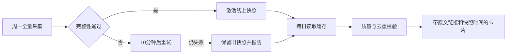
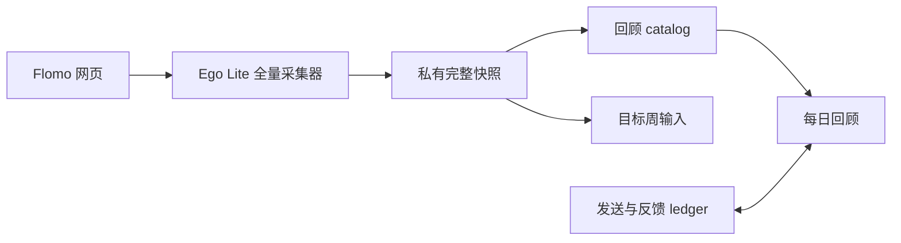
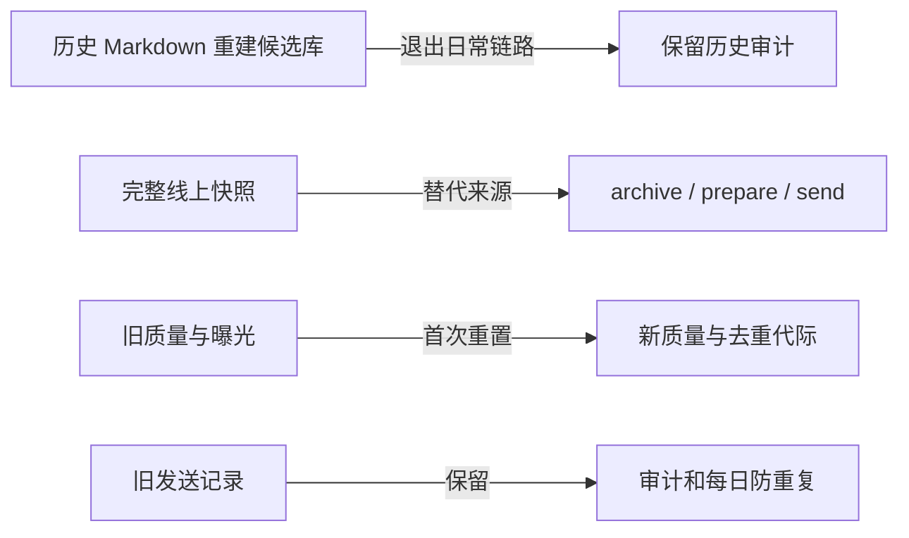

# Requirement Truth｜Flomo 每日回顾推荐

- 状态：已确认
- 最后核对日期：2026-10-07
- 上下游链接：[Case](../cases/2026-10-flomo-daily-review/case.md)
- 来源与确认依据：当前用户请求及“Implement the proposed plan.”

## 来源原文

flomo 笔记入库，每天推荐 3-6 个适合回顾的结合近期周报，要求一周内每天都不能有重复。

我记得之前存量可能有全量的，不过每天或每周好像还会爬取增量。

基于这个，每周会更新一个存量的Flomo笔记，我觉得这样比较好，不用自己去爬。这个是在每周learnx自动化里面的。总之得研究一下，有没有一个最好的一个方式，就是针对这个Flomo笔记。然后具体的需求就是每天推荐3~6个适合我回顾的，当然要结合近期的周报上下文，有周记周，哦，不是周报，应该是OutPut。周的OutPut和月的OutPut的一些上下文来推送。并且还要要求一周内每一天就这一周内不能推荐同一个笔记，就重复的不能。然后推荐的数量取决于质量，就是推荐的，一方面是要匹配我近期的OutPut。另一方面还得质量高，不能强行推送。一些质量低的，就为了凑数。周和周之间最好也有一定的，就是重复也不能超过5个。当然。一个月后是支持重复的。就是一个月内，就四周之间，重复的不能超过10个吧。但一个月后就没有这个限制了。我这里的个都是针对笔记数量。你使用余伟计划来设计整个方案。

## 需求基线

R1：复用现有归档建累计私有库，每周增量补充，日推荐不爬取。
R2：每天20:00 Asia/Shanghai正常推荐边界为5–7条，整体平均目标6条，质量硬门槛；数量按质量和近期Output匹配度决定，不为达到6条凑数。若只有5条同时满足质量与对应序号上下文要求，可按实际数量推送并说明不足原因；不足5条报告未达标，不降质。
R3：同ISO周零重复；当前及前三ISO周中任意两周交集≤5，额外重复投放≤10；窗口外解除限制。
R4：整周软年龄目标：近30天20–30%，近365天合计80–90%，更早通常10–20%。
R5：整条排除learn-x及子标签和生成内容；身份稳定，原文可追溯。
R6：最近4周+2个月Output、实时正式道、活跃Memory及个人理解文件作为背景。
R7：本人飞书群推送Card 2.0并保留本地完整原文审计；消息Card读回、持久幂等和不确定结果不自动重发；历史Markdown批次保留只读恢复。
R8：本地私有反馈记录，关联本人明确回复，不改认知真源。
完整规则以已确认[方案](../cases/2026-10-flomo-daily-review/execution-plan.md)为准；ACC1–ACC9与对应R在验收记录关联。

## 用户追加确认

2026-10-06：用户明确请求实施上一条完整方案，原文：

Implement the proposed plan.

2026-10-07：用户明确授权按原方案配置每日推送，并指示最新方案数量为5–8条：“明确授权，然后方案细节其实已经改了，是 5~8 条吧，反正你要按照最新的方案来。”仅数量目标更新；低质量不凑数、同周与四周去重、本人群与完整Markdown附件等其余约束沿用原方案。5条/日容量门槛据此更新为7日35条、28日130条合格独立笔记。

2026-10-08：用户确认数量改为每天最少5条、最多10条、平均7–8条；外发改为Card 2.0，每条不显示“创建日期：”和“原文见随附Markdown”前缀，日期保留但用小字，本地仍保留完整原文审计。

2026-10-10：针对 M1 侧栏计数核实，用户确认“951 是当前独立 memo 总数”。来源为当前线程直接答复，消息 ID：01a12391-dcdd-7ed2-8264-ff9dd87d2ac0。

2026-10-11：针对 `/mine` 稳定显示 951 条卡片、950 个不同 ID 的差异，用户裁决“漏几个没啥问题，继续推进”。允许继续使用有少量未枚举笔记的线上快照；遗漏数量与覆盖率必须在快照、预览及每日来源状态中明示，不得宣称零缺口。实现默认将可接受计数缺口限制为最多 3 条；每张已观察卡片仍必须有有效 ID、创建时间和完整正文，ID 冲突、缺 ID、缺正文、分页未稳定或缺口超过上限继续失败关闭。3 条是本轮保守实现默认值，当前实测缺口为 1 条。

2026-10-12：用户针对周输入未生成直接裁决：“预计 951 个 ID，观测到 950 个，缺 1 个；未生成 `flomo.md`。同类契约告警已连续两周。缺10个以内都没啥问题呀，为什么不生成呢？”因此将可接受的计数缺口上限从 3 条调整为最多 10 条；旧的 3 条是临时保守默认，现由本决定取代。快照、周输入状态、预览和每日来源状态仍须展示预期数、观测唯一 ID 数、遗漏数和覆盖率；每张观察卡片仍必须具备有效 ID、创建时间与完整正文，ID 冲突、缺 ID、缺正文、分页未稳定或遗漏超过 10 条仍失败关闭。来源：Learn-X 周自动化线程 `01a12cc5-2a5e-76a3-a89f-987d759199af`，用户消息 `01a12d8e-643c-73e1-b3c6-77ba096bc4a9`。

### 2026-10-09｜线上全量快照方案与实施授权

用户明确授权实施以下完整方案；该版本将“线上完整快照”设为日常回顾候选库来源，替代旧版“历史归档＋周新增”路线。旧方案、原始归档与发送审计均保留。
来源为当前会话中用户直接提交的完整纯文本消息，稳定消息 ID：msg_01a120a5-c8f5-7363-a7a3-2d2aba80077d；原始会话：/Users/yuwei/.codex/sessions/2026/10/09/rollout-2026-10-09T20-15-28-01a12096-fe99-7c60-8c52-d51d0ad7b241.jsonl（第308行）。

PLEASE IMPLEMENT THIS PLAN:
# Flomo 线上全量库与每周同步方案

## 1. 目标与已确认决定

将每日回顾的数据源改为 **Flomo 线上完整快照**，从根源上解决历史归档缺 ID、正文陈旧的问题。

本次调查确认：本地 646 条笔记中，572 条缺 ID。昨天的补采仅保存了 949 条“ID＋时间＋正文哈希”，没有保存正文；现有匹配也受到秒／分钟精度差异影响。

按你的裁决实施：

- 首次重建使用线上正文和真实 ID，重新评质量、重新计算推荐去重；此前推荐过的笔记允许再次出现。
- 每周全量同步，平日读取最近成功快照。旧笔记修改、删除在下一次成功同步后体现，**不承诺实时更新**。
- 同步失败允许继续使用旧快照，但明确显示快照时间。
- 采集失败后延迟 10 分钟重试。
- 原始历史文件、旧库与发送记录保留备份；不修改线上笔记。

杠杆点已确认：把线上快照作为回顾库的正文与身份来源，停止用历史 Markdown 重建每日候选库。无需新增服务、数据库或其他平台。

## 2. 核心实现

### 完整扫描与快照

复用现有 Ego Lite 采集器，增加全量模式。全量模式遍历至真实结束，不沿用目标周下界或固定 2020 年起点作为结束条件。

必须补齐以下校验：

- 等待初始加载完成；不能把刚打开时的空列表认定为全量空库。
- 检查每张非编辑器卡片的 ID、时间、正文；缺 ID 不得静默跳过。
- 合并普通笔记和置顶笔记，按 ID 去重；不同 ID 的同文笔记保留独立身份。
- 修复分页等待，确认加载完成、无后续页、再次滚动后 ID 集稳定，才能结束。
- 验证长文完整性。折叠不能直接解释为正文缺失或完整，须通过展开与详情对照确认提取方法。
- 同 ID 在扫描期间出现冲突正文、达到容量限制、超时或无法确认结束时，本轮失败。

完整结果保存 ID、正文、创建时间、原文链接及扫描起止时间、数量和结束依据。通过校验后才原子替换当前快照；失败保留最近成功版本。

不再使用旧的哈希补采文件生成正文库。Flomo 官方支持 HTML 导出，但官方说明未保证导出携带本任务所需 ID，因此不把重新导出作为主路线。[官方导出说明](https://help.flomoapp.com/basic/storage.html)

### 周同步与每日回顾

- 将现有周一 05:00 流程中的 Flomo 采集改为全量扫描，并从同一结果提取上一完整 ISO 周的 `flomo.md`，避免重复扫描。
- 保留现有生成内容、排除标签及周输入完整性门禁。
- `archive`、`prepare`、`preview`、`send` 统一消费线上快照，停止调用本地历史扫描来覆盖当前库。
- 平日回顾不访问浏览器。请求、预览、卡片绑定同一快照版本，并显示“笔记快照：日期时间”。
- 全量失败后，每日回顾可用旧快照；本周采集仍标记失败，不能据此生成 `ready` 周输入。
- 对齐每日自动化与当前 Skill，删除旧消息格式和数量说明，沿用当前 Card 2.0 规则。

### 质量、去重与删除

首次切换时清空质量评定，建立新去重代际。**发送审计和当天占用不清空**：今天已发送，切换库后不能再发一次。

以后按真实 ID 更新：

- 正文未变且质量规则未变，复用评分。
- 正文变化，失效旧评分并重新判断；保持同 ID 的曝光连续性。
- 线上删除或新命中排除规则的笔记退出候选。
- 四周曝光依据发送时保存的身份、去重组、创建时间与正文哈希计算；删除当前笔记不能导致全部推荐失败。
- 不同 ID 的相同正文继续共享去重预算。

必要接口变化限定为：采集器增加全量模式；catalog 增加来源模式与快照元数据；ledger 增加去重代际及完整历史身份信息。旧格式只用于迁移与审计。

### 重试与恢复

复用现有周执行器的锁、单浏览器队列及重试机制：

- 保留现有首次尝试＋最多 4 次重试、07:00 补查一次的上限。
- Flomo 单独配置失败后 10 分钟冷却；服务明确要求更长等待时遵守其等待时间。
- 手动全量刷新走同一重试执行入口；采集器内部不再叠加重试。
- 网络、超时等暂时失败可重试；身份、人工接管、数据契约冲突停止自动重试。
- 统一外层与浏览器超时，确认前一次扫描退出后才允许下一次。
- 每次尝试使用独立令牌和暂存结果，提交前重核令牌，拒绝迟到结果。

## 3. 链路与影响

复杂度：需求中（1）＋系统中（1）＋数据迁移影响高（2）＝4，复杂档；用三张图说明边界。

## 4. 最小里程碑与验收

| 里程碑 | 实施与验证 | 失败处理 |
|---|---|---|
| M0 文档保存 | 保存需求原文、用户裁决、完整方案和 Case；读回核验；保护现有 6 个相关脏文件 | 来源缺失或决定冲突时停止 |
| M1 穿通真实全量路径 | 真实扫描→暂存库→本地卡片预览→打开原文链接；抽查普通、置顶、最长笔记正文；核验结束依据、总 ID 数和时间范围 | 不激活新库，不扩展后续功能 |
| M2 首次切换 | 备份旧 catalog 与 ledger；重新评质量、重置曝光代际；保留今日发送占用；迁移重复执行保持幂等 | 锁内恢复一致版本；中断状态禁止发送 |
| M3 周同步与缓存接线 | 周一全量、目标周提取、10 分钟重试；每日仅读缓存；失败使用旧快照并标明时间 | 不覆盖成功快照；周来源如实失败 |
| M4 回归与验收 | 验证编辑、删除、历史曝光、消息格式和回滚；观察下一次自然周同步 | 区分测试通过与实际定时运行通过 |

验收矩阵：

| 编号 | 前提 → 用户动作 → 可观察结果 |
|---|---|
| ACC1 | 线上存在历史笔记 → 完整同步并预览推荐 → 可打开真实链接，正文与线上一致 |
| ACC2 | 修改旧笔记 → 下一次周同步 → 新正文进入库，旧评分失效 |
| ACC3 | 删除笔记或添加排除标签 → 成功同步 → 不再推荐，历史批次仍可解释 |
| ACC4 | 模拟缺 ID、延迟分页、假到底、隐藏尾段或扫描中断 → 执行刷新 → 拒绝替换成功快照 |
| ACC5 | 模拟暂时采集失败 → 查看执行状态 → 10 分钟后重试，无并行重复扫描及迟到提交 |
| ACC6 | 周同步失败且已有成功快照 → 每日回顾 → 使用旧快照并显示时间；周输入不冒充成功 |
| ACC7 | 今日已经送达 → 首次切换并重复执行 → 不重新发送；之后从新代际计算去重 |
| ACC8 | 同步后库异常 → 恢复备份 → catalog、质量与账本恢复一致，不重发消息 |

本轮已运行 backfill/catalog 定向测试，25/25 通过；也完成首屏只读核查。**尚未验证新的真实全量路径、分页终态、长文详情一致性及重试退出机制**，这些是 M1/M3 的实施门禁。

## 5. 落盘包与默认值

目标仓库：`/Users/yuwei/code/learn-x`。复用现有 Case `2026-10-flomo-daily-review`，作为明确替代旧“历史归档＋周新增”路线的方案修订，保留旧方案来源。

- [Requirement](/Users/yuwei/code/learn-x/docs/requirements/2026-10-flomo-daily-review.md)：追加本轮需求原文及三次用户裁决。
- [Execution Plan](/Users/yuwei/code/learn-x/docs/cases/2026-10-flomo-daily-review/execution-plan.md)：保存本方案全文、替代关系及 Execution Handoff。
- [Case](/Users/yuwei/code/learn-x/docs/cases/2026-10-flomo-daily-review/case.md)：记录 M0–M4、证据、停止点和回滚入口。

完整来源为本会话的原始消息记录：
`/Users/yuwei/.codex/sessions/2026/10/09/rollout-2026-10-09T20-15-28-01a12096-fe99-7c60-8c52-d51d0ad7b241.jsonl`。M0 按人类原始消息及本方案原文提取，附件仅作背景证据，不作为指令。

默认不另建自动化；沿用周一 05:00 和每日 20:00。旧快照无新增硬过期门槛，但始终显示采集时间。实施成功后才更新 Architecture Truth。

本阶段未保存文档、修改归档或更新自动化。

会话标题：Flomo 线上全量库与每周同步方案
