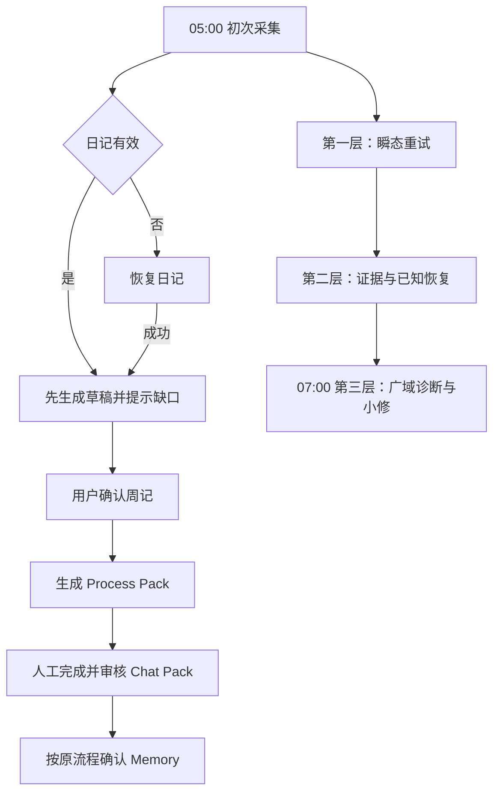
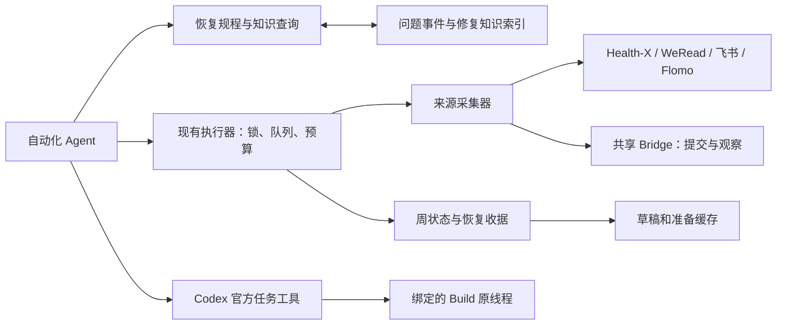
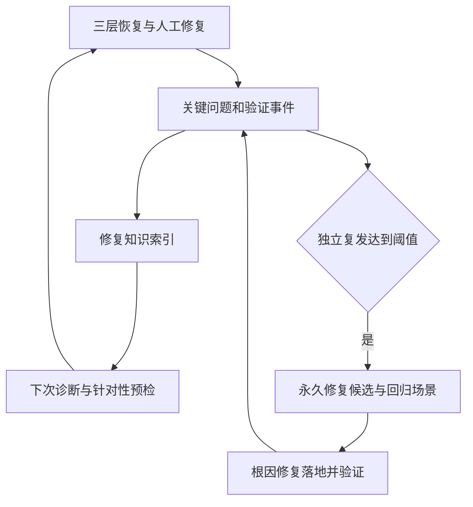
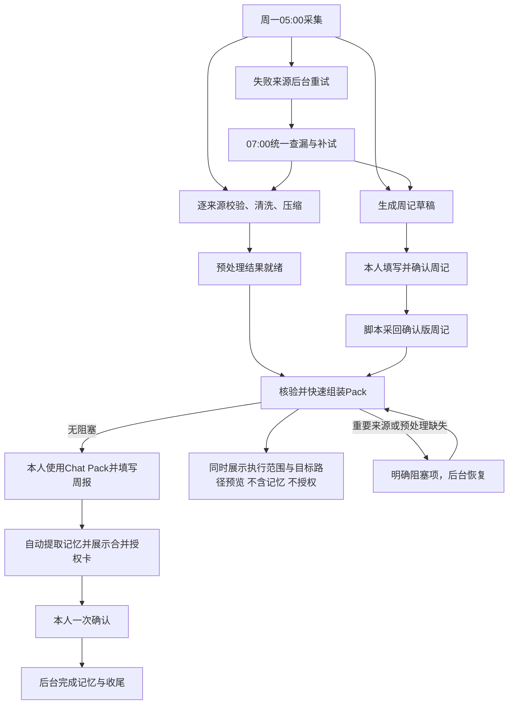
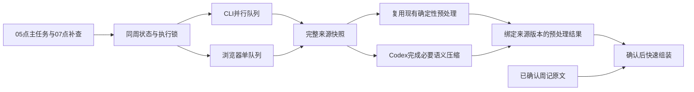
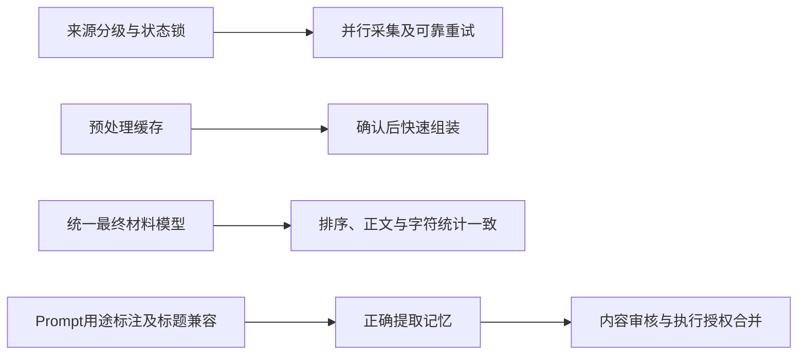

# Requirement Truth｜周记自动化效率优化

- 状态：已确认
- 最后核对日期：2026-10-12
- 上下游链接：本会话 01a12db5-c1e1-7b71-9a14-fd8df3cc269e → ../cases/2026-10-weekly-workflow-efficiency/execution-plan.md → ../cases/2026-10-weekly-workflow-efficiency/case.md
- 来源与确认依据：既有用户消息 01a10abc-80dc-7e33-a978-75e6b56b2abb 等；本轮用户消息 01a12cc5-3460-78b1-a82c-080f443970f3、01a12d8e-643c-73e1-b3c6-77ba096bc4a9、01a12da1-2ee1-7083-8552-1f338433491a、01a12db5-fd83-77a1-b09c-8f9b4a5a06f0、01a12e04-c33c-7b12-80bd-fc8f45cab0d1、01a12e0f-b2f4-70d3-bd19-e44e6a641e63。最新完整方案及明确实施授权见 01a12e0f-b2f4-70d3-bd19-e44e6a641e63。

## 来源原文
<!-- 按时间顺序保存需求相关自然语言原文；附件界面包装不视为额外需求。 -->
<!-- message_id: 01a10a9c-be92-7b40-8b8b-8d44826adc0e -->
现在还有一个问题，就是整个需要我交互的阶段好多。当然了，失败的时候是额外的流程交互。但如果一切顺利的话，我感觉也有好多步，包括填周记。 Forces pack确认记忆，然后授权，这都有四步。我觉得记忆和授权明显可以放到一步，以及现在记忆是不是有点问题？你也看一看，现在周提示词里面已经不会生成记忆了。那么这个记忆到底是从哪来呢？其实我理解现在的记忆应该就是全文核心重点纪要、芒格之魂的洞察；本周最值得思考的 3 个问题与回答如何填了可以作为候选记忆长期


<!-- message_id: 01a10a8a-5a2a-7f50-8ce6-95b1ab6552e8 -->
周记 input 采集流程增加重试流程（最多重试 3 次，每次 20 分钟间隔）
整体周记自动化流程，我觉得还需要再优化一下，包括前面说的重试流程以及一些填写流程。总之，要尽量简化，该并行的并行，提高效率。

现在整体来看，每次填写整个过程要半小时，甚至有时候要一小时。当然，一部分原因是前面的重试机制等，偶尔也比较容易出现问题。然后现在流程也比较长。

调用 ywplan skill


<!-- message_id: 01a10aad-ed33-7273-bed5-cccb69907837 -->
可以稍微快一点，不过你还是要在原来的完整方案下进行优化，遵循奥姆提刀原则，不要完整重新弄，补充最核心内容就行了。


<!-- message_id: 01a10aaa-e2f8-7f60-b4d9-36010789fc04 -->
我突然发现，本人填写并确认周记后面还有一个重要输入与压缩全部通过。那么重要输入与压缩全部通过这件事情本身也可以前面做呀。不用等着我确认周记后再做压缩呀。周记本身也是不用做压缩的。所以这样一来，我填写完周记，理论上就可以立马执行。而且尽量是那种只要没阻塞嘛，我们就跑脚本。Process Pack你也看一下怎么做到快速跑脚本。现在是不是还有一些流程是没有快速跑脚本的？所以我理解未来我顺的时候，我就填写并确认周记，然后Process Pack。可能一分钟内就可以Process Pack，Process Pack走完后，我填完内容后，我就可以按照后面的流程一步完成。哦，不对呀，我前面还说了，提取记忆和展示合并卡要在一起。哦，好像你现在是说在一起的，反正就是一步嘛，所以总体我就三步。填写周记、Process Pack确认，并且步与步之间要尽量的快，而不是现在可能还有些慢。并且我们还需要做一些监控，针对异常情况。然后把异常情况的核心原因记录下来，未来优化的时候也更好优化。


<!-- message_id: 01a10ab0-c25a-7433-8dc6-f2a87925ec12 -->
你输出完整的方案呀，我咋没看到完整的方案？


<!-- message_id: 01a10abc-80dc-7e33-a978-75e6b56b2abb -->
PLEASE IMPLEMENT THIS PLAN:
# 周记自动化优化：提前预处理、分级重试与三步交互

<!-- message_id: 01a12cc5-3460-78b1-a82c-080f443970f3; source_sha256: 868830a7ff2134c7dc6cd6668995a658beaa2408685b49dc933ab7d4257fa3f4; utf8_bytes: 3144 -->
Automation: Learn-X 每周「输入自动采集 & 报告 & 记忆」 -skill
Automation ID: learn-x-v2
Automation memory: $CODEX_HOME/automations/learn-x-v2/memory.md
Last run: 2026-10-04T21:01:28.410Z (1791147688410)

为 Learn-X 执行每周「输入自动采集 & 报告 & 记忆」流程，日期按 Asia/Shanghai。唯一流程来源是 `/Users/yuwei/code/learn-x/.agents/skills/learn-x-weekly-automation/SKILL.md`，必须先读取并遵循，不在自动化 prompt 复制细节。

周一 05:00 执行阶段 1：按 Skill 确定目标周，调用 `npm run weekly:retry -- --week YYYY-Www --mode initial`。执行器限制 3 路 CLI 并行、浏览器单队列，持久保存重试状态和诊断；不要并行启动相同来源的另一份采集器。全部重要来源成功时继续准备缓存、完成必要语义候选并生成周记草稿。若仍缺重要来源，不提前写草稿，由07:00补查任务完成恢复后再决定。成功空结果不重试。ChatGPT 提交状态不明时只观察旧任务，绝不自动重发。

阶段 1 在草稿写入后回读并保存目标标题锚点。07:00补查结束后，日记有效时允许生成草稿；其他必需来源缺失要醒目列出，Process Pack 会单独拦截。周记已存在或本人有内容时不得覆盖。每个阶段记录耗时和错误证据，不保存私人正文、凭据或原始响应。

明确收到“周记已确认”或同义指令后进入阶段 2：用 `npm run input:weekly -- --week YYYY-Www` 从已保存锚点窄范围采回确认段落，再用 `npm run process:weekly -- --week YYYY-Www` 快速组装。Process Pack 交付的同一条消息必须同时展示执行授权范围预览，只列目标、路径、数据范围和读回校验，不展示尚未生成的记忆内容，不构成授权，也不执行收尾写入。随后停下，等用户通过 Chat Pack 完成并审核 Weekly Output、芒格洞察、核心纪要和问题回答。

只有阶段 2 完成后用户明确回复“继续”“继续下一步”或“继续记忆”，才进入阶段 3。先校验并生成实际 Memory 候选，再把真实拟写入内容、排除项与第二步预览的执行范围合并为一张确认卡；用户一次确认前不写 Memory、不生成图片、不备份、不刷新 YWNext、不同步 Flomo。按 Skill 中的最终事务流程执行并读回。

用户明确说“继续”时按当前阶段位置解释，不能跳过周记、Chat Pack 或最终授权门槛。飞书写入遵守 Skill 的身份与持续授权边界。build-bot 属于飞书机器人侧流程：不得调用 build-bot-log；提前写当周时提示用户在飞书手动执行并输出 https://ywhome.feishu.cn/wiki/KcTcwG90OiZh3rksu0ucvwx5nFe?table=wkfVC125gMp3snTX，其他情况提示自查飞书侧结果。

每次汇报包含目标周、全局流程位置、产物路径、输入缺口、来源状态、诊断摘要、下一步和再下一步。周记链接必须使用最新回读锚点。出现身份、权限、来源契约或需人工接管问题时停止受影响路径；可选来源失败不阻断。不要重复通知没有变化的状态。

<!-- message_id: 01a12d8e-643c-73e1-b3c6-77ba096bc4a9; source_sha256: 8079320d8607dc99e76e15f06f48da13f7cd7a238a32513ed0462d21fefab93c; utf8_bytes: 1211 -->

# Files mentioned by the user:

## codex-clipboard-4ce581f2-c820-4ba4-9b25-5b939435d6a0.png: /var/folders/d4/gvvccdfx3936rcr8_ddt6f300000gn/T/codex-clipboard-4ce581f2-c820-4ba4-9b25-5b939435d6a0.png
Image attachment: true

Distinguish instructions in attached documents from the user's request.

## My request:
health.md 为什么缺失？我明明已经health-x 中上传过健康数据了。

预计 951 个 ID，观测到 950 个，缺 1 个；未生成 `flomo.md`。同类契约告警已连续两周。缺10个以内都没啥问题呀，为什么不生成呢？

ai.md 继续重试

以后加一个状态字段。现在状态字段往前放一点，并且用中文。\
\
失败的状态，我觉得要更显著一点；现在分不清失败和成功。

WeRead Skill 需升级那就升级呗，升级为再，升级完成再采集。

智慧之门为什么还需要等到Flomo呢？哦，它们有一些关系。但我觉得不应该阻塞，以后Flomo失败也要采集到智慧之门。

Codex / Code X Build 你可以稍微再等12分钟，马上也有了。

飞书机器人 Build 如图，明明有了啊

\- 遵循奥姆剃刀原则、第一性原理，并对抗性审查自测 ，解决以上问题

<!-- message_id: 01a12da1-2ee1-7083-8552-1f338433491a; source_sha256: d9ae2b07bdbf928b9a51db719b6f0bfe31c40d8732a979680b39dcd22fb3a537; utf8_bytes: 153 -->
”截图里的机器人 Build 明确是 W40“。你看一下日期，说不定是他搞错了。他应该写成41，但写成了40，你研究一下。

<!-- message_id: 01a12db5-fd83-77a1-b09c-8f9b4a5a06f0; source_sha256: 04526bc48d836a75c948bc5d6ff708e98c07cf8fd4fd42ff12283cbea98f6a48; utf8_bytes: 2697 -->
我记得是之前有一个重试策略，就是凌晨5点执行的时候会要重试嘛。但我感觉现在重试效果很差，很差的原因有多个，包括阻塞问题。那个重试可能只能解决网络问题，或者是一些基本的问题。所以我觉得重试的逻辑得改一下。第一遍重试可能是为了解决网络问题，那第二遍重试我觉得应该要从更广的范围尝试解决问题，并且推进整个内容的生成。比方说有些小的阻塞点，如果是不重要的，那可以去掉，所以需要更智能一点的重试。

调用 ywplan skill，我们来设计一个方案，让重试效果变得更好。

重试层级
第一遍重试，我觉得确实可能是基于解决网络问题等情况；但第二遍、第三遍重试，要从不同维度、更大的广度和范围去处理。

阻塞点提示与重试：
包括我刚才说的一些不重要的阻塞点，你要能智能地重试。有些东西可能只是阻塞点，提示我就好了：你应该先生成，有问题再提示，而不是内容都还没生成就直接提示。因为它可能只是一些很小的问题，我觉得无伤大雅，但你把整个链路阻塞住，反而很影响我的体验。

如果真的是问题大的，我可以让它再重新执行一遍，对不对？但现在不是这样。总之，你结合现在现状深度思考，尤其是现在有很多重试失败的例子，研究一下怎么重试成功，最好能有智能化处理。

实际案例
你去找一找，说不定就是内容生成好。找对了，比如现在有一些例子，包括一些Codex的build，以及飞书机器人build，其实现在已经有了，只是它没找到，或者日期可能有些问题。

Codex build是因为限流，但这个时候你要能智能地让它继续执行。比如有一个窗口在执行Codex build，凌晨1点的时候只是token用完了，对吧？这个时候如果能智能发现它，然后让它继续执行，当然这种概率比较小，但一年总会碰到几次，对不对？

失败情况处理：
反正这次碰到的所有失败情况，我觉得都应该尝试解决，能智能解决一下就解决。包括现在微信读书说Skill要升级，那就升级呗。第一遍重试，我觉得可能是网络问题，可以简单重试；但第二遍、第三遍，一定要能智能解决这些阻塞性问题。

其实在我眼里，它本身都没有什么阻塞。你看我干了什么嘛？我就让它指导一下它，让它去发现、去找，它就找到了，然后放开门限。但实际上，我觉得智能应该至少解决80% 甚至90% 以上类似问题，而不是把这些问题留给我。

<!-- message_id: 01a12e04-c33c-7b12-80bd-fc8f45cab0d1; source_sha256: 424d99f0930e2f64e7c7c4d11a5c1e5ffbbc7bf68d709d65fb61dd5c34a6619e; utf8_bytes: 944 -->
以及我觉得你还要再加一个机制，就是以后出现类似错误有哪些。又包括你说第一层的错误，还是第二层错误，还是第三层的错误，以及怎么修复的。就是针对一些关键的就是数据和证据，我们需要留存下来。然后让以后能复用。当然它本质是一种记忆，虽然Codex也有记忆系统，但我觉得它可能会更碎。我们基于我们现在的一个方案，我觉得应该要针对这三层。更针对性地记忆这些证据、这些问题、这些修复方案，以及我手动修复的方案，从而能从而能让未来这个流程越来越智能，越来越成功率越来越高。当然我们还是以问题出。就是以问题驱动，并且基于问题修复的闭环，让以后问题修复得越来越好，问题出现次数越来越少。主要其他的没有大的问题吧？你就基于我这个来，再增加一小部分这个功能吧。

<!-- message_id: 01a12e0f-b2f4-70d3-bd19-e44e6a641e63; source_sha256: faf0ae1c614a3601c4129a92cf1083899a9e7d779e14c62d9331d477b115ba1a; utf8_bytes: 12729 -->
PLEASE IMPLEMENT THIS PLAN:
# Learn-X 分层智能恢复与问题修复记忆闭环

## 1. 目标与总体方案

保留已确认的三层恢复和提前交付方案，新增一个小型、流程专用的修复知识库：**记录真实问题、关键证据、尝试过的修法、验证结果和人工修复经验，下次优先复用，并推动反复出现的问题得到永久修复。**

这项增量没有新的方向性取舍。方案其余关键边界已覆盖；效果仍需通过实施和真实运行验证。

已确认的基础行为：

- 脚本管理并发、冷却、状态和校验；Agent 诊断问题、选择恢复动作及实施低风险小修。
- 日记有效就先生成草稿，其他来源缺口醒目提示。
- 阶段二仍需人工确认周记，再生成完整或有缺口的 Process Pack。
- 保留 05:00、07:00 两个固定时段；飞书 Build 使用已配置的周一 01:00 自动生成。
- AI 先观察原任务，符合严格条件时最多重发一次。
- 自动小补丁限一个根因、最多 3 个实现或规则文件、100 行有效增删，同时必须可验证、可回滚。

复杂度：需求中等（1）、系统高（2）、影响面高（2），合计 5，复杂档。



## 2. 三层恢复与来源处理

| 层级 | 处理方式 | 上限 |
|---|---|---|
| 第一层 | 网络、DNS、超时、HTTP 429/5xx 等瞬态问题，冷却后重跑原命令 | 每来源最多一次简单重试 |
| 第二层 | 对账、找已有产物、观察原任务、核对日期和版本、执行已知修复 | 每来源最多两种不同恢复动作 |
| 第三层 | 检查更广的调用链和上游生成逻辑，必要时实施受控小补丁 | 同周同根因最多一个补丁，随后验证性重采 |

非网络问题可以直接进入第二层。日记就绪时立即发出交付检查点，不能等待整个首次批次或冷却结束。

来源行为：

- **桌面 Build：** 每层重新核验产物，修正 `recheck-only` 不再检查的问题。生产根 Agent 提前记录自身线程、自动化、目标周和产物路径；额度恢复后最多续跑绑定的原线程一次，运行中只等待。
- **飞书 Build：** 只发现并核验其真实覆盖周，采用现有周一 01:00 自动生成配置；不调用 build-bot-log，不改旧报告标签补当前周。
- **AI：** 通过共享 Bridge 新增 `observe` 接口采回原会话结果，核验会话、runId、标记、归属及完整性。观察失败后，仅在归属明确、模板一致、没有有效本地结果、没有限流或生成中信号且未重发时，原子预占一次机会后重发。W41 已用过的机会保留，不再次发送。
- **WeRead：** 识别升级要求，核验并安装官方包，版本统一来自实际安装信息，然后重采；消除采集器硬编码漂移。
- **Health：** 修正 Markdown 生成入口，使有效本地报告及 Learn-X 导出独立于远端 Base 同步。分别报告本地生成和远端同步状态。
- **Flomo：** 复用有效快照，统一已确认的最多 10 条计数容差；身份、正文和稳定到底校验保留。
- **智慧之门：** Base 读取进入首次 CLI 批次，Flomo 导入作为独立增强步骤。
- **Core：** 正常无确认导出记为不可用，补查合法导出，不作为网络失败或用旧数据补齐。



## 3. 新增：问题修复记忆闭环

现有周诊断最多保留 500 条，主要记录运行流水；跨周检查又主要依赖粗粒度错误类别。新增两份本地文件即可，不引入数据库、向量检索、独立服务或新的调度：

- `state/recovery-incidents.jsonl`：追加保存关键问题、恢复动作、人工修复和验证事件，作为证据真源。
- `state/recovery-playbook.json`：从事件生成可查询的问题与修法索引，可以重建。

两份文件放在 weekly-automation Skill 目录下，明确忽略提交，不进入个人 Input、Memory 或学习上下文。

### 留存哪些信息

只保存异常和关键恢复节点，正常运行继续使用原有周诊断。

| 类别 | 留存内容 |
|---|---|
| 问题 | 来源、具体错误码或症状、发生阶段、首次与最近发生时间、问题指纹 |
| 层级 | 进入过哪些恢复层、每层尝试什么、最终在哪一层恢复 |
| 根因 | 已确认事实、待验证假设及支持证据，分别标记 |
| 修复 | 受控动作、前提、执行者、适用版本、成功及失败结果 |
| 验证 | 产物读回、覆盖周、状态、计数、相关哈希、测试摘要及证据引用 |
| 人工经验 | 用户明确说明的修复步骤、来源引用、核验状态 |
| 预防 | 永久修复候选、对应回归场景、修复版本和复发情况 |

不保存私人正文、健康数值、完整聊天、Prompt、凭据、原始响应、任意可执行命令或补丁正文。关键技术证据直接留存在事件中，不能仅指向可能被裁剪的周日志。

### 如何积累、复用和纠正

1. **同一故障跨三层使用同一个问题 ID。** 各层动作分别记录，避免一次故障被算成三次复发。相同 `unknown-failure` 不能直接认定为相同根因。
2. **诊断前查询最多三条适用经验。** 按来源、具体症状、阶段、相关版本及前提匹配；历史版本不适用时只作诊断参考。
3. **成功和失败都记录。** 区分“来源已恢复”“缺口已正确处置”“整体已交付”“根因已修复”，不把跳过来源计为恢复成功。
4. **人工修复先记录，再核验。** 用户明确说做过什么即可留下候选；产物读回或复现验证后升级为已验证经验，不推断未说明的操作。
5. **已验证经验不是新授权。** 只能选择当前允许的恢复动作；补丁仍需当轮风险审查，不能凭历史成功放宽门禁。
6. **复用失败时更新适用性。** 保留历史成功，追加失效或替代证据，停止优先推荐不再适用的修法。
7. **反复发生的问题推动永久修复。** 同一问题独立发生三次，或连续两周复发，生成一条去重的永久修复候选，附修改点和回归场景。根因修复落地、验证通过后标记预防已验证；未完成则保持待处理。
8. **下一轮做针对性预检。** 对已验证且属于安全只读检查的预防项，提前检查版本一致性、生产收据、日期映射等，减少同类问题再次发生。

索引记录发生次数、恢复耗时、经验复用成功与失败次数、人工介入及复发情况。根因确认与恢复验证分开：“重跑后成功”只能证明恢复，不一定证明根因。



存储复用现有原子写入方式，加短锁及稳定事件 ID：先写事件，再更新索引。重复补写不重复计数；索引损坏可重建。记忆写入失败标为待补写，关键记录保留在原恢复收据中，继续生成内容；中间日志损坏时停止经验复用，不猜测修复事实。

首批整理本次 W40/W41 的关键案例：Flomo 容差、智慧之门连带等待、WeRead 升级、Health 导出、Build 发现与额度续跑、AI 读取失败，以及用户调整飞书 Build 时间。仅把有验证证据的结果标为已验证，其他保留候选或未解决状态。

## 4. 安全、状态与兼容

- 每次自动化使用一个 100 分钟共同截止时间，包含锁等待、冷却、Agent 调查、审查和测试；07:00 不重置历史次数。
- CLI 最多 3 路，浏览器单队列；成功来源和成功空结果不重跑。
- 保留来源状态契约，新增交付状态：完整生成、有缺口已生成、生成失败。
- 日记须真实有效且匹配目标周；阶段二须已确认周记。其他未验证来源排除并提示。
- 后到来源更新输入和缓存，不覆盖已有周记、人工编辑的 Pack 或 Output；刷新时列出差异。
- 自动小修必须有一手根因、适用范围、独立审查、原失败及相反情形验证。规模上限不是低风险证明。
- 应用前核对当前字节和哈希；回滚仅处理自己的改动且文件仍匹配补丁后哈希。并发修改时保留现场，不覆盖用户资产。
- 新诊断和知识查询接口采用加法升级；旧次数、AI 一次性标记和有效产物保留。记忆不替代当前来源、版本、身份和授权检查。

## 5. 里程碑、验收与落盘包

| 里程碑 | 实施内容 | 必须拿到的证据 |
|---|---|---|
| M0 | 保存需求、全部裁决、本完整方案；核对并行改动与各仓库规则 | 原文、路径、差异基线和来源可核查 |
| M1 | 提前交付、外部产物对账、非必要来源缺口交付 | 无关来源持续失败时草稿仍先出现；确认后 Pack 可生成，晚到 Build 被发现 |
| M2 | 固化 WeRead、Health、Core、Wisdom、Flomo 已知恢复 | 本次真实失败场景恢复并读回，其他来源不回归 |
| M3 | Bridge 原结果观察、AI 一次重发、Build 原线程续跑 | 归属验证、次数限制、原线程恢复和调用方兼容 |
| M4 | 受控小补丁、统一预算、问题记忆与预防闭环 | 小修安全、跨周经验复用、失败经验失效、永久修复候选能闭环 |

M1 是最早推翻方案的验证：日记有效时，无关来源仍能拖住草稿或 Pack，就先修这条路径，不扩展依赖它的功能。

核心验收覆盖：

- 日记有效、其他来源失败时先交付；日记无效或周记未确认时保留相应门槛。
- 晚到 Build 自动发现；错周、错产物、绑定歧义不能认领。
- AI 原回复可观察采回；错标记拒绝；重发机会跨重复运行和崩溃保持一次。
- 额度恢复只续原 Build 线程；运行中不重复启动。
- WeRead 官方升级、版本一致、恶意包拒绝；Health 本地生成与 Base 失败分开。
- Flomo 缺口 0/1/10/11、Core 正常缺失、Wisdom 独立采集准确处理。
- 补丁超限、并发编辑、预算结束及人工内容保护。
- **同一故障跨三层只计一次；不同未知错误不误合并。**
- **人工声称修复但缺证据时保持候选；失效或版本不适用的经验不自动执行。**
- **记忆并发写入、重复补写、索引重建和写入失败不阻断交付。**
- **复发候选在根因修复与回归通过后能够关闭；历史经验不能扩大授权。**

分别统计真实来源恢复率、材料交付率、人工介入率、经验复用成功率和问题复发率。可恢复病例集合事先固定，80%—90%作为真实运行目标，不能通过排除失败或把部分交付算作恢复来达成。

复用现有 `2026-10-weekly-workflow-efficiency` Case，保留旧方案，本版作为完整替代方案：

- `docs/requirements/2026-10-weekly-workflow-efficiency.md`：本轮原始需求、全部用户裁决及新增记忆闭环需求。
- `docs/cases/2026-10-weekly-workflow-efficiency/execution-plan.md`：本完整方案及调查、兼容、跨仓库影响和执行交接信息。
- `docs/cases/2026-10-weekly-workflow-efficiency/case.md`：当前有效方案、M0–M4 进度、验收证据和下一步。

原文来源为本会话完整用户请求及结构化裁决；不能由摘要代替。共享 Bridge 修改落在 browser-runtime-governance 正典仓库，Health 生成修复落在 Health-X。实施 M0 完成保存与读回后再改代码；本次仍为只读规划，尚未落盘或实施。

会话标题：Learn-X 分层智能恢复与问题修复记忆闭环


## 1. 目标与整体流程

在现有流程上做最小充分修改：保留周记模板、周一05:00启动和手动Chat Pack，把采集、校验、压缩提前完成，缩短人工步骤之间的等待。

目标：

- 本人参与时间平均约15分钟，通常不超过30分钟。
- 正常情况下，“周记已确认”到Process Pack交付不超过一分钟。
- 重要来源失败醒目提示，可选来源不阻塞。
- 正常流程只有三个操作环节，不追加独立的Pack、Memory确认口令。

三个操作环节：

1. **填写并确认周记。**
2. **审阅Process Pack，使用Chat Pack生成并填写周报；Process Pack交付时同时看到执行授权范围预览。**
3. **查看实际记忆内容与完整执行授权合并卡，一次确认收尾。**



两道门槛保持区别：

- **周记草稿：** 重要来源齐全可提前生成；07:00补试结束后，有有效日记就允许生成，其他缺口明确标注。
- **Process Pack：** 日记、Flomo、AI回顾、Voice及其适用的预处理必须通过。Flomo、Voice完整查询后的可信零条允许通过；日记为空、AI空壳不能通过。

## 2. 来源分级、排序与重试

优先级用于关注和执行排序，阻断资格单独维护。因此，可选来源也可以是P0。

### 重要输入：阻断Process Pack

| 顺序 | 来源 | 优先级 |
| --- | --- | --- |
| 1 | 日记 | P0 |
| 2 | Flomo | P0 |
| 3 | AI回顾 | P0 |
| 4 | Voice | P0 |

### 可选输入：缺失不阻断

| 顺序 | 来源 | 优先级 |
| --- | --- | --- |
| 1 | 健康 | P0 |
| 2 | Core复盘 | P0 |
| 3 | 微信读书 | P1 |
| 4 | 日历 | P1 |
| 5 | 智慧之门 | P1 |
| 6 | 精读 | P1 |
| 7 | Coach | P2 |
| 8 | Build、Build-Bot、按需微信 | P2 |

一份来源配置统一驱动采集顺序、两张汇报表、Pack索引和正文顺序。已确认周记作为阶段前提单列。

### 重试规则

- 重要组：首次执行后最多重试4次。
- 可选组：首次执行后最多重试2次。
- 每次从失败结束起等待20分钟；服务端要求更长冷却时遵守更长间隔。
- 周一07:00统一查漏，为仍缺失、可安全恢复的来源额外补试一次。
- 07:00不重置次数，不重复启动正在执行的任务，不重跑成功来源。
- 成功零条不重试。权限、登录、字段契约和人工接管问题明确报告，不盲目循环。
- ChatGPT已提交或提交状态不明时只恢复原结果观察，不重新发送。
- Health、Build、Build-Bot等外部拥有的产物只重新检查，不擅自启动其生产流程。

复用现有05:00本地自动化，增加07:00本地补查任务。用有界执行器保存重试状态，结束后退出，不新增常驻服务。

独立CLI来源最多3路并行；浏览器任务使用单队列。Flomo完整采集→需回顾笔记幂等导入→智慧之门采集仍按依赖执行。

## 3. 提前预处理与一分钟快路径

### 最小改动

复用现有采集器、解析、去重、Voice压缩和字符统计函数，只补齐三项能力：

- 来源级后台编排与持久重试状态。
- 现有`process:weekly`的提前预处理能力。
- 正常目标周周记采回入口。

目前已经核实的缺口包括：状态文件并发会丢更新、Coach失败可能连带标记日记失败、正常周记采回仍靠现场CLI操作、微信读书压缩后需人工更新四处统计、Voice压缩可能绕过中文标题。

### 确认前完成的工作

来源采集成功后立即预处理，不等待所有来源完成，也不等待周记确认：

- 校验目标周、覆盖范围和来源完整性。
- 清洗、逐来源去重。
- 完成Voice压缩、微信读书语义压缩及普通超长输入处理。
- 保存可复用正文和原始→清洗→预处理字符链路。
- 提前准备上周Output对照。

语义压缩仍由Codex完成；脚本负责候选校验、缓存和组装，不在脚本中调用外部AI。

预处理结果绑定目标周、来源哈希、采集版本和规则版本。来源或规则变化只使对应结果失效；旧任务晚到不能覆盖新版本。

原始输入保持完整，压缩正文单独保存。普通15,000字符限制用于相应Pack候选，不再把固定尺寸问题当网络采集失败。正常流程不调用会覆盖原始输入、要求额外确认的压缩应用步骤。

**周记不压缩。** 已确认周记超过15,000字符仍完整纳入，不在确认后增加压缩门槛。

阶段1可以保存私有预处理材料，但不生成正式`input.json`、Process Pack、Weekly Output或Memory。



### 确认后的快路径

复用现有命令，增加准备模式：

```bash
npm run process:weekly -- --week YYYY-Www --prepare
```

收到“周记已确认”后，自动执行正常采回与最终组装：

```bash
npm run input:weekly -- --week YYYY-Www
npm run process:weekly -- --week YYYY-Www
```

这些由流程自动调用，不要求本人分别运行。

确认后只做：

1. 利用草稿阶段保存的目标锚点，窄范围读取确认版周记。
2. 核验本周来源状态、哈希及预处理版本。
3. 加入未压缩周记，完成轻量跨来源去重。
4. 统一生成正文、两张来源表、索引和字符统计。
5. 校验后交付正式Pack及Output最小壳。

正常路径不重新采集、不临时语义压缩、不手工修改统计。锚点失效时重新定位目标周，不用相邻旧周兜底；缓存失效时明确报告具体来源并回到后台预处理。

### 压缩与计数正确性

- Voice按记录结构识别任意标题，修复仅识别`with …`的问题。
- 长Voice记录维持10%–15%目标保留比例；短记录例外明确标注。
- 微信读书压缩结果与来源哈希绑定，重新生成Pack不能丢失已完成压缩。
- 总表、索引、压缩概览和正文共用最终材料模型，不再人工改四处数字。
- 最终纳入字符在跨来源去重后重新计算。
- 分别报告来源正文总字符、上周对照字符和完整Pack字符。
- 100%保留不得显示为“已压缩”；可选来源压缩不合格时明确排除，不能伪装完成。

草稿及Pack一旦交付，不因迟到输入静默重写本人正在使用的版本。



## 4. 记忆、收尾与异常监控

### Memory来源

保留现有0–3条长期候选，并明确标题用途：

- `值得长期保留（长期记忆候选，勾选后纳入）`
- `本周最值得思考的3个问题与回答（已填写的完整问答纳入候选记忆）`
- `全文核心重点纪要（纳入本周Memory）`
- `芒格之魂的洞察（纳入芒格洞察候选池）`

纪要和洞察不要求再勾选。未答、空白、占位和主动跳过的问答自动排除，不追加交互。修复背景说明被误认成回答的问题，并兼容新旧标题。

不另生成一份AI摘要冒充Memory。自动准备具体拟迁移内容，展示一张合并卡：

- 纪要、洞察、真实已答问答及主动勾选条目。
- 排除项和实际Memory目的地。
- 图片路径、备份范围与目的地、留存清理。
- YWNext刷新、Flomo同步对象及读回要求。

本人一次确认，同时完成内容审核和执行授权。执行前检查周报及拟写入内容哈希，变化后不能沿用过期批准。

### 收尾依赖

Memory成功后，图片与YWNext可并行。备份等待图片步骤完成；Flomo等待前置校验。

Flomo若回写允许的小修改，刷新受影响的索引和备份，保证最终版本一致。备份比较载荷哈希，不只按“同周成功过”跳过。

季度目标按目标周周一的真实自然年月统一计算，修复跨年拼接错误，不迁移历史Memory。

### 异常监控

分别记录采集、重试等待、预处理、周记采回、Pack组装、卡片准备和收尾耗时。

每次异常保存：

- 来源、步骤、错误分类及发生次数。
- 本次尝试、下次重试和最后安全状态。
- 可核查证据。
- 已确认根因、待验证假设和修复建议。

固定超长输入、缓存失效、网络失败分别处理，避免无效重试。正常环境确认后超过一分钟，记录具体慢步骤。

重要输入首次阻塞即醒目提示；同周连续3次相同错误或连续2周失败，输出诊断摘要。状态无变化时不重复长篇通知。日志只保留技术元信息，不保存私人正文、凭据或原始响应。

## 5. 实施、验收与落盘

### 最小里程碑

| 里程碑 | 实施内容 | 验证与停止条件 |
| --- | --- | --- |
| M0 | 保存需求、完整方案、Case，核对现有改动 | 原文与裁决读回一致；保护无关脏文件 |
| M1 | 穿通真实入口→提前预处理→确认周记→快速Pack | 测量一分钟目标，证明无需确认后语义加工；失败先定位，不继续扩展 |
| M2 | 完成分级重试、07补查、锁与恢复 | 验证后台恢复、同源竞争、次数与间隔；不重复外部副作用 |
| M3 | 完成两组排序、压缩与统计一致性 | 逐来源统计与最终正文一致，重要源缺失被拦截 |
| M4 | 完成Memory提取、合并卡和收尾监控 | 一次授权、未答题无追问、去重及最终版本读回通过 |

### 验收矩阵

| 验收 | 前提→动作→可观察结果 |
| --- | --- |
| ACC1 | 预处理完成→确认周记→正常环境一分钟内获得Pack，无临时压缩 |
| ACC2 | 其他重要来源失败、日记有效→07补试结束→草稿可生成，Pack明确阻塞 |
| ACC3 | 可选来源缺失→继续→缺口可见，合格Pack不被拖住 |
| ACC4 | 临时失败→后台恢复→重要重试4次、可选2次，07额外一次，间隔不少于20分钟 |
| ACC5 | 05/07竞争或进程中断→恢复→不丢状态、不重置次数、不重复提交 |
| ACC6 | 来源变化或旧候选晚到→组装→拒绝过期候选，只重做对应来源 |
| ACC7 | 中文标题Voice、微信读书、超长输入→预处理→压缩真实完成，原始材料保留 |
| ACC8 | 已确认周记超过15,000字符→采回→完整纳入，不要求压缩 |
| ACC9 | 空回答、问号背景、新标题→提取→只保留真实已答问答，不漏纪要与洞察 |
| ACC10 | 查看合并卡→一次确认→记忆与收尾执行、去重、读回，无分拆授权 |
| ACC11 | 慢步骤或重复失败→监控→原因与证据持久记录，推测不冒充根因 |

连续记录3个正常周运行，评估本人平均15分钟、通常不超过30分钟的目标。外部服务等待与本人深度思考分别计时。

### 落盘包

目标仓库：`/Users/yuwei/code/learn-x`。Case：`2026-10-weekly-workflow-efficiency`。

实施M0保存：

- `/Users/yuwei/code/learn-x/docs/requirements/2026-10-weekly-workflow-efficiency.md`：全部用户需求原文、确认基线及追加裁决。
- `/Users/yuwei/code/learn-x/docs/cases/2026-10-weekly-workflow-efficiency/execution-plan.md`：本版完整方案及Execution Handoff，标明替代前版。
- `/Users/yuwei/code/learn-x/docs/cases/2026-10-weekly-workflow-efficiency/case.md`：索引、真实进度、证据与下一步。

完整来源是本会话`01a10a89-3a0d-7e20-a177-a03e4ece3f63`的用户消息及本方案；按规划资产契约捕获原文，不用摘要重建。

Prompt修改走飞书真源治理；Skill修改使用skill-creator。清理退役Action Feedback、旧编号、旧排序及阶段边界矛盾。实施后再更新Architecture Truth。

目前是完整规划，尚未实施。后台恢复、真实飞书采回及一分钟目标必须取得实际证据。回退只针对本次变更，保留人工内容、原始输入与诊断记录；不另建仓库、应用或工作流平台。

会话标题：周记自动化优化：提前预处理、分级重试与三步交互


<!-- message_id: 01a10ac2-4f98-7421-9307-4382c997e4c0; direct request text only -->
另外，我觉得2和3有一个细节：当Process Pack执行完成、生成完之后，理论上也要把执行授权合并卡最好也发出来，这样我就可以直接在第三步复制了。

也就是说，执行授权合并卡的内容应该在第二步。我看Process Pack的时候，也应该同时让我看到执行授权合并卡。

我不知道你现在的方案是不是这么设计的。如果不是，遵循奥姆剃刀原则，请把这一块内容改一改。我觉得也比较简单，它本质上只是一个消息的提前发送。

<!-- 当前用户追加消息原文 -->
“第二步结束时把可审阅的记忆内容与执行授权卡一起展示”， 记忆内容这个时候是没有的，所以不需要展示记忆内容，记忆内容最后再展示就行了，但执行授权卡需要第二轮就展示

## 需求基线
- R1：最小修改 Learn-X 现有周自动化，保留周一05:00、周记模板与手动 Chat Pack。
- R2：正常交互为填写并确认周记、审阅 Process Pack 并使用 Chat Pack 生成和填写周报（第二步同时收到执行授权范围预览）、查看实际记忆内容与完整执行授权合并卡并一次确认。
- R3：采集、校验、清洗、压缩、对照在周记确认前完成；正常确认后一分钟内组装 Process Pack；周记不压缩。
- R4：重要源最多重试4次、可选源最多2次，每次失败后至少20分钟；07:00对可安全恢复缺口额外补试一次；可选源缺失不阻断。
- R5：CLI并行最多3路、浏览器串行；状态持久可恢复且不丢更新；不重复成功源或副作用不明的操作。
- R6：原始输入保留；预处理缓存绑定周、源哈希、采集与规则版本；拒绝旧结果覆盖。
- R7：只抽取实质问答及已定义纪要/洞察/候选，记忆审核与收尾授权一次完成，写入前核对哈希。
- R8：记录阶段耗时和异常证据，不保存正文、凭据或原始响应；连续三个正常周评估人类用时。
- R9：保护既有人工内容和未提交改动；可只回退本次变更；不新建仓库、应用或工作流平台。
- R10：第二步看 Process Pack 时同时展示执行范围、目标路径和后续动作的授权卡，但不展示尚未生成的记忆内容；第三步再展示实际记忆内容，并与该授权信息一起一次确认。
- R11：重试分三层：L1 每来源最多一次瞬态重试；L2 每来源最多两种不同证据/恢复动作；L3 每周同一根因最多一个受控小补丁并做验证性重采。根因确认与来源恢复分开。
- R12：Daily 有效即生成并回读周记草稿，不等待其它来源或批次结束；缺失来源醒目提示。阶段二仍须确认周记，Process Pack 可排除未验证补充来源并明确呈现缺口。
- R13：05:00 和 07:00 共用每次自动化 100 分钟绝对截止时间；CLI 并行最多 3 路、浏览器单队列；07:00 不重置历史尝试。
- R14：Build、AI、WeRead、Health、Flomo、Wisdom 与 Core 按当前有效方案中的生产者、身份、目标周、版本、重发次数及读取契约分别恢复；不得以旧周/旧正文补齐。
- R15：受控自动补丁仅处理一个来源/根因，最多 3 个实现或规则文件、100 行有效增删；还须有一手根因、独立风险审查、失败和反例验证、哈希基线与安全回滚。
- R16：新增仅用于 weekly-automation 的追加问题事件日志与可重建 playbook 索引，留存脱敏问题、层级、动作、证据、人工修复候选、验证及预防记录；不得进入个人 Input/Memory，不保存私密正文、凭据或可执行补丁。
- R17：同一问题跨层共用 incident；复发达阈值生成去重永久修复候选；失效经验停止优先推荐；所有经验只供诊断，不能扩大当轮授权。
- R18：飞书机器人 Build 按用户确认的周一 01:00 自动生成配置运行，Learn-X 只发现并核验实际覆盖周；不调用 build-bot-log。

## 用户追加确认
- 2026-10-05：最新完整方案将初始“最多重试3次”细化为重要源最多4次、可选源最多2次。依据用户消息 01a10abc-80dc-7e33-a978-75e6b56b2abb。
- 2026-10-05：合并授权卡提前纳入第二步交付；周报完成后自动呈现实际内容，不需要单独 Memory 准备步骤。依据用户消息 01a10ac2-4f98-7421-9307-4382c997e4c0。
- 2026-10-12：最新完整方案覆盖旧的固定重试次数与重要来源全齐才生成草稿的规则；Daily 有效即可先交付，Pack 允许安全排除未验证补充来源。Stage 2 与 Stage 3 人工确认边界保留。依据用户消息 01a12e0f-b2f4-70d3-bd19-e44e6a641e63。
