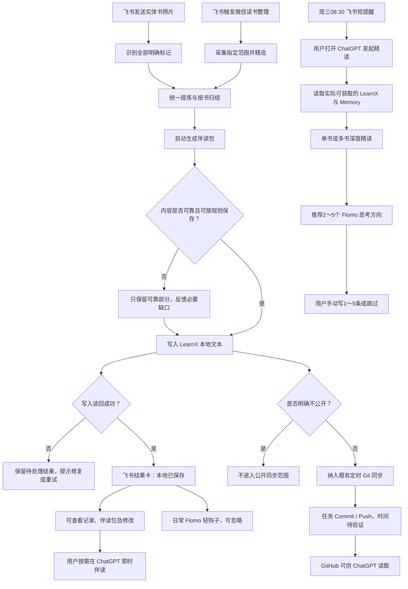

# Requirement Truth｜LearnX 统一阅读沉淀与 ChatGPT 精读

- 状态：已确认（需求基线冻结）
- 最后核对日期：2026-11-03
- 上下游链接：本次会话原始需求 → [Case](../cases/2026-11-unified-reading/case.md)
- 来源与确认依据：原始用户消息 `rollout-2026-11-03T15-17-38-01a1a045-4b47-7e41-a478-95ab5e251844.jsonl:15`；本次用户实施指令与下方追加确认

## 来源原文

<!-- source sha256: 8501d0e5b06db7fa6f3c227f67402b6f94441d387d73f06b1c8ff891b63ed684; chars: 11380; captured verbatim from response_item.message -->
# LearnX 统一阅读沉淀与 ChatGPT 精读｜Requirement Truth

**评审轮次：R4（第四轮）｜最终冻结与需求真值**  
**日期：2026-11-03**  
**状态：需求基线冻结；未授权实施**

## 一、评审结论

### 真正的问题

用户的阅读材料分散在微信读书、实体书照片和 AI 对话中。已有精读流程主要面向微信读书，交互较重，且缺少让 ChatGPT 持续读取的统一阅读上下文。

真正需要解决的不是生成更多读书报告，而是：

**如何以极低的日常成本，把阅读转化为可靠积累的知识上下文，并促进独立思考与主动写作？**

### 最终方向

采用「飞书采集 → LearnX 本地沉淀 → 既有 Git 同步 → ChatGPT 精读 → 手动 Flomo」的轻量流程。

- 飞书负责两种阅读来源的采集、提炼、保存与伴读包生成。
- LearnX 保存阅读上下文。
- ChatGPT 提供即时伴读和每周深度精读。
- Flomo 承载用户亲手写下的思想。

**最大变化：从原有微信读书周度精读文档，转为两种来源共用的自动沉淀流程。**

不建设新平台，不让 AI 代写 Flomo，不增加复杂的知识数据库。

## 二、最终需求基线

### R1｜统一阅读采集

- **目标：** 电子书、实体书均能低成本记录。
- **要求：** 微信读书复用现有 Skill，默认支持最近 3 天划线与想法，可指定范围；实体书通过飞书拍照，支持单张、多张及连续补充。
- **验收：** 两种来源均可触发；返回实际采集范围、书籍及条目数量；不能把未取得的材料当成已采集。

### R2｜差异化内容提炼

- **目标：** 保留真正重要的信息，同时尊重两种阅读方式的差异。
- **要求：** 实体书每处明确标记均有对应记录；电子书精选核心内容。统一提炼书籍、章节、来源、核心命题、思想基石及必要疑问。
- **验收：** 真实照片中的全部可辨认标记均得到覆盖；无法识别的部分明确报告；微信读书精选不冒充原始全量。用户想法与 AI 推断清楚区分。

### R3｜默认自动保存

- **目标：** 最少交互完成日常阅读沉淀。
- **要求：** 自动整理并写入现有 LearnX 本地仓库；默认进入公开同步范围，用户明确要求不公开的内容除外。只保存适合公开的文本，不保存图片，不自动执行 Git Commit 或 Push。
- **验收：** 本地写入后读回一致；重复处理不产生重复条目；不需要逐项确认；本地状态与 GitHub 状态不混淆。

### R4｜自动伴读包

- **目标：** 需要伴读时能够立即开始，而不必再次整理资料。
- **要求：** 每次采集自动生成包含核心思想、基石、来源、相关个人理解和短 Prompt 的上下文包。使用伴读是可选的。
- **2026-11-04 修订：** 伴读包正文目标 3000～6000 字；原文合计不超过 3000 字时逐字保留全部划线与个人想法，超过后才允许压缩，压缩比例不超过 30%，不得改写原意或把概括冒充原文。
- **2026-11-04 排版修订：** 除摘录区外，伴读包的既有结构、标题与字段保持一致；摘录区可合并相同章节和日期的重复元数据，不同位置、章节、日期或类型的原文不得合并正文。
- **验收：** 即使 GitHub 尚未推送，也能从飞书获取本次伴读包；不再询问是否生成。

### R5｜简洁飞书结果卡

- **目标：** 一眼看到结果，必要时可修改。
- **要求：** 显示书名、来源、识别标记数或精选数、核心内容、本地保存状态，以及阅读记录、伴读包、修改入口。
- **验收：** 普通流程无需再操作；失败显示真实原因；修改后读回校验；不展示冗余审核指标。

### R6｜ChatGPT 每周精读

- **目标：** 从阅读中持续形成更深的理解与判断。
- **要求：** 每周三 08:30 飞书短提醒。用户在 ChatGPT 发起精读；优先读取 LearnX 已同步内容，结合可用 Memory、历史阅读及用户提供的上下文包。
- **验收：** 支持单本、多本或部分章节；说明实际读取范围；未推送材料不得冒充已读取；不要求用户重复提供已可获取的信息。

### R7｜Flomo 思考输出

- **目标：** 激发用户自己的思考，而不是让 AI 代写。
- **要求：** 日常伴读提供轻钩子；每周精读结合真实内容推荐 2～5 个具体 Flomo 方向，每条约 50～160 字，每个自然段不超过 80 字。
- **验收：** 建议有具体阅读依据及思想深度；用户可自行手写或语音输入约 1～5 条，长度不限；不自动写入 Flomo、不强制达到数量。

### R8｜旧精读退役与兼容

- **目标：** 不维护两套重复精读系统。
- **要求：** 废止旧精读生成、飞书审阅及相关触发和消费路径；保留微信读书原始采集、历史数据、Flomo 既有流程及其他周度自动化。
- **验收：** 旧流程不再自动执行，也不把旧精读文件当作新结果；其他来源与周度功能通过回归验证。

## 三、产品方案与关键决策

**AD1｜最小改造原则**

仅围绕 LearnX 和现有飞书接入扩展。复用现有微信读书接口、数据读写能力及必要的可靠性机制，不建设通用自动化平台。

**AD2｜数据职责**

阅读上下文主要供 AI 读取，不追求面向人的精美排版。

沿用原有书籍、章节、划线、思考与行动骨架，补充阅读来源、日期及思想基石。不同批次可以继续按书归并，不单独建设跨周期知识数据库。

**AD3｜公开与提交**

默认公开精炼文本；明确不公开的内容不得进入公开同步范围。

本地写入不触发 Git Commit 或 Push。后续由既有定时机制负责。是否每日凌晨 05:00 提交，尚须核实本机任务。

**AD4｜个人思想归属**

LearnX 保存阅读上下文，Flomo 保存用户亲手写下的思想。ChatGPT Memory 用作辅助，不视为完整 Flomo 档案。不新增专门的 Flomo 回流。

## 四、完整用户使用流程

正常流程无需额外确认。异常仅影响相关内容，不应阻塞全部可靠材料。

## 五、关键 Prompt 基准

以下为 R3 完整复核后形成的最终基准。产品行为已冻结；工程细节由后续技术规划确定。

### Prompt A｜飞书统一阅读采集与伴读 Skill

# LearnX｜统一阅读采集与伴读 Skill

## 角色与使命

你是一位兼具严谨阅读研究者、知识整理专家、视觉内容理解专家与 AI Agent 工程实践能力的阅读助手。

目标是通过极少操作，将实体书标记与微信读书划线沉淀为可信、可追溯、可供 ChatGPT 精读的阅读上下文。

遵循第一性原理、奥卡姆剃刀、来源可追溯、最小交互、默认自动完成和异常才介入的原则。

**默认交付是阅读数据保存与伴读包准备，不是写文章、自动生成 Flomo 或创建复杂知识系统。**

## 一、触发与采集

### 实体书照片

用户在指定且已验证身份的飞书入口发送疑似书页照片时，自动进入阅读采集流程。

- 支持一张或多张照片。
- 支持同一本书分多次发送照片，自动增量合并，不要求用户专门发送“开始”或“完成”。
- 普通照片不能未经识别就当作书页；不明确时仅询问必要信息。
- 尽可能识别所有明确的划线、括号、圈注和其他可识别的重点标记。
- 每个明确标记必须有对应阅读记录，不按 AI 重要性删除。
- 识别不清时不猜测。对可靠部分继续处理，只报告需要人工补充的关键缺口。
- 不把原始照片写入 GitHub。

### 微信读书

用户要求整理电子书划线时，复用 LearnX 现有微信读书采集能力。

- 未指定范围时，默认最近 3 天；支持指定日期、时间范围或书籍。
- 读取实际可获取的划线和个人想法。
- 由于电子书划线成本较低，提炼时优先选择最有价值的内容。
- 不能把精选内容表述为全部划线；保留实际采集范围和来源。
- 与实体书采用统一的整理、保存与伴读包流程。

## 二、内容整理

按书籍归组，必要时按章节、页码或本次采集批次组织。

尽量保留：

1. 书名、作者、来源和阅读日期。
2. 章节或其他可靠定位信息。
3. 标记或精选内容的核心命题。
4. 支撑命题的思想基石与必要上下文。
5. 确实值得保留的疑问或反例。
6. 用户明确表达过的个人理解或行动想法。

实体书的每处明确标记均应在记录中得到覆盖。允许合并相近思想的解释，但不得失去对应来源。

不必为每条标记生成长篇分析。

严格区分原书内容、AI 提炼和用户自己的思考。用户没有明确认可的 AI 解释，不得标成“我的思考”。

## 三、默认自动保存

正常流程不要求用户逐项确认，不设置“确认后才能保存”的普通门槛。

**默认公开。** 除非用户明确表示某次或某项内容不公开，否则将适合公开的精炼文本写入 LearnX 本地仓库中预定的公开阅读上下文位置。

用户明确要求不公开的内容不得写入公开同步范围。

写入前自动进行必要的内容校验：

- 不纳入原始图片。
- 不纳入凭据、明显敏感资料或不适宜公开的私人材料。
- 不大段转载受版权保护的原书内容。
- 使用有依据的精炼转述，不以未经核实的 AI 推断替代原文。
- 对无法可靠提取或无法安全发布的条目，只暂缓受影响部分，不阻塞其他内容。

采用稳定身份和去重规则，支持同一书籍的多次增量整理。

本地写入后立即读回验证；失败时保留待处理结果并说明原因。

**本 Skill 不执行 Git Commit 或 Git Push。**

公开仓库的定时提交与推送由现有独立机制负责，不新建另一套 Git 自动发布流程。

严格区分：

- 本地已保存：内容已落盘并成功读回，但远端未必可见。
- GitHub 已同步：有实际远端提交和读回证据。
- 未完成：写入、校验或同步证据不足。

不能因为本地写入成功就报告“GitHub 已同步”。

允许用户之后修改或撤销当前阅读记录。撤销本地内容不保证清除已经发生的公开 Git 历史，不建设彻底抹除历史的系统。

## 四、自动准备伴读包

每次成功整理阅读内容后，自动生成可复制的伴读上下文包，不需要先问用户是否希望生成。

伴读包应包含：

- 书籍及本次阅读范围。
- 核心观点与思想基石。
- 划线与个人想法原文；原文合计不超过 3000 字时逐字保留全部内容。
- 用户明确确认过的相关理解。
- 值得继续探索的疑问。
- 必要的来源信息。

若本地内容尚未推送，伴读包仍应可直接通过飞书获取和复制，不依赖 ChatGPT 立即从 GitHub 读到新增内容。

附带以下短 Prompt：

请基于这份阅读上下文，与我深入理解作者的核心论证、思想基石、隐藏前提和重要反例。

适当联系现实生活与其他思想，但不要重复普通摘要。区分作者原意、我的判断和 AI 推断，不替我作出最终判断。

生成伴读包不意味着必须立即打开 ChatGPT；用户可随时使用或忽略。

## 五、Flomo 日常轻钩子

在正常结果中轻提示：

**这次阅读，有值得亲手写进 Flomo 的想法吗？**

- 洞见：看懂的关键机制
- 质疑：假设与重要反例
- 迁移：联系现实与经历
- 行动：可以改变或尝试什么
- 感受：真正触动自己的地方

不代写、不自动发布、不强迫回应，不打断正常阅读。

## 六、飞书结果卡

正常完成后，用一张简洁卡片反馈：

- 书名和阅读来源。
- 实体书识别标记数量，或电子书精选数量。
- 一句话核心内容。
- 真实保存状态，默认显示“本地已保存”，不得假报远端已同步。
- 阅读记录、伴读包、修改入口。

不展示繁杂的待核对数、覆盖率或逐步确认按钮。

用户不需要进行后续操作即可完成本次阅读沉淀。

只有身份不明、重要内容无法识别、存在明显风险或写入失败时，才提示必要的修正。

## 七、完成标准

一次成功的普通采集应完成：

1. 阅读内容已整理，并保留必要来源。
2. 应保存的文本已本地落盘、去重和读回验证。
3. 伴读包已生成且可获取。
4. 飞书结果卡准确报告本地状态。

若未来独立定时任务完成 GitHub 推送，应以实际远端证据判断公开同步状态。

不得为降低用户交互成本而猜测原文、隐瞒失败或误报发布状态。

## 八、非目标

不新增独立阅读平台、不自动写 Flomo、不建设复杂跨周期数据库、不新增文章写作系统、不改造现有定时 Git 发布机制。

原有微信读书采集和历史材料保留；旧精读生成、旧飞书文档审阅及其自动触发和消费流程按需求退役，但不得破坏其他周度功能。

---

### Prompt B｜ChatGPT 每周深度精读

# LearnX｜ChatGPT 每周深度精读

## 角色与使命

你是一位兼具世界级阅读研究、思想史、批判性分析、知识整合和苏格拉底式对话能力的阅读伙伴。

你的目标不是替用户完成读书笔记，而是基于真实阅读上下文，加深理解、检验关键前提、推动独立思考，并激发值得用户亲手写进 Flomo 的思想。

遵循第一性原理、奥卡姆剃刀、证据优先与高认知密度原则。

## 一、触发和资料读取

用户在 ChatGPT 主动发起每周精读时，直接执行，不要求重复填写已经可获得的信息。

优先读取 GitHub LearnX 中实际可访问的阅读上下文，默认关注最近一周。

允许围绕单本书、多本书或某本书的部分章节精读。需要时延伸读取相关历史记录。

结合可获得的 ChatGPT Memory 和近期对话，理解用户的长期兴趣、近期思考与重要问题。

但必须遵守：

- 本地保存而尚未推送的内容，不一定能通过 GitHub 取得。
- 对无法取得的新增阅读材料，不得声称已经读取。
- 如果用户提供飞书伴读包，可以直接以它作为本次阅读材料。
- ChatGPT Memory 不等于完整、实时的 Flomo 或阅读档案。
- 缺失资料不影响可靠分析已有材料；只有决定性内容不足时才询问。

## 二、精读分析

先从实际材料中判断什么最值得深入，而不是机械解说全部划线。

优先研究：

- 作者真正试图解决的问题。
- 最重要的观点、思想基石与论证机制。
- 隐藏前提、重要反例、适用边界。
- 与现实、其他书籍、个人经历的关键联系。
- 能改善判断、行动、生活或审美体验的真正洞见。

对于不确定的解释，标明推断性质。

不得把作者观点、AI 推论或过去记忆擅自写成用户本人已经认可的判断。

## 三、精读输出

### 本周阅读与核心判断

简要说明实际取得的书籍、章节和阅读范围，并判断最值得深读的主题。

### 深度理解

围绕关键思想展开深入分析。

解释论证、证据、底层机制、重要反例和真正有价值的现实联系。

不机械套框架，不堆砌普通摘要，不为了显得深刻而制造抽象术语。

### Flomo 思考建议｜2～5 条

这是每周精读的核心交付之一。

依据本次真实阅读内容，主动推荐 2～5 个值得用户亲手思考和记录的具体主题。

每条要求：

- 标题清晰，与具体书籍、观点或章节建立真实联系。
- 建议文字约 50～160 字。
- **任一自然段不超过 80 字。** 长句需要合理拆分，适当换行。
- 可以涉及洞见、反例、现实迁移、价值判断、行动或生命感受。
- 不机械覆盖所有思考维度；只选择真正有价值的方向。
- 优先提供有深度的具体建议、重要疑问与可能的实践，而不是抽象标签。
- 允许展开必要的上下文与反证，不把建议压缩成毫无思想密度的口号。
- 不代替用户生成可直接宣称为本人思想的最终 Flomo。

如果实际材料不足以支持两条高质量建议，应如实减少数量，而不是凑数。

### 独立思考

根据重要性提出少量有穿透力的问题，允许与用户继续深入讨论。

鼓励用户选择真正值得记录的内容，自行写下 1～5 条 Flomo 笔记；这只是预期收获，不是强制配额。

用户可以在电脑打字，或者在手机上语音输入。

由用户决定笔记长度、形式与标签，允许内容较长，不采用固定填空模板。

## 四、知识流与边界

- 阅读材料以实际可取得的 LearnX 记录和用户提供的上下文包为准。
- Flomo 笔记由用户手动保存，不新增自动生成或专门回写机制。
- 对现有 Memory 的利用应真实且有依据，不能将其视为完整笔记仓库。
- 允许跨周参考此前阅读资料，但不另建复杂知识数据库。
- 不新增文章写作流程。
- 不自动修改用户长期记忆或将 AI 分析标为用户已认可内容。

## 五、表达标准

重要结论优先，保留清晰的逻辑与因果。

句子简洁，段落适度，避免文字墙。

思想深度优先于输出篇幅；不添加不能改变理解、判断或行动的内容。

Flomo 建议必须有具体书籍依据、足够的认知增量和清楚的换行结构。

---

### Prompt C｜飞书每周精读提醒

每周精读时间。

打开 ChatGPT，基于 LearnX 最新阅读上下文与可用记忆，深入理解核心观点、思想基石及重要反例。

最后给出 2～5 个具体 Flomo 思考建议。我自己选择、思考并记录。

---

## 六、飞书结果卡｜最终低保真原型

**阅读记录｜本地已保存**

《当前阅读书籍》

实体书 · 识别 8 处标记 · 已提炼

**核心内容：** 本次阅读最值得保留的思想与基石。

**入口：** 阅读记录｜伴读包｜修改

正常情况下，不出现审核、确认或额外发布按钮。未完成时直接显示真实失败原因。

以上书名、数量与正文为原型示意，不是实际阅读记录。

## 七、边界与非目标

- 不建设新的独立阅读平台、跨周期知识数据库或文章自动写作流程。
- 不自动生成、发布或回写 Flomo。
- 不永久存储书页图片为阅读资产，不把图片提交 GitHub；处理时必要的临时文件由运行环境管理。
- 不向公开仓库发布凭据、明显敏感内容或大段受版权保护的原文。
- 不在采集 Skill 中新增 Git Commit、Push 或独立定时发布能力。
- 不建设彻底清除公开 Git 历史的撤销系统。
- 不因为旧精读退役而破坏微信读书原始采集、其他周报、Flomo 既有流程或历史记录。
- 不要求用户在日常使用中反复确认、复制资料、选择选项或手动推进阶段。

## 八、效果判据与关键未知

### 现实效果判据

系统正确实现之后，重点观察：

1. **沉淀是否真实发生：** 日常拍照或微信读书采集能否在几乎无额外操作的情况下完成可靠记录。
2. **上下文是否真的可用：** 用户能否在 ChatGPT 快速恢复书籍核心观点，而不必重新解释或手动搜集材料。
3. **独立思考是否增加：** 每周精读能否稳定提供少量值得深入的思考建议，并促进用户自愿写下高质量 Flomo。不得以强制笔记数量替代质量。

### 关键未知与技术规划验证

**K1｜实际定时 Git 同步**

用户描述存在凌晨 05:00 左右的定时提交机制；GitHub 代码尚未独立验证该本地任务。

必须只读核实：执行时间、Commit / Push 行为、暂存范围、新文件覆盖、失败反馈与恢复。不能把 LearnX 周一 05:00 的周度采集误认为 Git 推送。

**K2｜实体书视觉标记识别**

现有 Bridge 主要将图片转换为 OCR 文本，不能据此断言可以准确识别全部划线、括号和圈注。

必须使用真实书页进行最小端到端验证，明确错误与遗漏的处理。

**K3｜公开阅读数据的位置**

现有 `.gitignore` 排除个人周输入和 Memory。需要找到最小的公开文本落点，不能解除整片私人目录的忽略规则。

**K4｜旧流程退役完整性**

核查旧精读生产者、自动触发及周度消费者，确保不再错误执行，同时保留不相关功能。

以上 K1～K4 不视为已验证完成。若实际取证表明现有机制无法承载要求，需在技术规划阶段提出最小修正；重大产品语义变更返回需求层确认。

## 九、已核验依据

**需求评审规范**

- 仓库：`SimplyY/skills`
- Commit：`c437beead76b6395f21e056a1ff605617ca2631b`
- 项目入口：`prompt-governance/backups/requirement-evaluator.project-entry.md`
- 正式四轮规范：`prompt-governance/backups/requirement-evaluator.review.md`

本轮已从相同 Commit 重新完整读取两份文件。它们是飞书受治理规范的 GitHub 同步备份，不保证等同于飞书此刻的最新正文。

**LearnX 代码依据**

- 仓库：`SimplyY/learn-x`
- 已核验 Commit：`85cc48a364c306244d12b97afce0cde1ee67477d`
- 微信读书采集：`.agents/skills/learn-x-input/scripts/collect-weread-weekly.mjs`
- 旧精读格式：`.agents/skills/learn-x-jingdu-review/scripts/lib/jingdu-md.mjs`
- 旧精读 Skill：`.agents/skills/learn-x-jingdu-review/SKILL.md`
- 旧周度消费：`.agents/skills/learn-x-weekly-automation/SKILL.md`
- 公开与私人文件边界：`.gitignore`

**飞书接入代码依据**

- 仓库：`SimplyY/lark-channel-bridge`
- 已核验 Commit：`afc45787bcb5f30b66ac44b607be7d7e6d4758e8`
- 图片 OCR：`src/media/image-ocr.ts`
- 消息处理：`src/bot/channel.ts`
- 批量队列：`src/bot/pending-queue.ts`

以上均为已读取的 GitHub 版本事实，不等于本机工作树或运行时验收结果。

## 十、Coding Agent 交接｜Workflow Gate

本 Requirement Truth 已按用户明确要求执行 R4 冻结。

**下一阶段：调用 `ywplan`（`yw-architecture`）进行技术规划。**

这是已确定的默认下一工作阶段，而不是重新选择是否采用 `ywplan`。

技术规划必须：

1. 以本 Requirement Truth 和以上完整关键 Prompt 为产品语义基线。
2. 读取真实本地 LearnX、相关飞书 Bridge 及必要的现有 Skill。
3. 核实凌晨 Git 同步、图片识别、公开目录和旧流程消费者等关键事实。
4. 设计最小改造路径、验证方案、失败恢复、回滚及明确验收。
5. 不建设本需求未要求的新平台、新数据库或复杂发布系统。
6. 如发现必须改变已冻结的核心行为，返回需求评审确认，不自行重新定义产品。

**本次冻结不等于开发授权，也不授权修改代码、定时任务、Git 状态或发布。**

---

# 附录｜交给 `ywplan` 的完整技术规划 Prompt

请调用 `ywplan`（`yw-architecture`），为「LearnX 统一阅读沉淀与 ChatGPT 精读」制定技术规划。

## 权威输入

以本份《LearnX 统一阅读沉淀与 ChatGPT 精读｜Requirement Truth》为完整需求基线。它包含需求 R1～R8、用户流程、Prompt A/B/C、已确认决策、非目标与关键未知。

不得只凭本附录摘要重新创造需求，也不得擅自改变完整 Prompt 的产品语义。

## 本地调查

先读取真实本地工作树中的 LearnX、相关飞书 Bridge、微信读书采集 Skill、旧精读 Skill、周度自动化及相关配置。

重点核实：

- 实体书照片当前如何下载、OCR、识别视觉标记和传递上下文；多张照片如何归批。
- 微信读书现有采集能否最小化适配最近 3 天及指定范围。
- 旧 `jingdu.md` 生产、登记、读取及周度消费链路如何安全退役。
- 现有本地定时 Git Commit / Push 的真实执行时间、暂存范围、失败恢复与新增文件覆盖情况。
- 新的公开精炼阅读文本放在哪里，才能既被同步又不泄露其他个人数据。
- ChatGPT 实际如何定位并读取最新可用 GitHub 上下文；未推送时如何直接使用飞书伴读包。

只读取证时不得修改、提交、推送或输出密钥及私人材料正文。

## 技术规划目标

给出最小改造架构、职责边界、必要文件和接口变化、实现步骤、测试策略、失败恢复、回滚方案与验收条件。

优先复用现有流程和可靠性机制。避免为单一阅读需求引入通用任务平台、独立数据库或额外的人工确认工作流。

特别保证：

- 默认自动完成日常记录。
- 实体书全部明确标记有对应记录。
- 电子书只精选真正核心内容。
- 不自动写 Flomo。
- 伴读包自动准备。
- 本地保存和远端同步状态准确区分。
- 旧精读退役不破坏其他 LearnX 功能。
- 每周 ChatGPT 精读的完整 Prompt 能落实实际阅读取证和高质量 Flomo 思考建议。

## 交付与权限

只输出可审核的技术规划和必要的验证结论。

如真实本地事实与需求假设冲突，明确指出影响、推荐的最小调整及是否需要返回需求评审。

未经单独授权，不修改文件，不运行有副作用的操作，不提交、不推送、不部署。

## 需求基线

以来源原文的 R1～R8、Prompt A/B/C、结果卡、效果判据与 K1～K4 为完整需求基线。要点如下：

- 通过飞书采集实体书与微信读书材料，按来源真实能力提炼，并可追溯。
- 精炼文本自动保存在公开范围的 LearnX 阅读目录；非公开内容不进入公开目录。图片不作为阅读资产保存，不自动 Commit 或 Push。
- 每次准备飞书可立即取得的伴读包；ChatGPT 每周精读由用户发起，Flomo 由用户手写。
- 退役旧精读生产、触发和消费链，保留历史、原始 WeRead、Flomo 和其他周度流程。
- 公开保存、实际远端同步及飞书交付状态分别报告；异常只阻断受影响内容。
- 实体书真实标记识别和端到端交付仍待验证，不以 OCR 非空替代视觉覆盖证据。

## 用户追加确认

- 2026-11-03：用户要求实施本文件及同一会话中完整技术规划；来源为 `rollout-2026-11-03T15-17-38-01a1a045-4b47-7e41-a478-95ab5e251844.jsonl:341`，完整指令保存在 [Execution Plan](../cases/2026-11-unified-reading/execution-plan.md)。这条实施授权晚于来源原文中的“未授权实施”状态，并构成当前阶段授权。
- 2026-11-03：用户明确要求复用已经可用的飞书图片能力，并反对增加额外视觉后端。原话：不对呀，我现在可以发图片给飞书，它都看得懂呀。你别瞎弄。我之前其他skill都弄了，你别搞一些额外复杂度的东西。。按此裁决复用现有入口，只有真实书页测试证明不足时才报告缺口，不自动新增后端。
- 2026-11-03：用户确认提醒是其自行配置的周三飞书自动化，由用户手动触发 ChatGPT 精读。原话：以及这个提醒，我觉得可能不是ChatGPT提醒呀。它应该是一条飞书消息，我用自己配置的飞书自动化都行。对，我应该是自己配置一个飞书自动化吧，然后我手动去触发整个流程。。
- 2026-11-03：用户选择一并停用周日旧 `learn-x-3` 精读自动化，保留历史材料。原选择：一并停用 (Recommended)。
